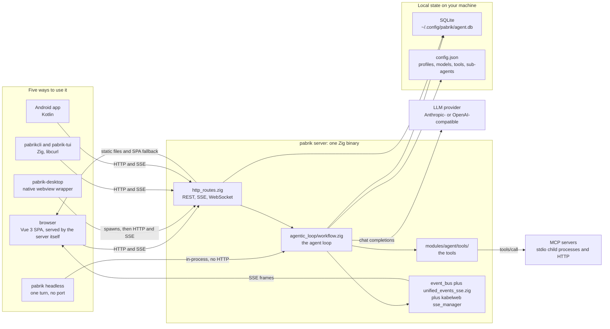
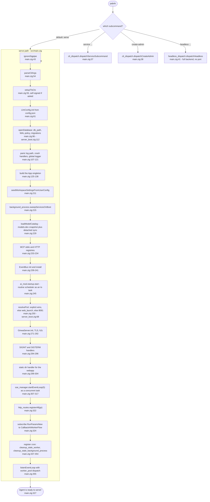
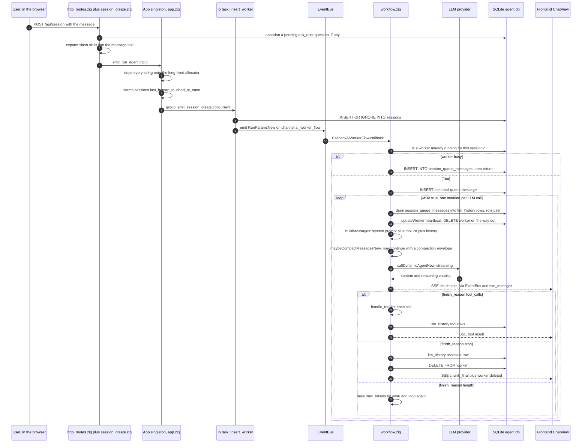
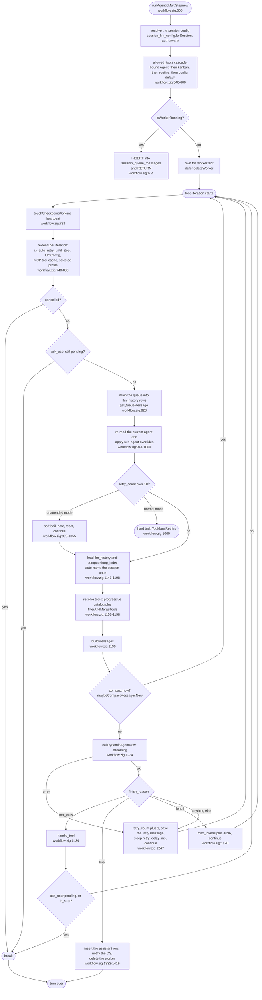
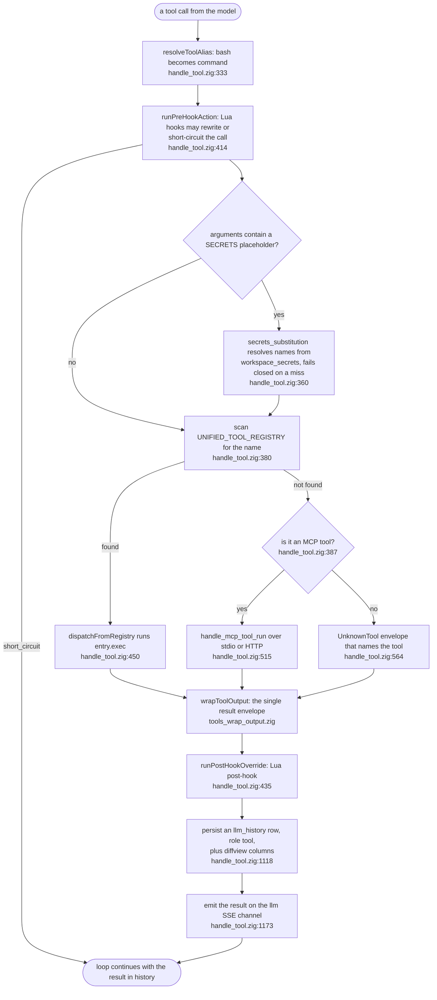
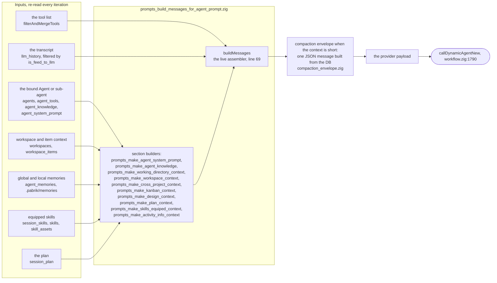
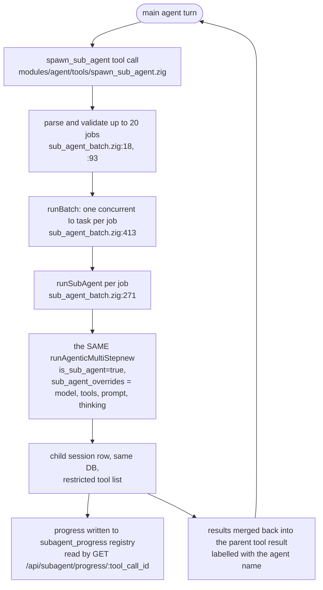
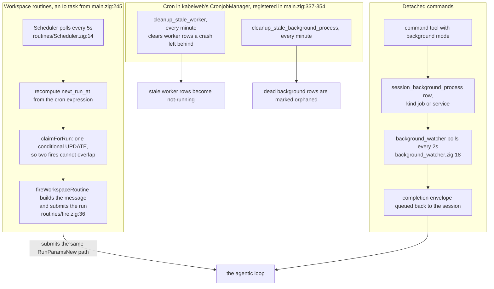

# How pabrik works — diagrams

A diagram set that explains the real runtime, traced from the code on
`main` (2026-10-16, `bba481b06`). Every claim below carries a
`file:line` citation so it can be re-verified instead of trusted.

Read it in this order:

| # | Diagram | Question it answers |
|---|---|---|
| 1 | [System context](#1-system-context) | What are the pieces, and who talks to whom? |
| 2 | [Boot sequence](#2-boot-sequence) | What happens between `execve` and "Agent is ready to serve"? |
| 3 | [One chat turn, end to end](#3-one-chat-turn-end-to-end) | What runs when the user hits send? |
| 4 | [The agentic loop](#4-the-agentic-loop) | How does one turn become many LLM calls? |
| 5 | [Tool dispatch](#5-tool-dispatch) | What happens between a tool call and its result? |
| 6 | [What the model is shown](#6-what-the-model-is-shown) | Where does the prompt come from? |
| 7 | [SSE event fan-out](#7-sse-event-fan-out) | How does a DB write become pixels in the browser? |
| 8 | [Sub-agents](#8-sub-agents) | How does one agent run many agents? |
| 9 | [Background work and the clock](#9-background-work-and-the-clock) | What runs without a user? |
| 10 | [Data model](#10-data-model) | What is in `agent.db`? |
| — | [File map](#file-map) | Where do I edit what? |
| — | [Landmines](#landmines) | What will surprise you? |

## 1. System context

Evidence: the five clients are `src/apps/desktop` (Vue 3 + Pinia),
`src/apps/desktop_app` (webview), `src/apps/cli` (also ships
`pabrik-tui`), `src/apps/android_mobile`, `src/headless` (README at
`src/headless/README.md`: "no HTTP listener"). The server is
`zig-out/bin/pabrik`; the HTTP framework is the **sibling repo
`kabelweb`**, imported as `@import("kabelweb").server` and aliased
`gserverz` (`src/app.zig:5`). Static + SPA fallback for `/app` and
`/login`: `src/boot/server_boot.zig:207-213`.

## 2. Boot sequence

A few things this makes obvious that the code spreads out:

- **Migrations run before anything else can touch the DB** — and they
  are registered by one list (`src/migrations/migration.zig:454`,
  `registerAllMigrations`), driven by 110 `migration_*.zig` files. The
  applied count is the `schema_migrations` row count (110).
- **No threads are spawned for background work here.** The routine
  scheduler (`main.zig:245`), the SSE event loop (`main.zig:315`) and
  every session-create task all ride the same `std.Io.Group`.
- **Shutdown is not an unwind.** After `listenEventLoop` returns, the
  process kills `background_persistence` services and calls
  `std.process.exit(0)` (`main.zig:361-382`) — the comment there says a
  full unwind segfaults.

## 3. One chat turn, end to end

Citations: route and handler `src/http_routes.zig:60`,
`src/http_handlers/session_create.zig:281` (abandon pending),
`:306` (slash skills), `:327` (`emit_run_agent`).
`emit_run_agent` `src/app.zig:99`, spawn-and-emit `:146-195`,
`insert_worker` `:216`, worker-busy enqueue
`src/agentic_loop/workflow.zig:620-640`, the loop body `:505-1546`,
tool dispatch call site `:1434`, `finish_reason` branches
`:1331-1521`.

## 4. The agentic loop

`runAgenticMultiStepnew` (`src/agentic_loop/workflow.zig:505`) is one
`while (true)` whose iteration == exactly one LLM round-trip. Everything
that can change mid-run is re-read at the top of every iteration.

Notes that matter for reading this:

- The worker row **is** the lock. It is written
  `INSERT ... ON CONFLICT(id) DO UPDATE`
  (`src/agentic_loop/update_worker.zig:52-68`), i.e. last-writer-wins,
  and every "is this session running?" check
  (`isWorkerRunning`) reads it.
- Allocator discipline is per-turn: a run arena for the whole run
  (`workflow.zig:506`) plus an arena reset with `.free_all` at the top
  of every iteration (`workflow.zig:727`). Nothing allocated inside
  the loop survives the iteration.
- `finish_reason == .stop` with empty content does **not** end the turn
  — it `continue`s (`workflow.zig:1338-1347`).

## 5. Tool dispatch

The three tool lists live in ONE file, `src/agentic_loop/tools_equipped.zig`:

| Symbol | Line | Meaning |
|---|---|---|
| `equips()` | 79 | what the model is *shown* |
| `UNIFIED_TOOL_REGISTRY()` | 174 | what dispatch can actually *run* (57 entries today) |
| `DEFAULT_AGENT_TOOLS` | 305 | seeded into a fresh Agent |
| `DEFAULT_KANBAN_TOOLS` | 368 | seeded into a kanban-bound session |
| `TOOL_NAME_ALIASES` / `RETIRED_TOOL_NAMES` | 385 / 401 | `bash` becomes `command`; retired names get a suggestion |

Each tool's own code (schema + pure fn + exec fn + inline tests) is one
file under `src/modules/agent/tools/` (59 files); its exec fn is
re-exported through `src/agentic_loop/tools.zig:12+`. Adding a tool
therefore touches the definition file, `tools.zig`,
`tools_equipped.zig` and `src/root.zig`.

## 6. What the model is shown

- `buildMessages` (`prompts_build_messages_for_agent_prompt.zig:69`)
  is the live assembler. `build_agent_prompt` in the same file
  (`:1305`) is **dead** — its only callers are tests
  (`src/modules/agent/prompts.zig:88-197`). Do not add parameters to it.
- Tool visibility is `filterAndMergeTools`
  (`workflow.zig:1955`): built-ins ∩ `allowed_tools`, plus MCP tools,
  plus tools the session enabled on demand (progressive search via
  `search_tool` / `view_tool` / `use_tool`, recorded in
  `session_progressive_tool`).
- Compaction: `shouldCompactDefault` (`workflow_compact_message.zig:512`)
  with `MIN_MESSAGES_TO_COMPACT = 5` (`:216`). The replacement message is
  a JSON envelope (`compaction_envelope.zig:14`, `FORMAT_VERSION = 2`)
  whose every field except `summary` is read straight from the DB — so a
  handoff needs no model call and cannot fail on one. The optional
  summary goes through `callCompactAgent` (`:387`).
- Per-session config: in `--auth` mode the LLM config comes from
  `users.config_json` via `session_llm_config.forSession`
  (`workflow.zig:524`), not from the process singleton — the singleton
  describes the on-disk `config.json` only.

## 7. SSE event fan-out

```mermaid
flowchart LR
  subgraph emit["Emitters, all writing to the in-process EventBus"]
    e1["on_event_sent.zig<br/>workers 154, llm_history 203, sessions 322"]
    e2["stream chunk serializers<br/>content 541, reasoning 568, final 595,<br/>tool-call deltas 622"]
    e3["on_event_sent_kanban.zig, on_event_sent_design.zig"]
    e4["background_process_events.zig, skill_eval_events.zig,<br/>git_file_stage_events.zig, git_pr_state_events.zig"]
  end

  bus["EventBus: routing key to callback<br/>modules/event_bus/src/event.zig:3"]
  ep["GET /api/events with channels query<br/>unifiedEventsStreamHandler<br/>unified_events_sse.zig:318"]
  parse["parseChannels: workers, sessions, kanban, llm, queue,<br/>background_process, skill_evals, git_file_stage,<br/>git_pr_state, design_element<br/>unified_events_sse.zig:155"]
  fwd["forwardToClients: encode one SSE frame per key<br/>unified_events_sse.zig:10"]
  own["clientMayReceive: per-user ownership filter<br/>unified_events_sse.zig:66"]
  mgr["kabelweb sse_manager.sendToClient<br/>poll-based, per-client socket"]
  fb["frontend: one EventSource per browser,<br/>leader election across tabs<br/>helpers/sseBus.ts, sseTabChannel.ts"]
  stores["Pinia stores: kanbanSse, designSse, tabs,<br/>agentError, notifications"]
  comp["components: ChatView, kanban board, sidebar"]

  emit --> bus
  bus -->|"one channel per routing key"| ep
  ep --> parse
  parse --> fwd
  fwd --> own
  own --> mgr
  mgr --> fb
  fb --> stores
  stores --> comp
```

- The bus is **in-process only** (`event.zig:3-70`: a
  `StringHashMap` of callbacks). Nothing crosses processes, which is why
  `pabrik headless` subscribes to the very same channel
  (`src/headless/boot.zig:198`) instead of implementing a second backend.
- Owner filtering is what makes `--auth` multi-user safe: an event is
  attributed to a session, then `clientMayReceive` asks whether that
  client's owner may see it (`unified_events_sse.zig:66-88`).
- DB-then-broadcast, always in that order: the SSE frame is what makes
  the UI *fast*, but the row is what makes it *true*. A reconnecting
  client re-reads `/api/session/:id/messages`.

## 8. Sub-agents

- A sub-agent is **not** a new mechanism: it is the same
  `runAgenticMultiStepnew` with `is_sub_agent = true` and an override
  struct (`sub_agent_batch.zig:271-300`).
- The tool contract forbids recursion and human contact:
  `ask_user` and `spawn_sub_agent` are main-agent-only
  (`spawn_sub_agent.zig:43`, `:62`).
- Each sub-agent gets its own session row and profile, and its identity
  is recorded (`workflow.zig:606`).

## 9. Background work and the clock

- Liveness for a background process has exactly one implementation
  (`bg_proc.isAlive`), used by the watcher, the boot sweep and the
  `process` tool (`background_watcher.zig:26-29`).
- Signal handlers only set a flag; the closing work and the log line
  happen after `listen` returns (`src/main.zig:361-382`).

## 10. Data model

Logical relations; not every edge is a SQLite FOREIGN KEY. 64 tables,
110 migrations applied.

```mermaid
erDiagram
  workspaces ||--o{ workspace_items : contains
  workspace_items ||--o| workspace_item_tasks : "kanban cards"
  workspaces ||--o{ workspace_routines : schedules
  workspaces ||--o{ workspace_settings : configures
  workspaces ||--o{ workspace_secrets : "stores credentials"

  sessions ||--o{ llm_history : transcript
  sessions ||--o{ session_queue_messages : queue
  sessions ||--o| worker : "running marker"
  sessions ||--o{ session_agents : "agent binding"
  sessions ||--o{ session_skills : "equipped skills"
  sessions ||--o{ session_progressive_tool : "tools enabled on demand"
  sessions ||--o| session_pending_question : "ask_user"
  sessions ||--o| session_plan : plan
  sessions ||--o{ session_background_process : "detached commands"
  sessions ||--o{ session_activity : heartbeat

  kanban ||--o{ kanban_columns : has
  kanban ||--o{ workspace_item_tasks : "holds cards"
  kanban_task_dependencies }o--|| workspace_item_tasks : "blocks"

  agents ||--o{ agent_tools : "tool allow-list"
  agents ||--o{ agent_knowledge : knowledge
  agents ||--o{ agent_system_prompt : "prompt sections"
  agents ||--o{ agent_kanbans : "kanban mode"
  agents ||--o{ agent_routines : "routine mode"
  agents ||--o{ agent_memories : memories

  skills ||--o{ skill_assets : bundles
  skill_eval_runs ||--o{ skill_eval_results : produces
  skill_eval_results ||--o{ skill_eval_facts : records

  design_pages ||--o{ design_page_elements : contains
  users ||--o{ auth_sessions : "login session"
  users ||--o{ user_companies : tenancy
  model_catalog_providers ||--o{ model_catalog_models : lists

  sessions {
    text id PK
    text cwd
    text selected_profile_model
    text last_finish_reason
    text user_id
  }
  llm_history {
    text id PK
    text session_id FK
    text role
    text response_content
    text tool_calls_json
    integer is_feed_to_llm
    integer total_tokens
  }
  worker {
    text id PK
    text session_id
    text last_activity_nano
    integer cancelled
  }
  session_queue_messages {
    text id PK
    text session_id FK
    text message
  }
  workspace_item_tasks {
    text id PK
    text workspace_id FK
    text cwd
    text status
  }
```

Full-text search: `messages_fts` (over `llm_history`) and
`agent_memories_fts`, both FTS5 with their shadow tables. Path:
`~/.config/pabrik/agent.db`, resolved by
`src/helpers/db_path.zig:8`. Connection policy: WAL,
`synchronous = .full`, `busy_timeout = 15s`, a 256 MiB mmap window and
an elastic reader pool (`src/boot/db_config.zig:13-27`, `:156`); the one
production open site is `src/boot/server_boot.zig:125`.

## File map

| Concern | Where |
|---|---|
| Process entry, boot phases, shutdown | `src/main.zig`, `src/boot/*.zig` |
| Every HTTP route, in one table | `src/http_routes.zig` (201 handlers in `src/http_handlers/`) |
| The agent loop | `src/agentic_loop/workflow.zig` |
| Tool dispatch | `src/agentic_loop/handle_tool.zig` |
| Tool registry and defaults | `src/agentic_loop/tools_equipped.zig` |
| Tool implementations | `src/modules/agent/tools/*.zig` |
| Prompt assembly | `src/agentic_loop/prompts_build_messages_for_agent_prompt.zig` + `prompts_make_*.zig` |
| Compaction | `src/agentic_loop/workflow_compact_message.zig`, `compaction_envelope.zig` |
| SSE | `src/modules/event_bus/`, `src/http_handlers/unified_events_sse.zig`, `src/agentic_loop/on_event_sent*.zig` |
| HTTP framework | sibling repo `kabelweb` — `server/http_server.zig`, `server/router.zig`, `server/sse_manager.zig`, `server/cronjob_manager.zig` |
| DB access and migrations | `src/migrations/migration.zig` (110 files beside it), `src/boot/db_config.zig` |
| Domain stores | `src/models/*.zig`, `src/agentic_loop/{llm_history,kanban_model,design_model,agent_memories,skills_store}.zig` |
| Frontend | `src/apps/desktop/src/` — `api/`, `helpers/sseBus.ts`, `stores/`, `components/` |
| Other frontends | `src/apps/desktop_app/`, `src/apps/cli/`, `src/apps/android_mobile/`, `src/headless/` |
| MCP | `src/modules/agent/mcp/mcp/` (stdio, HTTP, transports, types) |

## Landmines

1. **`build_agent_prompt` is dead.** `src/modules/agent/prompts.zig:88-197`
   are tests; the live path is `buildMessages`. Editing the wrong one
   changes nothing at runtime.
2. **`src/startup.zig` wipes `worker` and `session_queue_messages`** on
   entry ("this is temporrary", `src/startup.zig:17-32`). It is exported
   at `src/root.zig:263` but no production caller exists in `src/`. Do
   not wire it into boot.
3. **The worker row is a race, not a lock.** `update_worker.zig:68` is
   `ON CONFLICT DO UPDATE`. Correct for one process; two processes
   sharing one DB can both believe they own a session.
4. **`--auth` changes where the LLM config comes from.** Off (default):
   the process singleton loaded from `config.json`. On: per-user
   `users.config_json` via `session_llm_config.forSession`. A tool that
   reads the singleton directly works in dev and is empty in auth mode.
5. **The SSE bus does not cross processes.** `event.zig` is an
   in-process map. `stream_snapshot` and `subagent_progress` are
   in-memory too (`stream_get.zig:23`), so a restarted server answers
   `active: false` — the frontend self-heals on the next message read.
6. **A stale worker row looks running for up to a minute** after a crash
   — only `cleanup_stale_worker` (cron, `main.zig:337`) clears it, and
   `POST .../start_agent` refuses with `worker_already_running` until it
   runs (`src/http_handlers/start_agent.zig:45`).

---

Verified against `main` at `bba481b06`. Mermaid syntax checked with the
real `mermaid` parser (v11) before commit.
