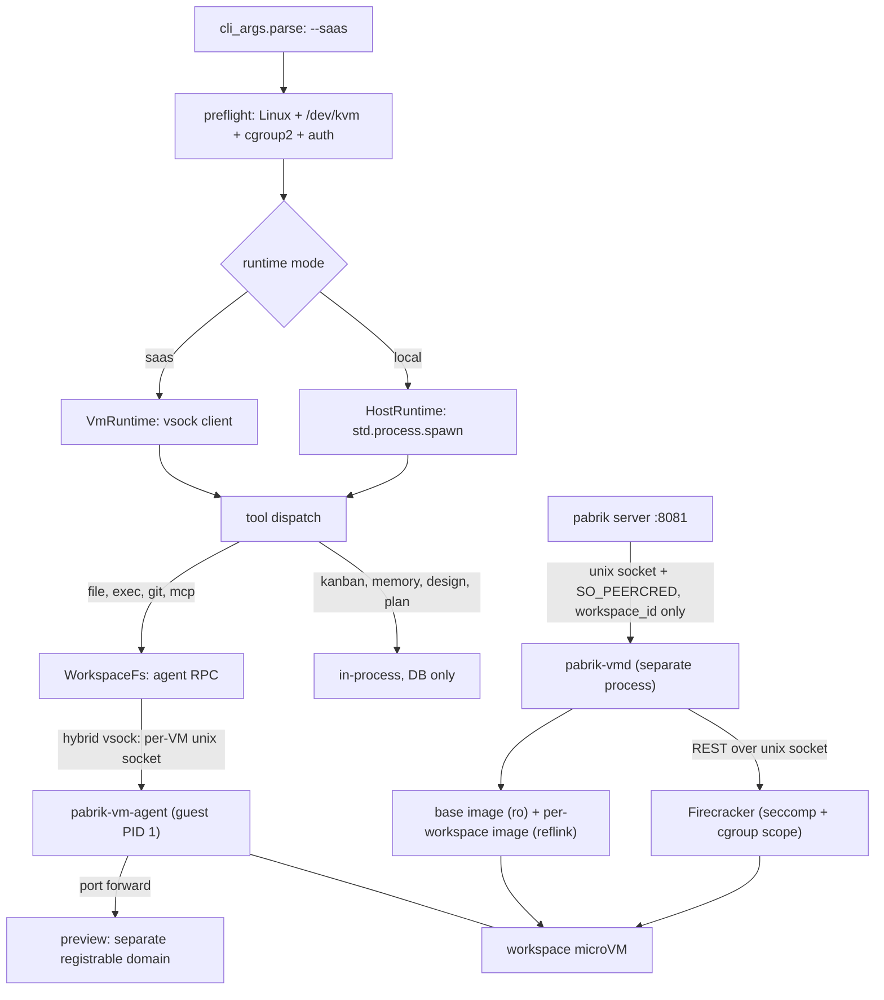

# Plan / design discussion — "every workspace is a VM": Linux-only SaaS mode (`pabrik --saas`)

- **Task**: `task_1792245573147_0` — "Workspace is a vm from microvm"
- **Worktree**: `~/.config/pabrik/.worktrees/workspace-is-a-vm-from-microvm-1792245526062`
- **Branch**: `worktree/workspace-is-a-vm-from-microvm-1792245526062` (base `main`)
- **Status**: rev 4 — **P0 has landed in this branch** (§18); the rest is still a plan.
- **Human decision** (2026-10-17): the microVM runtime is a **Linux-only, opt-in mode** (`pabrik --saas`).
  Without the flag Pabrik behaves exactly as today; every non-SaaS feature works in both modes.

### Rev 3 — the storage decision reversed to **sealed**

The second review is right that rev 2 undermined its own default. §4.2 had already demoted "the host
must read the tree", leaving shared/virtiofs with only *operator convenience* as a benefit — while its
costs stayed concrete, and two of them are unfixable on this box:

- **Disk I/O isolation does not exist unprivileged.** Verified here: the `io` controller is present at
  the root cgroup but the delegated subtree is `cpu memory pids` only, and `user-1000.slice` has no
  `io.*` files — so `IOWeight` in rev 2's §10.2 would have been silently inert. A tenant saturating
  disk through `virtiofsd` is not preventable with the privileges we have.
- **Disk quota in shared mode is racy by construction** (`du` on a live tree), and the volume also
  holds SQLite.
- Plus: `virtiofsd` is the process resolving guest-controlled paths (a whole attack surface that
  sealed mode deletes), and native ext4 is simply faster than virtiofs for build workloads.

So: **sealed (per-workspace block image) is the default; Firecracker is the default VMM; shared /
virtiofs becomes an opt-in mode for local/ops convenience.** A lot of rev 2's machinery falls away
with that (custom kernel, virtiofsd hardening, scratch-disk workaround), which is the point.

Everything else the review raised is folded in, including five genuine holes I had missed:
**stored XSS through `/api/files/download`**, **cookies leaking to the tenant's preview server**,
**`pabrik-vmd` accepting paths over RPC**, **vsock peer authentication**, and **DNS as an exfil /
rebinding channel**. Plus the persistence and resize decisions, the "strict" leftover, and the
local-mode git hardening that is worth shipping on its own (§2.2).

---

## 1. The shape being proposed

One binary, two runtimes:

```
pabrik            → local mode   (today: tools execute on the host, arbitrary user paths)
pabrik --saas     → SaaS mode    (Linux only: one microVM per workspace, Pabrik-owned sealed images)
```

- **SaaS mode is Linux-only and refuses to start anywhere else** (or without `/dev/kvm`) with a
  precise message.
- **`--saas` implies the SaaS contract**: auth required, one tenant per workspace, Pabrik-owned
  storage, quotas, idle shutdown.
- **Local mode is not a degraded path** — it is the current product. That is why P0 is a seam, not a VM.
- The mode is process-wide in v1.

### 1.1 Mode matrix

| | local mode | `--saas` |
|---|---|---|
| tool execution | host (`shell.zig` → `bash -c`) | inside the workspace microVM |
| workspace storage | arbitrary user paths | **sealed ext4 image** per workspace (default) |
| who may touch tenant files | the host process, directly | **only the guest agent** |
| cross-project reads | any sibling dir the user names | **none in v1** (design for CoW snapshot attach, §9.4) |
| auth | `--auth` opt-in | **mandatory** |
| isolation | none | kernel-level per workspace |
| lifecycle | none | start / stop / suspend / quota per workspace |
| networking | the host's | vsock over a per-VM unix socket; preview on a **separate registrable domain** |
| disk I/O isolation | n/a | **Firecracker per-drive token bucket** (no privilege needed) |
| platforms | Linux, macOS, Windows | **Linux + KVM only** |
| kanban / design / memory / docs / skills | yes | **yes — identical code, tenant-scoped** |

---

## 2. Today: where code actually executes

One Zig process (`pabrik --port 8081`) owns the SQLite DB, the agent loop, the HTTP/SSE API,
kanban/design/memory models and every tool. Tools are in-process calls from
`src/agentic_loop/handle_tool.zig`. The execution surface is the host, **with no confinement**:

| Fact | Evidence |
|---|---|
| `command`/`bash` spawns a real process: `bash -c <string>` | `command.zig:19`, `shell.zig:600` |
| The only guards are strings: `cwd` present + absolute, `timeout` 1–600 s | `shell.zig:621-643` |
| The child inherits the server's full environment (API keys included) | no `env_map` in `shell.zig` |
| `read_file` reads **any absolute path** | `read_file.zig:352-395` |
| A path-prefix sandbox exists for exactly one tool (`present_files`) | `file_sandbox.zig:1-8`, `:147` |
| Detached jobs are host PIDs per session | `session_background_process.zig:5-26` |
| Secrets are substituted into tool arguments, scrubbed from output | `secrets_substitution.zig:1-30`, `handle_tool.zig:2357` |

`AGENTS.md` already contains a rule only isolation can enforce ("DONT KILL THE PORT 8081 SERVER") —
nothing stops `kill $(pgrep -f 'pabrik --port 8081')`, same uid and PID namespace.

### 2.1 The host already runs `git` on the project tree — seven places (RCE included)

| Call site | What a malicious repo can do |
|---|---|
| `git_state.zig:57` (host `git status` for the git chip) | `core.fsmonitor` → **arbitrary command execution** |
| `set_git_worktree.zig:167` (`git worktree add`) | tenant repo's **`post-checkout` hook** runs on the host |
| `system_folder.zig:275`, `list_directory.zig:75` (`git check-ignore`) | config parsing on a path the agent can aim anywhere |
| `git_pr_status.zig:267,341`, `git_pr_conflicts.zig:78`, `status_pull_request.zig:783` | tenant-controlled input to host processes |
| any host `git diff` / `git show` | `.gitattributes` `textconv` / `filter.*` drivers → **arbitrary command execution** |

**Rule for SaaS mode (absolute, testable): the API process never executes `git`/`gh` with a
tenant-controlled tree as its working directory or `-C` target.** Those seven call sites move to the
guest (Appendix C).

### 2.2 The same bug exists in local mode — ship that fix separately

The review is right that this is not a SaaS-only problem: opening an untrusted repo in Pabrik can run
`core.fsmonitor` on the host today. A cheap, independent hardening pass:

```
-c core.fsmonitor=false -c core.hooksPath=/dev/null -c diff.external=
-c core.pager=cat -c core.sshCommand= -c protocol.ext.allow=never
env: GIT_CONFIG_NOSYSTEM=1 GIT_TERMINAL_PROMPT=0 GIT_OPTIONAL_LOCKS=0
plus --no-textconv / --no-ext-diff on diff-shaped invocations
```

Honest limits: this **reduces** the surface, it does not eliminate it — `filter.*.clean/smudge`
drivers are named by the repo's own `.gitattributes`/config, and there is no single flag that
enumerates them. The real fix is "never run git on an untrusted tree", which local mode cannot do
(the user's own tree *is* the product). So: ship the flags, and document the residual risk.

This touches criterion 6 ("local mode is byte-identical") — it is a **deliberate, documented
exception**: identical *except* that git no longer honours repo-controlled execution hooks.

---

## 3. Acceptance criteria

1. **A workspace's shell cannot see a path outside its VM** — `cat /home/ginwa/.ssh/id_rsa`,
   `ls ~/.config/pabrik`, `rm -rf ~/pabrik` fail with `ENOENT`.
2. **A workspace cannot signal a host process** — `pkill -f pabrik` fails.
3. **A workspace cannot reach the control plane** — including through the egress proxy and the
   DNS resolver: loopback (v4, v6, **and IPv4-mapped**), `0.0.0.0`, RFC1918, CGNAT `100.64/10`
   (Tailscale), link-local, `169.254.169.254`, and the host's own listeners — denied and logged.
4. **A workspace's files survive the VM** — stop it, start it, tree byte-identical.
5. **Two tenants with the same repo path never collide**; a workspace's total disk is capped and
   filling it cannot affect the host volume holding SQLite.
6. **Local mode is byte-identical to today** — except §2.2's git hardening, which is deliberate.
7. **`--saas` off-Linux or without KVM fails fast** with a message that says what to do.
8. **The host process never opens a file inside a tenant filesystem.** Structurally: the only
   production `WorkspaceFs` implementation is the agent. If a host read is ever added, it uses
   `openat2(RESOLVE_BENEATH|RESOLVE_NO_MAGICLINKS)` on a directory fd and reads from that fd, never
   re-resolving a path (the current `files_download.zig:139-160` pattern is the counter-example).
9. **The host never runs `git`/`gh` against a tenant tree** (§2.1) — tested with a fixture repo
   carrying a `core.fsmonitor` canary.
10. **A preview cannot act as the app**: separate registrable domain (hosted) or a distinct port
    (single box) *with `Cookie`/`Authorization` stripped by the proxy*, host-only session cookies,
    and an `Origin` allowlist on every mutating route.
11. **Tenant-controlled files are never rendered on the app origin** — `text/html` and `image/svg+xml`
    are served as `Content-Disposition: attachment` + `X-Content-Type-Options: nosniff`; inline types
    are an explicit allowlist.
12. **A guest cannot exhaust the host**: RAM/vCPU/PIDs via cgroup v2, **disk I/O via the VMM's own
    rate limiter**, disk size via the image, output volume via the protocol budget.
13. **Host-side parsers treat guest output as hostile**: size caps, no exec, fuzzed (§14).
14. **The vsock channel is peer-authenticated** — per-VM unix socket (hybrid vsock), plus a CID check
    where a CID is used.

---

## 4. Constraints

### 4.1 Absolute paths are load-bearing — and in SaaS mode we choose them

`sessions.cwd`, `git_worktree_cwd`, kanban `cwd`, `workspace_items.path` all speak absolute paths. In
SaaS mode Pabrik owns the storage, so it mounts the workspace at a stable path inside the guest
(`/workspace`), and the DB stores the *logical* path plus the workspace id — not a host path. In
local mode nothing changes.

### 4.2 "The host must read the tree" — resolved, and now moot

Rev 1 turned a serving requirement into an architectural one, which forced virtiofs, a custom kernel
and a VMM choice. Serving is now an agent RPC. With sealed mode there is no host-side tree at all, so
the constraint disappears entirely; it survives only in the optional `shared` mode (§9.4).

### 4.3 Firecracker has no shared filesystem — verified, and now irrelevant

`firecracker_spec-v1.17.0.yaml` exposes `actions, balloon(+hinting), boot-source, cpu-config, drives,
pmem, logger, machine-config, metrics, mmds, entropy, serial, hotplug/memory, network-interfaces,
snapshot/{create,load}, version, vm, vm/config, vsock` — **no virtiofs, no 9p, no vhost-user**.
In sealed mode that is not a limitation; the workspace is a block device, which is exactly what
Firecracker is best at.

Two consequences worth stating: **Firecracker block devices are raw only** (no qcow2), and there is no
live disk resize.

### 4.4 The stock Firecracker kernel is now an advantage, not a problem

`strings` over `vmlinux-6.18.51`: `ext4` 40, `virtio_blk` 11, `virtio_pci` 11, `fuse` 14,
`overlay` 37, `squashfs` 5, `nfs` 58, `vsock` 7 — and `virtiofs` 0, `9pnet_virtio` 0.

Sealed mode needs ext4 + virtio-blk + vsock, all present. So the rev 2 "build and ship our own
kernel" item shrinks to **"pin the CI kernel by hash, and ship our own rootfs"** — with a custom
kernel as a later size/speed optimization, not a prerequisite.

### 4.5 No privilege on this box — and what that costs

`sudo -n true` → password required. `/dev/kvm` and `/dev/vhost-vsock` are `crw-rw-rw-`.
cgroup v2: root controllers include `io`, but the delegated subtree is **`cpu memory pids`** and
`user-1000.slice` exposes no `io.*` — so **no unprivileged disk I/O throttling via cgroups**. That is
why §10.2 uses the VMM's rate limiter instead: `firecracker_spec` defines `rate_limiter` token buckets
(`bandwidth`, `ops`) on drives and network interfaces. Verified in the local spec; needs no privilege.

---

## 5. Threat model

**Adversary**: code the agent runs in the guest — a tenant repository, a dependency's `postinstall`, a
prompt injection that talks the model into a destructive command, or the tenant themselves.

**Assets**: host filesystem, `pabrik.db` + secrets, other tenants, the control plane on `:8081`, host
availability, and the VMM manager's authority.

| # | Vector | Mitigation | Criterion |
|---|---|---|---|
| T1 | symlink/`..`/TOCTOU escape from a mounted tree into a host read | **no host-side tenant filesystem access at all** (sealed) | 8 |
| T2 | tenant `.git/config`/hooks/`textconv` executed by host `git` | git only in the guest; §2.2 flags for local mode | 9 |
| T3 | guest reaches `localhost:8081` via egress proxy or DNS | deny list + resolve-then-connect + same policy on the resolver | 3 |
| T4 | tenant dev server calls the API with the user's cookies | separate registrable domain, **proxy strips `Cookie`/`Authorization`**, host-only cookies, `Origin` allowlist | 10 |
| T5 | **stored XSS**: an uploaded `.html`/`.svg` served by the host on the app origin | `attachment` + `nosniff` + inline allowlist; never render tenant HTML on the app origin | 11 |
| T6 | resource exhaustion (RAM, vCPU, PIDs, disk, disk I/O, stdout) | cgroup v2 for cpu/memory/pids; **VMM rate limiter for I/O**; image size for disk; protocol budget + flow control for output | 12 |
| T7 | malformed frames / malformed diffs, listings, index batches (guest→host parsers) | length-capped codec, fuzzed decode paths, size caps on every parser | 13 |
| T8 | another guest connects to the host's vsock listener | **hybrid vsock** (per-VM unix socket, `uds_path`, verified in the FC spec) + CID check | 14 |
| T9 | `pabrik-vmd` RPC abused to configure an arbitrary VM | vmd **derives every path from `workspace_id` by rule**, never accepts a path or a mount plan; `SO_PEERCRED` uid check | — |
| T10 | in-guest root replaces/kills the agent, or lies over RPC | commands run as a **non-root uid with `no_new_privs`**, rootfs read-only | — |
| T11 | golden image supply chain | pinned kernel hash, content-addressed rootfs, `image_version` per VM, read-only image dir | — |
| T12 | prompt injection inside the tenant's own workspace | **not mitigated by the VM** — state it in the product docs | — |

---

## 6. What a VM buys, and what it does not

**Buys:** no path from the guest to `~`, `pabrik.db`, `~/.ssh`, other tenants, or the control plane;
`pkill -f pabrik` fails; disk is a hard cap; disk I/O is rate-limited without privilege; and there is
no `virtiofsd` in the path to resolve hostile paths.

**Does not buy:** secret hygiene *inside* the guest (the agent is root there, §12); protection from
model judgement inside the workspace; a patched host kernel (KVM is still a shared surface);
docker/GPU/nested virt; macOS/Windows; and it does not make a malicious repo's *content* safe to parse.

---

## 7. Stack comparison — re-scored after the storage reversal

| | **Firecracker 1.17** | Cloud Hypervisor | QEMU `-M microvm` | libkrun | (ref) bubblewrap |
|---|---|---|---|---|---|
| sealed block root | ✅ raw only | ✅ raw/qcow2 | ✅ | ✅ | n/a |
| per-drive I/O rate limit, no privilege | ✅ (token buckets, verified in spec) | ✅ | ⚠️ blkio cgroup = needs delegation | ⚠️ | ❌ |
| vsock | ✅ **hybrid UDS per VM (verified)** | ✅ (vhost-user) | ✅ | ✅ | n/a |
| snapshot/restore | ✅ (same-disk resume) | ✅ | ✅ | ❌ | n/a |
| shared dir (virtiofs) | ❌ | ✅ | ✅ | ✅ | n/a |
| boot / overhead | <125 ms / ~5 MB | ~150–300 ms | larger | small | 0 |
| packaging here | **`extra/firecracker` ✅** | ❌ not in repos | ✅ qemu 11.1.1 | ❌ source | ✅ |
| maturity | ★★★★★ | ★★★★☆ | ★★★★★ | ★★★☆☆ | ★★★★★ |

### 7.1 Recommendation

- **Default: Firecracker, sealed.** In the Arch repos, raw block + hybrid vsock + per-drive rate
  limiters + snapshots, no virtiofsd, no second binary to package, no custom kernel for v1.
- **QEMU `-M microvm` for CI/dev** — installed, rootless, no KVM exposure needed for the test suite.
- **Cloud Hypervisor only if `shared` mode is ever wanted** (it is the only path to virtiofs here).
- **bubblewrap stays a seam validator**, never a SaaS backend: shared-kernel isolation is not
  SaaS-grade, and `--saas` keeps refusing to start without KVM.

This reverses rev 2's choice, and the reason is simple: rev 2 chose the VMM to fit a storage mode that
turned out to be the wrong default.

---

## 8. Architecture

### 8.1 Components



1. **`pabrik-vmd` — a separate process from P2.** A bug in the web-facing server must not be able to
   configure VMs, and a server restart must not kill tenants' dev servers (this repo restarts
   constantly). **The RPC never carries a path or a mount plan**: the server sends a `workspace_id`
   and an action; vmd derives image path, drive config, socket path and cgroup scope from the id by
   rule, and authenticates the caller with `SO_PEERCRED` (uid + pid of the peer).
   Note on `jailer`: it needs root (it chroots and drops uid), so a **rootless** deployment
   relies on Firecracker's built-in seccomp filters plus the cgroup scope, and a root deployment
   (typical for a SaaS host) adds the jailer on top. Do not claim jailer-level isolation for the
   unprivileged case.
2. **`pabrik-vm-agent` — guest PID 1 (root).** Static Zig (`-target x86_64-linux-musl`): mounts the
   data drive, sets the resolver/proxy config, listens on vsock, forks/execs **as uid 1000** with
   `PR_SET_NO_NEW_PRIVS` and a `noexec`-free but `nosuid`/`nodev` mount set, streams output under a
   byte budget, tracks pids, runs `git`, serves file reads, forwards ports, reaps zombies, powers off.
3. **`WorkspaceFs` / `VmClient`** — length-prefixed JSON frames (`hello`, `exec.*`, `fs.*`,
   `port.forward`, `health`, `shutdown`), version negotiated in `hello`, 4 MiB frame cap enforced
   before allocation, per-stream flow control. Transport: **hybrid vsock** — Firecracker's `uds_path`
   (host dials the VM's own socket; a guest cannot reach another VM's channel, and socket permissions
   are filesystem permissions). Where a numeric CID is used (QEMU), verify the peer CID.

### 8.2 The seam

```zig
pub const WorkspaceRuntime = struct {
    vtable: *const VTable,
    pub const VTable = struct {
        ensureReady: *const fn (ctx: *anyopaque) Err!void,
        exec: *const fn (ctx: *anyopaque, req: ExecRequest) Err!ExecResult,
        spawnDetached: *const fn (ctx: *anyopaque, req: DetachedRequest) Err!Handle,
        readFile: *const fn (ctx: *anyopaque, req: ReadRequest) Err!ReadResult,
        writeFile: *const fn (ctx: *anyopaque, req: WriteRequest) Err!void,
        // glob, search, list, remove, git: same shape
    };
};
```

`HostRuntime` wraps today's `shell.zig` unchanged. `VmRuntime` speaks vsock. `FakeRuntime` executes
locally against a temp dir and is what unit tests use (§14).

### 8.3 Tool matrix (SaaS mode)

| Tool family | Where | Why |
|---|---|---|
| `command` / `bash` / `pwsh` | **guest** (uid 1000) | the risk surface |
| all file tools (`read_file`, `write_file`, `text_replace`, `glob`, `list_directory`, `search`, `remove_file`, `present_files` source, `diff`) | **guest** | one writer; no host path; guest-native scans |
| git/gh/forge (`set_git_worktree`, `pr_cli`, `status_pull_request`, `git_state`, ignore checks) | **guest** | §2.1 |
| MCP stdio servers | **guest** | spawn binaries, need project deps |
| semantic indexing | content from guest, embeddings on host | keys stay host-side |
| kanban, memory, skills, documents, plan, design | in-process | pure DB, tenant-scoped |
| secrets resolution, LLM, web_search | host | §12 |

**V1 — the guest is the only writer.** **V2 — no control plane in the guest.** Two invariants, and
with sealed storage both are true rather than aspirational.

---

## 9. Storage

### 9.1 sealed (default)

```
/var/lib/pabrik/images/<image_version>/base.ext4      read-only, content-addressed, shared
/var/lib/pabrik/workspaces/<id>/disk.ext4             per workspace, reflinked from base
/var/lib/pabrik/workspaces/<id>/home/                 rw, mounted at $HOME inside the guest
```

- **Image creation is O(1) on this box**: `/` and `/home` are **btrfs**, and
  `cp --reflink=always` succeeds (verified), so a new workspace image is a copy-on-write clone of the
  base with shared extents, not a 1 GB copy. On a non-reflink filesystem it degrades to a real copy —
  which is why the data dir should be btrfs/XFS and the image dir should carry `chattr +C`
  (`nodatacow`) to avoid CoW fragmentation of block images.
- **Building and inspecting images needs no root**: `mkfs.ext4 -d`, `debugfs`, `resize2fs`, `e2fsck`
  all work on a file (verified present here). No loop mounts, no sudo.
- **Disk quota is structural**: a workspace's disk is its image size. Filling it cannot touch the
  volume holding SQLite beyond the declared cap. Growing = **offline** (`truncate` + `resize2fs`, then
  start), because Firecracker has no live disk resize.
- **Export/backup**: copy the image file (the host never interprets it — it is a block file), or have
  **the guest** stream a `tar` if a file-level export is wanted. Never `tar`/`rsync` a live
  guest-controlled *tree* on the host (symlinks, hardlinks, device files, races) — that was a rev 2 bug.
- **Offline read of a stopped workspace is gone.** The UI must say "workspace stopped — start to
  browse", and file-level export runs through the guest.

### 9.2 What persists, and what doesn't (the review's missing decision)

Recommended: **immutable OS, persistent workspace.**

| layer | lifetime | rationale |
|---|---|---|
| base image (`base.ext4`, read-only drive) | shared, versioned | reproducible toolchain; a bad image is one version bump |

| workspace image (`/workspace`, rw) | persistent per workspace | the tenant's code, `node_modules`, build outputs |
| `$HOME` (rw, inside the workspace image) | persistent per workspace | `npm i -g --prefix ~/.npm-global`, `pip --user`, `cargo install` survive |
| OS packages (`apt install`) | **do not persist** — rootfs is read-only, commands are uid 1000, no sudo | no drift, no snowflake VMs |

The alternative — a writable OS layer per workspace — is available (`reset` = re-reflink from base),
but it creates per-tenant snowflake images, doubles disk per workspace, and makes support impossible.
Say it in the docs; offer "install tools into `$HOME`" as the supported path, and ship a fat base
image (node, python, rust, zig, go, ripgrep, git, gh, build toolchain).

### 9.3 Build caches

Native ext4 means `npm install` / `cargo build` / `zig build` run at local speed — **the rev 2 scratch
disk disappears**. The trade: caches live inside the workspace image, so they count against the
workspace quota, and they are not visible to the host (fine — they are caches).

### 9.4 shared (opt-in) and cross-workspace context

- **`shared` mode** (virtiofs/virtiofsd) is kept for local/ops convenience and for development of the
  product itself. It is **not** the SaaS default, because it cannot meet criteria 5/12 on an
  unprivileged host (§4.5) and it keeps `virtiofsd` in the path (T7 of rev 2).
- **Cross-workspace reads are dropped in v1.** The designed path is a **read-only CoW reflink snapshot
  of the sibling's image**, attached as a second read-only drive — safe because the clone is
  point-in-time and the source is not mounted twice. Taking it requires the sibling to be quiesced
  (guest-side `fsfreeze` → reflink → thaw); that is a later phase, not v1. The alternative (RPC to the
  sibling's agent) forces the sibling VM to be running, which contradicts idle shutdown.

---

## 10. Lifecycle, resources, output

### 10.1 States

`absent → provisioning → starting → ready → busy → idle → suspended|stopping → stopped → absent`,
with `failed(last_error)` and backoff. `ready` = the agent answered `hello`. One VM per workspace;
`busy` is a counter; `pabrik-vmd`'s reconciler is the only writer of state.

### 10.2 Resource limits

| resource | mechanism | note |
|---|---|---|
| RAM | cgroup v2 `MemoryMax` on the VMM scope + guest `mem_size_mib` | `systemd-run --user --scope -p MemoryMax=…` works here (verified) |
| vCPU | `CPUQuota` + `vcpu_count` | |
| PIDs | `TasksMax` | |
| **disk I/O** | **Firecracker `rate_limiter`** (bytes/s + ops/s token buckets) per drive | cgroups cannot: `io` is not delegated (§4.5) |
| disk size | image size (structural) | grow offline |
| output volume | protocol byte budget + flow control (§10.4) | |

Each `virtiofsd` (shared mode only) also gets its own scope.

### 10.3 Boot, suspend, snapshots

| stage | target |
|---|---|
| VMM spawn + configure | < 50 ms |
| kernel → agent `hello` (stock kernel, our rootfs, no systemd) | < 800 ms |
| first `command` | **< 1.2 s** |

- **Suspend/resume of the same workspace is viable**: Firecracker snapshots capture memory+devices and
  the workspace image is unchanged while suspended, so resume is consistent. The host-side vsock
  socket is recreated on resume and the agent re-listens.
- **No shared template warm pool**: a template VM cannot be restored for a *different* workspace,
  because the disk differs (and a shared-disk pool is exactly the inconsistency risk). Cold boot under
  1.2 s is the answer for v1.

### 10.4 Output must be bounded on the host

Per-exec byte budget (reusing `max_output`/`max_lines` semantics), flow-control window (the host
pauses reads instead of buffering), a truncation marker, and a hard cut when the budget is exceeded.
A guest that floods stdout loses its output, never the host's memory. The decoder is fuzzed (criterion 14).

### 10.5 Process accounting

`session_background_process` gains `vm_id` + `guest_pid`; the `process` tool resolves through the
agent. Stopping a VM kills its jobs — correctly, and visibly ("VM stopped — job ended").

### 10.6 Resize and restart semantics

- RAM/vCPU: **restart required**, only when the workspace is idle; running jobs are drained, and the
  UI says so. No silent kill.
- Disk: **grow only**, offline (stop → `truncate` + `resize2fs` → start). Shrinking is not supported.

---

## 11. Networking

```
guest process → in-guest forwarder → hybrid vsock (per-VM UDS) → host proxy → real socket
```

### 11.1 Egress deny list (and the resolver)

Refuse, before connect: loopback `127/8` + `::1` **+ `::ffff:127.0.0.1` (IPv4-mapped)**,
`0.0.0.0`/`::`, RFC1918 (`10/8`, `172.16/12`, `192.168/16`), **CGNAT `100.64/10` (Tailscale)**,
link-local (`169.254/16`, `fe80::/10`), the metadata IP `169.254.169.254`, multicast/broadcast, and
**every address the host's own listeners bind** (`:8081`). Resolve-then-connect (the IP that was
checked is the IP that is dialled), then a per-tenant allowlist and an audit log.

**The in-guest DNS resolver is a channel too** — it forwards over vsock, so it gets the same policy:
no query for a denied address, no arbitrary port, and a response-size cap. Otherwise it is a
rebinding and exfiltration path around the proxy.

### 11.2 Preview origin, and the cookie leak the review caught

Rev 2 offered "a distinct port per preview" as origin isolation. Two things were wrong:

1. **Cookies are not port-scoped.** `127.0.0.1:3000` still receives the app's cookies for
   `127.0.0.1`; the tenant's dev server would see the user's session cookie on every proxied request.
2. **Ports do not change the site.** `SameSite=Lax` still sends the cookie, because same-site is
   eTLD+1, not origin.

So:

- **The proxy strips `Cookie`, `Authorization`, `Proxy-Authorization` and hop-by-hop headers** before
  forwarding to the guest. This is mandatory in every deployment, not just hosted.
- **Hosted: a separate registrable domain** (`ws-<id>.preview.example.net`, wildcard DNS + cert), not a
  subdomain of the app domain.
- **Session cookies**: host-only (`Domain` unset), `Secure`, `HttpOnly`, `__Host-` prefix where possible.
- **Mutating API routes reject a foreign `Origin`**, plus a CSRF token — because same-site ≠ same-origin.
- **CSP on preview responses** (`frame-ancestors`, `connect-src`), so a tenant page can't frame the UI.

### 11.3 Serving tenant files (the stored-XSS hole)

`/api/files/download` serves tenant-controlled bytes from the app origin. An uploaded `.html` or `.svg`
would run as the app. Fix:

- `Content-Disposition: attachment` **by default**, and `X-Content-Type-Options: nosniff` on everything.
- Inline rendering only for an explicit allowlist (raster images, pdf, video/audio) — `text/html` and
  `image/svg+xml` are **never** inline, and SVG is treated as an active document.
- `present_files` keeps its sandboxed iframe (it already has one), but the download path is the hole
  that iframe does not cover.
- Optional hardening: serve file bytes from the preview origin instead of the app origin.

### 11.4 Known limits (documented)

Raw sockets (`ping`, mDNS) do not work; UDP is not proxied; `git+ssh` unsupported in v1 (HTTPS remotes
with `insteadOf`); a privileged tap-based mode is opt-in via a separate `CAP_NET_ADMIN` helper and is
out of scope for v1.

---

## 12. Secrets

Substitution currently puts a value into tool-argument strings; a VM breaks that in two directions:
the value lands in `/proc/<pid>/cmdline` (readable by the agent, root in the guest), and mounting the
config dir would hand over the store (V2 forbids it — one `read_file` on `pabrik.db` would otherwise
exfiltrate everything).

- **R1 — no substitution into guest commands by default.** Credentialed steps run on the host
  (LLM, web_search, forge API). A guest command referencing a secret is refused with an explanation.
- **R2 — explicit per-command grants** (`secrets: ["GH"]`): injected into the guest agent's per-exec
  environment (never the command line), scrubbed from the stream, logged.
- **R3 — no long-lived guest credentials.** No SSH keys in the image, no `~/.netrc`, no cloud tokens.
- **R4 — guest root is not a boundary.** The boundary is *what the VM was given*.
- **R5 — the placeholder token is substituted by a pass over tool arguments**, so a doc, prompt or
  fixture that quotes it verbatim can trip substitution and fail the call. Build it from parts (§14).

---

## 13. Data model

```sql
-- migration next-free (112 is the current head)
CREATE TABLE workspace_vms (
  workspace_id   TEXT PRIMARY KEY REFERENCES workspaces(id),
  vm_id          TEXT NOT NULL,
  state          TEXT NOT NULL,      -- absent|starting|ready|idle|suspended|stopped|failed
  backend        TEXT NOT NULL,      -- firecracker|qemu|cloud-hypervisor
  storage        TEXT NOT NULL,      -- sealed|shared
  api_socket     TEXT NOT NULL,      -- VMM REST unix socket
  vsock_socket   TEXT NOT NULL,      -- hybrid vsock uds_path (per VM)
  pid            INTEGER,
  scope_unit     TEXT NOT NULL,      -- systemd --user scope (cgroup limits)
  image_version  TEXT NOT NULL,
  disk_path      TEXT NOT NULL,      -- workspaces/<id>/disk.ext4
  disk_mb        INTEGER NOT NULL,   -- the quota
  mem_mb         INTEGER NOT NULL,
  vcpus          INTEGER NOT NULL,
  cmd_uid        INTEGER NOT NULL DEFAULT 1000,
  created_at     INTEGER NOT NULL,
  last_used_at   INTEGER NOT NULL,
  last_error     TEXT
);

ALTER TABLE session_background_process ADD COLUMN vm_id TEXT;
ALTER TABLE session_background_process ADD COLUMN guest_pid INTEGER;

CREATE TABLE server_settings (key TEXT PRIMARY KEY, value TEXT NOT NULL);  -- runtime=saas
```

No `workspaces.runtime` column: the mode is process-wide, so the row is identical in both modes.

---

## 14. Test strategy (behavior-first, deterministic, KVM-free by default)

**L1 — pure logic.** Frame codec (every type, unknown type, oversized/truncated, version mismatch) plus
a **fuzz pass**; mount/drive-plan builder from `workspace_id` only (assert no path ever crosses the
RPC — criterion 9); reconciler transitions with an injected clock; output-budget accounting; egress
classifier as a table-driven test including `::ffff:127.0.0.1`, `0.0.0.0`, `100.64.0.1`,
`169.254.169.254`, and a literal `:8081` probe; **header-stripping test** for the preview proxy
(`Cookie`/`Authorization` never reach the guest); **download response test**
(`text/html` → `attachment` + `nosniff`).

**L2 — tool behavior through `FakeRuntime`.** Every existing `command` test keeps passing (criterion
6), plus: a `cwd` outside the workspace is refused before any spawn; file tools route to the runtime
(assert on resulting content, never "called with"); a secret placeholder in a guest command yields the
actionable refusal; a fixture repo with a `core.fsmonitor` canary proves no host git runs; a fuzz-ish
batch of malformed guest diffs/listings is rejected by size caps, not by crashing.

**L3 — real VM smoke (opt-in, `PABRIK_VM_TEST=1` + `/dev/kvm`).** QEMU `-M microvm` rootless: `hello`,
`echo`, guest-written file visible in the image, dev-server port through the preview origin,
preview-origin isolation probe, egress probe to `127.0.0.1:8081` fails, stopped VM ends its jobs,
suspend/resume keeps the tree.

Anti-goals: `sleep 2; assert`, "wait for the SSH banner", existence/arity assertions instead of behavior.

---

## 15. Phases

| Phase | Deliverable | Exit criterion |
|---|---|---|
| **P0 — seam + flag** | `--saas` flag + preflight, then the `WorkspaceRuntime`/`WorkspaceFs` seam with `HostRuntime`/`FakeRuntime` (**flag + preflight done, seam still open**) | `--saas` refuses correctly off-Linux/no-KVM; local mode byte-identical (modulo §2.2); tests green |
| **P0.5 — tenancy gate** | answers to §16 Q1–Q3; quota model; an admin bootstrap built on the existing `pabrik create-admin` subcommand | no later phase depends on an unresolved tenant question |
| **P1 — image + benchmark** | rootfs build (reflink/unprivileged `mkfs.ext4 -d`), pinned kernel hash, `pabrik-vm-agent`, **sealed-vs-shared benchmark as the control arm** | rootless `qemu -M microvm` runs `echo`; benchmark table exists (boot, `git status`, `npm install`, 500 MB read, image clone time) — and the design survives it |
| **P2 — vmd + exec** | `pabrik-vmd` as a **separate process** (workspace_id-only RPC, `SO_PEERCRED`); `VmRuntime` + hybrid vsock; non-root command uid; cgroup scopes; `vm_id`/`guest_pid` | commands run in the VM; host `ps` shows no agent shell; restarting `pabrik` leaves VMs alive; a forged RPC without the right uid is rejected |
| **P3 — files, git, serving** | all file tools + git through the agent; download hardening (attachment/nosniff); folder/diff/index content from the guest with size caps | criteria 8, 9, 11 pass; no host `git` on a tenant tree |
| **P4 — network** | port forward, preview on a separate domain, header stripping, `Origin` allowlist, egress + DNS deny lists | criteria 3, 10 pass |
| **P5 — secrets + quotas + audit** | R1–R5, per-tenant egress allowlist, disk quota growth path, resize semantics | criteria 5, 12 pass |
| **P6 — security gate** | threat-model walkthrough (§5) + pre-launch review against criteria 8–14 | no open high-severity finding |
| **later** | suspend/resume, cross-workspace CoW snapshots, `shared` mode, remote `--vm-host`, local `--vm` | — |
| **independent** | **§2.2 local-mode git hardening** — its own small PR, shippable before any of the above | canary test proves `core.fsmonitor`/`post-checkout` no longer execute on the host |

---

## 16. Open questions

1. **Tenancy**: user, organization, or "whoever owns the workspace"? Quotas, mount plans and audit logs
   all depend on it — before P2.
2. **First admin**: `pabrik create-admin --email E --password P` already exists (`src/boot/cli_dispatch.zig:133`) and provisions a default workspace, so this may need no new code — only a decision about who may run it in SaaS mode.
   migration 77, `workspace_members` since 100).
3. **Quota and scale**: this box (14 GB, ~5 GB free) honestly supports ~6–8 live VMs at 512 MB —
   one box or a scheduler over boxes?
4. **Persistence**: confirm "immutable OS + persistent workspace image" (§9.2), with `apt install`
   explicitly not supported. Or pay for per-workspace OS layers.
5. **Cross-workspace context**: confirm it is dropped in v1, and that the CoW-snapshot attach
   (§9.4) is the planned later path.
6. **`shared` mode at all?** If it is dropped, Cloud Hypervisor and virtiofsd leave the design
   entirely and the VMM story is one binary from the distro repos.
7. **Import/push**: clone in the guest by URL, upload, or both? Is `git push` to the tenant's forge
   allowed? (This is the credential story, R2/R3.)
8. **Remote VM hosts**: should vmd's RPC be network-reachable from day one (`--vm-host`)?

---

## 17. What I would decide now

1. **Sealed storage + Firecracker as the default.** It is the only combination that satisfies disk
   isolation (rate limiter), disk quota (image), and attack-surface reduction without privilege — and
   it is one binary from the Arch repos.
2. **`shared`/virtiofs demoted to opt-in.** If nobody needs it, Cloud Hypervisor and `virtiofsd` leave
   the design entirely.
3. **P0 seam first, §2.2 git hardening as a separate PR now.**
4. **`pabrik-vmd` separate from P2, workspace_id-only RPC, `SO_PEERCRED`, hybrid vsock.**
5. **Immutable OS + persistent workspace image**, `apt install` unsupported by design, fat base image.
6. **Preview: separate registrable domain when hosted, header stripping always, `Origin` allowlist on
   mutation, tenant files never inline on the app origin.**
7. **Say "no" in the docs**: no docker/GPU/nested-virt, no macOS/Windows VM, no `git+ssh`, no live disk
   resize, no cross-workspace mounts in v1, bubblewrap is not the SaaS answer.

---

## Appendix A — verified on this box (2026-10-17)

```
OS       Arch Linux, kernel 7.2.7-arch1-1, x86_64, AMD SVM
storage  / and /home on btrfs; `cp --reflink=always` succeeds → O(1) image clones
KVM      /dev/kvm          crw-rw-rw-  (unprivileged OK)
vsock    /dev/vhost-vsock  crw-rw-rw-  (VSOCKETS=m, VIRTIO_VSOCKETS=m)
cgroup   cgroup2fs; root controllers include io, but delegated subtree is "cpu memory pids" and
         user-1000.slice has no io.* files → NO unprivileged I/O throttling via cgroups
         `systemd-run --user --scope -p MemoryMax=64M -- /bin/true` → exit 0
sudo     password required (no passwordless)
VMMs     qemu 11.1.1 (virtio-9p + vhost-user-fs present)
         firecracker v1.17.0 binary in ~/firecracker-demo (booted here 2026-10-13 → 2026-10-14)
         extra/firecracker 1.17.0 in the Arch repos; cloud-hypervisor NOT installed/repo
firecracker spec: rate_limiter (bandwidth + ops token buckets) on drives and net;
         vsock is hybrid: uds_path (host dials `CONNECT <port>`), uds_path_<PORT> for guest-initiated
image tools (unprivileged, no loops): mkfs.ext4, debugfs, resize2fs, e2fsck
virtiofsd 1.14.0 at /usr/lib/virtiofsd (not on PATH): --sandbox namespace|chroot|none,
         --uid-map/--gid-map, --translate-uid/--translate-gid (squash-guest), --xattr, --posix-acl
guest kernel vmlinux-6.18.51: ext4/virtio_blk/virtio_pci/fuse/overlay/squashfs/nfs/vsock;
         NO virtiofs, NO 9pnet_virtio
```

## Appendix B — Firecracker 1.17 API surface (local spec)

`/actions /balloon /balloon/statistics /balloon/hinting/{start,status,stop} /boot-source /cpu-config
/drives/{id} /pmem/{id} /logger /machine-config /metrics /mmds /mmds/config /entropy /serial
/hotplug/memory /network-interfaces/{id} /snapshot/create /snapshot/load /version /vm /vm/config /vsock`

## Appendix C — host `git` call sites that must move into the guest (SaaS mode)

```
git_state.zig:57             git <status/diff …>            ← core.fsmonitor = RCE
set_git_worktree.zig:167     git worktree add …             ← post-checkout hook = RCE
system_folder.zig:275        git -C <dir> check-ignore -- …
list_directory.zig:75        git -C <dir> check-ignore <name>
git_pr_status.zig:267,341    git rev-parse --git-dir | remote get-url origin
git_pr_conflicts.zig:78      git -C <path> …
status_pull_request.zig:783  git remote get-url origin
(+ any host `git diff`/`git show`: .gitattributes textconv / filter drivers)
```

---

## 18. Implementation status (this branch)

Landed in `worktree/workspace-is-a-vm-from-microvm-1792245526062`:

| item | where | proof |
|---|---|---|
| `--saas` flag, usage line, parse test | `src/cli_args.zig` | 67/67 file tests pass |
| mode decision + refusal messages with an injected probe | `src/runtime_mode.zig` (new) | 6/6 tests pass |
| preflight wired before TLS/config/DB; refusal exits 2 | `src/boot/server_boot.zig`, `src/main.zig` | `pabrik --saas` prints the refusal and exits `2`; `pabrik --port 8099` booted and logged `runtime mode: local` |
| git hardening prefix (`-c` policy: fsmonitor, hooksPath, diff.external, pager, sshCommand, protocol.ext) | `src/helpers/git_hardening.zig` (new) | 3/3 tests pass |
| wired into `git status` (fsmonitor), `git worktree add` (post-checkout) and both `check-ignore` sites | `git_state.zig`, `set_git_worktree.zig`, `system_folder.zig`, `list_directory.zig` | `zig build test:shard:0` compiles the whole tower; the two argv tests were rewritten and pass |

Still open from P0, deliberately: the `WorkspaceRuntime`/`WorkspaceFs` seam (`HostRuntime` +
`FakeRuntime` + routing the tool layer through it) and `server_settings.runtime` — that table has no
consumer until `pabrik-vmd` exists, and a table nobody writes is not worth a migration.

Three of §2.1's seven call sites are **not** yet hardened: `git_pr_status.zig:267,341`,
`git_pr_conflicts.zig:78`, `status_pull_request.zig:783`. They run `rev-parse`/`remote get-url`,
which spawn no hooks and no filters, so they are the lowest-risk remainder — but the rule is "git
never runs on an untrusted tree", so they are listed as open rather than settled.

The environment-variable half of the hardening (`GIT_CONFIG_NOSYSTEM`,
`GIT_TERMINAL_PROMPT`, `GIT_OPTIONAL_LOCKS`) is **not** wired: `helpers/run_captured.run` has no
`env_map` parameter, so it needs a signature change across its call sites. The `-c` layer is the
load-bearing one (command-line config outranks every config file), so the env layer is a follow-up,
not a gap in the current policy.

---

## 19. P1 status (step 1 landed)

`scripts/vm-guest-smoke.sh` boots a guest image on Firecracker **without root and without a NIC**
(vsock + block + serial only) and completes a framed `hello` round-trip. `scripts/vm-vsock-hello.py`
is the host-side client.

| item | how | result |
|---|---|---|
| guest agent | `src/vm_agent/main.zig`, static `x86_64-linux-musl` | **4912 bytes**, PID 1, raw syscalls only |
| image | `truncate` + `mkfs.ext4 -d` + `e2fsck -fn` | 32 MiB ext4, clean, **no root, no loop mount** |
| boot | `firecracker --api-sock … --enable-pci`, no tap, no iptables | kernel reached `/init` at **0.725 s** (guest clock); agent listening within ~50 ms |
| transport | hybrid vsock: host connects to `uds_path`, sends `CONNECT 5000\n` | `{"type":"hello","agent":"pabrik-vm-agent","version":"0.1"}` |
| shutdown | `{"type":"shutdown"}` → `{"type":"bye"}` + guest log ack | asserted in the smoke run |

Four findings that change P2:

1. **Hybrid vsock has a text handshake.** The host must read one `OK <port>\n` line after `CONNECT`
   before any frame arrives; a client that reads a frame first sees the handshake bytes as a length
   prefix (this cost a debugging cycle). The muxer's `ERR` form must be handled too.
2. **The guest cannot make Firecracker exit.** `reboot(LINUX_REBOOT_CMD_POWER_OFF)` logs
   *"Power off not available: System halted instead"* on the CI kernel — no ACPI power path. So the
   `shutdown` frame is only an acknowledgement; **stopping the VM is `pabrik-vmd`'s job** (P2), and
   the smoke test asserts the ack plus stops the VM from the host instead of waiting for an exit.
3. **`devtmpfs` is missing from the stock CI kernel.** `proc` and `sysfs` mount; `devtmpfs` does not,
   so the guest has no `/dev` — which P2 needs for PTYs. Either build our own guest kernel with
   `CONFIG_DEVTMPFS` + `CONFIG_DEVPTS` (rev 1 planned this; rev 3 deferred it, which this partially
   reverses) or have the agent `mknod` its own nodes as root-in-guest. Decide in P2.
4. **Firecracker warns `Cannot acknowledge unknown features page: 2/3`** on every boot with this
   kernel — cosmetic noise, not a failure, but it should not be mistaken for one in a CI log.

Reproduce: `FC_BIN=<firecracker> scripts/vm-guest-smoke.sh`.

---

## 20. P1 status (step 2 landed) — exec over the protocol

`scripts/vm-guest-smoke.sh` now drives the whole protocol and asserts ten behaviours from the host
side (`scripts/vm-guest-probe.py` is the client):

| assertion | result |
|---|---|
| muxer handshake, `hello` frame | ok |
| `exec` stdout round-trip (`/bin/probe echo …`) | ok |
| exit code 0 / non-zero exit code 7 + stderr | ok |
| **commands run as `uid=1000`** (non-root, `no_new_privs`) | ok |
| a guest-written file survives in the sealed image | ok, read offline as `persisted` |
| `timeout_ms: 500` on a 30 s sleep → `exec.timeout` + killed | ok |
| `max_output_bytes: 64` on a 4 KiB flood → `truncated`, 64 bytes kept | ok |
| `shutdown` ack | ok |

Implementation: `src/vm_agent/main.zig` (fork + two pipes + `poll` loop, `setgid`/`setuid`
1000, `PR_SET_NO_NEW_PRIVS`, per-exec output budget, `SIGKILL` on deadline,
`{"exec.stdout","exec.stderr","exec.exit","exec.timeout"}` frames, base64 payloads), plus
`src/vm_agent/probe.zig` — a 9 KB static multicall fixture (`echo`, `id`, `env`, `write`, `read`,
`sleep`, `fail`) so the protocol has something to exec before the image has a userland.

Five findings:

1. **exec as uid 1000 with `no_new_privs` works in this minimal guest** — `id` reports
   `uid=1000 gid=1000`, so the "agent is PID 1 root, workloads are not" split from §8.1 is real,
   not aspirational.
2. **The missing `devtmpfs` is solved without a custom kernel.** The agent creates its own device
   nodes as root-in-guest (`mknod /dev/null`, `zero`, `full`, `random`, `urandom`, `tty`, plus a
   `devpts` attempt) and logs `device nodes prepared`. This reverses §19's finding 3 for P1/P2:
   a self-built kernel is a size/speed optimization, not a prerequisite.
3. **A hard VM stop leaves the image unclean, and `debugfs` does not replay the journal.** The
   guest's `fsync` did commit (the transaction was in the journal), but the file appeared in the
   image only after `e2fsck -fy`. So: **any offline read of a stopped workspace needs a journal
   replay first**; a raw `cp` backup is still safe. It is also the argument for a clean stop
   (`sync` in the guest, then stop) before snapshot, export or cross-workspace CoW (§9.4).
4. **The golden image needs a pinned static userland, and this box has none.** Arch's
   `/usr/lib/initcpio/busybox` is dynamically linked (glibc + libcrypt), so it cannot run in this
   guest; that is why the probe fixture exists. P2's exit criterion ("a real session's commands run
   in the VM") needs `busybox-static` (built in CI, or fetched with a pinned checksum) in the image
   — a supply-chain decision that now has a deadline.
5. **The VM smoke test cannot run on hosted CI.** Firecracker needs `/dev/kvm`, which GitHub-hosted
   runners do not expose, so this stays a local/self-hosted-runner test. It is deliberately not
   wired into `zig build test`; the P2 CI plan needs a self-hosted Linux runner or nothing.

Reproduce: `FC_BIN=<firecracker> scripts/vm-guest-smoke.sh` (needs `/dev/kvm`, e2fsprogs,
python3; no root, no tap, no sudo).

---

## 21. The userland supply chain — decided, implemented, running

§20 finding 4 left the image with no userland (Arch's `/usr/lib/initcpio/busybox` is dynamic, so it
cannot run in the guest). This is the answer, and it is running today:

**The guest rootfs is assembled from a pinned `alpine-minirootfs` (musl end to end), and
`scripts/guest-image.manifest` is the whole supply chain.**

| piece | what it does |
|---|---|
| `scripts/guest-image.manifest` | one `<sha256>  <url>` line per artifact. Nothing else may enter the image. |
| `scripts/build-guest-image.sh` | fetch → **verify sha256 (fail closed)** → extract (no root, no loop mount) → add `/init` + `/bin/pabrik-probe` → `mkfs.ext4 -d` → `e2fsck -fn` → print image sha256 |
| `scripts/vm-guest-smoke.sh` | uses the builder, then boots and drives the protocol |

Verified in the guest, over vsock, as `uid=1000`:

```
/vm-smoke ok  the guest image ships a real shell          → 3.24.2
/vm-smoke ok  shell expansion and command substitution    → 42 / 1000
/vm-smoke ok  busybox provides the userland               → 304 applets
```

### The rules (these are the supply chain)

1. **Nothing enters the image except through the manifest**, and every entry carries a 64-char
   SHA-256. A missing hash or a mismatch stops the build — the same "fail closed" rule
   `CODING_STANDARDS.md` §3.4 sets for lints.
2. **Version-pinned URLs only.** `/alpine/v3.24/releases/...` is immutable;
   `/alpine/latest-stable/...` is banned in the manifest because the pinned content could move.
3. **The image hash is the version.** The builder prints it; `workspace_vms.image_version` records
   it, so a workspace is tied to the bytes it was created to boot, and an upgrade is a new image
   rather than a mutation.
4. **Our own binaries are built from this repo in the same run** (`/init`, and the probe fixture),
   so the image hash transitively pins the agent's source.
5. **Fetch through `PABRIK_VM_CACHE`** (`~/.cache/pabrik-vm`), so a rebuild works offline and CI can
   seed the cache; verification happens on every build, cached or not.

### Where the size goes next (P2/P3)

Today the base gives `sh` + coreutils (304 busybox applets) and no more. The dev toolchain —
`git`, `node`, `python`, `rust`, `zig` — is added as **Alpine packages from the same pinned
generation** (`apk add --root <rootfs> --repository <pinned-snapshot> ...`), each package an entry
in the manifest. `apk` needs apk-tools on the build host, so that step belongs in the CI image
build (a container), not in the local rootless path. **Decision to make in P2:** the exact package
set per plan tier (a smaller `base` image + a fatter `dev` image is the obvious split).

### Two caveats, both recorded rather than papered over

- **Ownership.** A rootless build cannot restore root ownership, so the whole base lands as
  `uid 1000` inside the guest — meaning a `uid-1000` workload *can* rewrite `/bin/busybox`. Inside a
  tenant's own VM the blast radius is their own workspace, but this must not ship: CI builds the
  image as root (in a container), and the builder warns loudly when it cannot.
- **The build needs the network once** (~19 s for 3.7 MB from here) and then works from cache.
  CI must cache by hash and must never skip verification to make a build faster.

---

## 22. P2 status (step a landed) — pabrik's own VM client

`src/vmd/vm_client.zig` is the product's side of the protocol — boot, exec, stop — and
`src/vmd/main.zig` is a CLI over it. `scripts/vmd-smoke.sh` asserts five behaviours:

```
[vmd-smoke] ok  exec over the Zig client -> hello / uid 1000 / Alpine 3.24.2
[vmd-smoke] ok  exit=7 reported and stderr forwarded
[vmd-smoke] ok  /workspace/keep.txt read back after a full VM restart
[vmd-smoke] ok  deadline tripped, reported as timed_out
[vmd-smoke] ok  $PABRIK_VM_DIR/workspaces/demo/{disk.ext4,api.sock,vsock.sock,serial.log,fc.log}
```

**The layout rule is now code, not a promise**: `layoutFor()` derives every path from a workspace
id (`<root>/workspaces/<id>/…`), which is what lets P2b's RPC take an id and literally nothing else.
The base image is cloned per workspace with `cp --reflink=auto` (O(1) on this box's btrfs), so the
sealed disk from §9.1 is real and a workspace's files survive a stopped VM — asserted, not assumed.

Three findings, all of which the daemon has to respect:

1. **Ready is not "started".** The muxer accepts a `CONNECT` before the guest's listener exists, so
   the first request can fail with a protocol error (my first attempt did). Readiness = **a retried
   `hello` answered** (`waitReady`), the §10.1 definition — nothing weaker works.
2. **Stale sockets break a boot.** Firecracker refuses to bind an `api.sock` that already exists, and
   a killed VM leaves one behind. The manager unlinks both sockets before boot; in P2b the reconciler
   must first prove no live VMM owns them.
3. **The VMM must not inherit the manager's stdout.** Firecracker's early lines ("Running
   Firecracker…", "Listening on API socket…") went to the CLI's stdout and corrupted the captured
   command output. The child now writes both streams to the workspace's `fc.log` and reads stdin from
   `/dev/null` — a daemon whose stdout is a protocol stream cannot let a child share it.

Reproduce: `FC_BIN=<firecracker> scripts/vmd-smoke.sh` (needs `/dev/kvm`; no root, no tap, no sudo).

