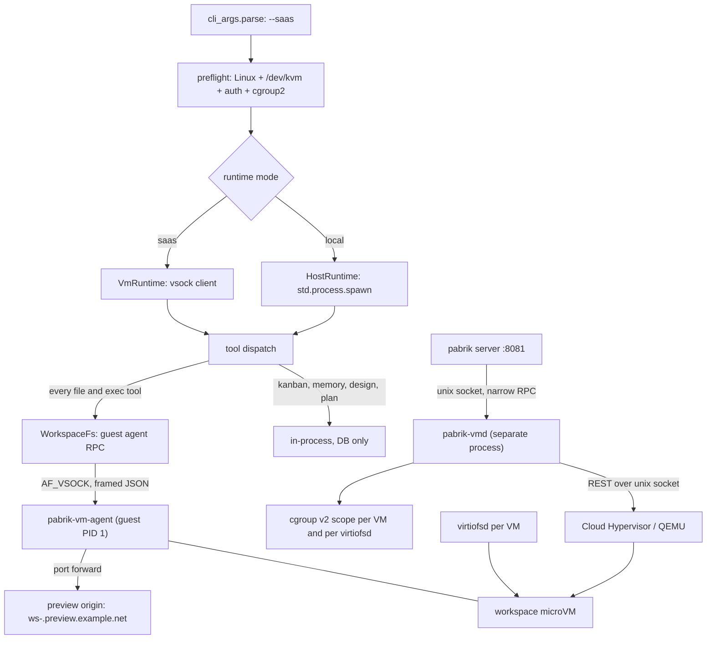

# Plan / design discussion — "every workspace is a VM": Linux-only SaaS mode (`pabrik --saas`)

- **Task**: `task_1792245573147_0` — "Workspace is a vm from microvm"
- **Worktree**: `~/.config/pabrik/.worktrees/workspace-is-a-vm-from-microvm-1792245526062`
- **Branch**: `worktree/workspace-is-a-vm-from-microvm-1792245526062` (base `main`)
- **Status**: PLANNING (rev 2) — nothing implemented. This document is the discussion artifact.
- **Human decision** (2026-10-17): the microVM runtime is a **Linux-only, opt-in mode**, selected at
  startup with `pabrik --saas`. Without the flag, Pabrik behaves exactly as today — tools run on the
  host. Every non-SaaS feature (kanban, design, memory, documents, skills, local chat) works in both
  modes.
- **Rev 2** folds in an external review. What changed, in one line each:
  1. **The host no longer reads the tenant tree at all** — all tenant file access goes through the
     guest agent (`WorkspaceFs`), which removes the symlink/TOCTOU class instead of defending it.
  2. **The host never runs `git` on a tenant tree** — seven existing host call sites are enumerated
     in §2.1, each with a concrete RCE path.
  3. **The preview proxy gets its own origin**; "one origin, no CORS puzzles" was a vulnerability,
     not a benefit.
  4. **The egress proxy denies the control plane, loopback, RFC1918 and metadata by default.**
  5. **`pabrik-vmd` is a separate process from P2**, not an in-process library.
  6. **No Cloud Hypervisor snapshot warm pool in v1** (virtiofs + vhost-user restore is not a
     supported combination); cold boot under 1 s is the budget.
  7. **The "host must read every file" constraint is demoted** from architectural requirement to
     operational convenience — which re-opens Firecracker as a viable backend (§9.1).
  8. **Tenancy decisions move before P2**; a **threat model** (§5) and a **pre-launch security
     review** gate are added; P1 gains a virtiofs rootless spike + benchmarks.

---

## 1. The shape being proposed

One binary, two runtimes:

```
pabrik            → local mode   (today: tools execute on the host, arbitrary user paths)
pabrik --saas     → SaaS mode    (Linux only: one microVM per workspace, pabrik-owned paths)
```

- **SaaS mode is Linux-only and refuses to start anywhere else** (or without `/dev/kvm`) with a
  precise message. A tenant believing they are isolated when they are not is worse than a failed boot.
- **`--saas` implies the rest of the SaaS contract**: auth required, one tenant per workspace,
  workspace roots created and owned by Pabrik, quotas, idle shutdown.
- **Local mode is not a degraded path** — it is the current product. That is why phase P0 is a seam,
  not a VM.
- The mode is process-wide in v1. The seam leaves room for a per-workspace `--vm` later without
  designing it now.

### 1.1 Mode matrix

| | local mode | `--saas` |
|---|---|---|
| tool execution | host (`shell.zig` → `bash -c`) | inside the workspace microVM |
| workspace filesystem | arbitrary user paths | Pabrik-owned root per workspace |
| who may touch tenant files | the host process, directly | **only the guest agent** (§9) |
| cross-project reads | any sibling dir the user names | other workspaces of the same tenant, read-only, opt-in |
| auth | `--auth` opt-in | **mandatory** |
| isolation | none (same uid, kernel, PID ns) | kernel-level per workspace |
| lifecycle | none | start / stop / idle-shutdown / quota per workspace |
| networking | the host's | vsock proxy; preview on its **own origin** |
| platforms | Linux, macOS, Windows | **Linux + KVM only** |
| kanban / design / memory / docs / skills | yes | **yes — identical code, tenant-scoped** |

The product is the same in both modes; only the execution substrate and the path policy differ. All
the work therefore concentrates at one boundary — the tool layer — instead of spreading across
features.

---

## 2. Today: where code actually executes

Pabrik is one Zig process (`pabrik --port 8081`) owning the SQLite DB, the agent loop, the HTTP/SSE
API, kanban/design/memory models and every tool. Tools are in-process calls dispatched from
`src/agentic_loop/handle_tool.zig`. The execution surface is the host, **with no confinement**:

| Fact | Evidence |
|---|---|
| `command`/`bash` spawns a real process: `bash -c <string>` | `command.zig:19`, `shell.zig:600` |
| The only guards are strings: `cwd` present + absolute, `timeout` 1–600 s | `shell.zig:621-643` |
| The child inherits the server's full environment (API keys included) | `shell.zig` has no `env_map` |
| `read_file` reads **any absolute path** | `read_file.zig:352-395` |
| A path-prefix sandbox exists for exactly one tool (`present_files`) | `file_sandbox.zig:1-8`, `:147` |
| Detached jobs are host PIDs per session | `session_background_process.zig:5-26` |
| Identity is DB rows + a `cwd` string | migrations 22, 46, 71, 28 |
| Secrets are substituted into tool arguments, scrubbed from output | `secrets_substitution.zig:1-30`, `handle_tool.zig:2357` |

Consequences the SaaS mode must fix:

- **The agent reaches everything the user can reach**: `~/.ssh`, `~/.config/pabrik/pabrik.db` (where
  the secrets live), every other project, the cloudflared config, the `pabrik` process itself.
- **`AGENTS.md` already contains a rule only isolation can enforce**: "DONT KILL THE PORT 8081
  SERVER". Nothing stops `kill $(pgrep -f 'pabrik --port 8081')` — same uid, same PID namespace.
- **The path sandbox is a string comparison.** `file_sandbox.zig` is 627 lines of hardening for
  `..`, symlinks, UNC prefixes and Windows case rules — and it protects one tool out of ~40.
- **A secret on a command line is visible in `/proc/<pid>/cmdline`** to anything running as that uid.

### 2.1 The host already runs `git` on the project tree — seven places

This was the review's sharpest point, and it is worse than "one place". The host spawns `git`
inside a directory whose `.git/config`, hooks and `.gitattributes` the *tenant* controls:

| Call site | What a malicious repo can do |
|---|---|
| `src/modules/system_folder/system_folder.zig:275` (`git -C <dir> check-ignore -- …`, used by folder listings) | reads `.git/config`; `check-ignore` itself is tame, but the *pattern* is established |
| `src/modules/agent/tools/list_directory.zig:75` (`git check-ignore <name>`) | same, on a path the agent can point anywhere |
| `src/agentic_loop/git_state.zig:57` (host `git` for the git chip) | `git status` honours `core.fsmonitor` → **arbitrary command execution** |
| `src/http_handlers/git_pr_status.zig:267,341` (`rev-parse --git-dir`, `remote get-url origin`) | config parsing; no hooks, but it is still tenant-controlled input to a host process |
| `src/http_handlers/git_pr_conflicts.zig:78` (host `git -C <path> …`) | depends on the subcommand; `diff`/`status`-shaped calls execute filter drivers |
| `src/modules/agent/tools/set_git_worktree.zig:167` (`git worktree add`) | runs the **`post-checkout` hook** from the tenant's repo |
| `src/modules/agent/tools/status_pull_request.zig:783` (`git remote get-url origin`) | config parsing |

Plus the diff path: any host-side `git diff`/`git show` honours `.gitattributes` `textconv` and
`filter.*` drivers — **arbitrary command execution on the host**, with no `command` tool involved and
no approval.

**Rule for SaaS mode (absolute, testable): the API process never executes `git` (or any VCS/forge
CLI) with a tenant-controlled tree as its working directory or `-C` target.** Those seven call sites
must get a `WorkspaceFs`-shaped replacement that runs in the guest. This is not a hardening task —
it is a correctness boundary, and it is cheaper than auditing which of the seven happen to be benign.

---

## 3. Acceptance criteria

Written as testable statements; §15 is judged against them.

1. **A workspace's shell cannot see a path outside its mount plan** — `cat /home/ginwa/.ssh/id_rsa`,
   `ls ~/.config/pabrik`, `rm -rf ~/pabrik` all fail inside the VM with `ENOENT`.
2. **A workspace cannot signal a host process** — `pkill -f pabrik` from the guest fails.
3. **A workspace cannot reach the control plane** — including *through the egress proxy*: loopback,
   RFC1918, link-local, `169.254.169.254`, and the host's own listening ports are denied and logged.
4. **A workspace's files survive the VM** — stop it, start it, the tree is byte-identical.
5. **Two tenants with the same repo path never collide.**
6. **Local mode is byte-identical to today** — same outputs, same tests green, no KVM needed.
7. **`--saas` on macOS/Windows or without KVM fails fast with a message that says what to do.**
8. **The host process never opens a file inside a tenant tree.** Enforced structurally: the only
   production implementation of `WorkspaceFs` is the guest agent; a host-side open of a tenant path
   is a compile-time-visible API nobody calls. If a host read is ever added (export, offline index),
   it goes through `openat2` with `RESOLVE_BENEATH | RESOLVE_NO_MAGICLINKS` on a directory fd, reads
   from that fd (never re-resolves the path), caps the size, and is covered by a symlink-swap test.
   *(Note: `files_download.zig:139-160` already canonicalizes + prefix-checks — the right idea,
   implemented racily, since it re-opens by path after the check. That is exactly the pattern the
   rule forbids.)*
9. **The host never runs `git`/`gh` against a tenant tree** (§2.1) — tested by putting a
   `core.fsmonitor`/`post-checkout`/`textconv` payload in a fixture repo and asserting nothing
   executes on the host.
10. **A page served from a workspace preview cannot act as the authenticated app**: the preview has
    its own origin (scheme+host+port), session cookies are host-only, and mutating API routes reject
    a foreign `Origin`.
11. **A guest cannot exhaust the host**: RAM, vCPU, disk, PIDs and *output volume* are bounded per
    VM; a guest that floods stdout is cut off, not buffered into host RAM.
12. **The vsock codec is hostile-input safe**: fuzzed, length-bounded, and it never allocates more
    than the frame cap before validating the length.

---

## 4. Constraints the code and this box impose

### 4.1 Absolute paths are load-bearing — but in SaaS mode *we* choose them

`sessions.cwd`, `git_worktree_cwd`, kanban `cwd`, `workspace_items.path` and the tool contracts all
speak absolute paths, and the model writes them into commits and PR bodies. In SaaS mode Pabrik
creates the root itself, so it can mount it at an identical path inside the guest
(`/var/lib/pabrik/workspaces/<id>/root` → same path). One rule, satisfied by construction.

### 4.2 The host must be able to *serve* and *export* files — not *open* them

The browser is served by the host (`GET /api/files/download`, `present_files`), diffs and folder
listings are rendered there, and semantic indexing runs there. The first version of this document
turned that into "the host must read the tree", which forced a shared filesystem, a custom kernel
and a VMM choice. The review is right that this is an assumption, not a law:

- **Serving** = bytes → the guest agent streams them. No host `open()`.
- **Diff/folder/status** = guest-side computation (which also fixes §2.1).
- **Indexing** = the guest streams file batches; the host only embeds.
- **Backup/export/quota** = `du`/`tar`/`rsync` that never execute anything and never need to
  interpret content.

So the operative requirement is "the *guest* must be fast at filesystem work, and the operator must
be able to back the tree up" — not "the host must read". §9.1 keeps virtiofs because it is the least
work, but the architecture no longer depends on it.

### 4.3 Firecracker has no shared filesystem — verified

`firecracker_spec-v1.17.0.yaml` (local, v1.17.0) exposes: `actions, balloon(+hinting), boot-source,
cpu-config, drives, pmem, logger, machine-config, metrics, mmds, entropy, serial, hotplug/memory,
network-interfaces, snapshot/{create,load}, version, vm, vm/config, vsock`.
**No virtiofs, no 9p, no vhost-user device.** Consequence: with Firecracker the workspace is a block
device and every host-side file operation is an RPC (which §9 now allows, at an operational cost).

### 4.4 The stock guest kernel cannot mount a shared directory

`strings` over `vmlinux-6.18.51`: `ext4` 40, `virtio_blk` 11, `virtio_pci` 11, `fuse` 14,
`overlay` 37, `squashfs` 5, `nfs` 58, `vsock` 7 — and **`virtiofs` 0, `9pnet_virtio` 0**.
Pabrik must ship its own kernel + rootfs (`CONFIG_VIRTIO_FS=y`, `CONFIG_VIRTIO_VSOCKETS=y`,
`CONFIG_EXT4_FS=y`, `CONFIG_OVERLAY_FS=y`, `CONFIG_MODULES=n`), built reproducibly in CI, versioned
and checksummed. Supply-chain work item, not a footnote.

### 4.5 No privilege on this box

`sudo -n true` → *"a password is required"*. `/dev/kvm` and `/dev/vhost-vsock` are `crw-rw-rw-`, so
KVM and vsock work unprivileged; tap and `iptables` do not. **Default backend must be
privilege-free: no NIC, all networking over vsock.** On a SaaS server one *could* run as root; we
should not, because a root VMM manager turns a tool bug into a host compromise.

---

## 5. Threat model (new)

**Adversary**: code the agent runs in the guest — a tenant-controlled repository, a dependency's
`postinstall`, a prompt injection that talks the model into a destructive command, or (in the
multi-tenant product) the tenant themselves.

**Assets**: (a) host files outside the workspace, (b) `pabrik.db` + the secrets store + API keys,
(c) other tenants' trees, (d) the control plane on `:8081`, (e) host availability, (f) the VMM
manager's authority (a manager that can configure a VM can configure *any* VM).

| # | Vector | Where it bites | Mitigation | Criterion |
|---|---|---|---|---|
| T1 | symlink/`..`/TOCTOU escape from the mounted tree into a host read path | host `read_file`, download, `present_files` | host never opens tenant paths; if it must, `openat2(RESOLVE_BENEATH)` + fd-based reads + size caps | 8 |
| T2 | tenant-controlled `.git/config`/hooks/`textconv` executed by a host `git` | the seven call sites in §2.1 | git only in the guest; import/clone in the guest; host backup tools never interpret content | 9 |
| T3 | guest reaches `localhost:8081` (or the host's DB socket) through the egress proxy | control plane | egress deny list (loopback, RFC1918, link-local, metadata), resolve-then-connect, per-tenant allowlist | 3 |
| T4 | tenant dev server served from the app origin calls the API with the user's cookies | session hijack | preview on its own origin; host-only cookies; `Origin` allowlist on mutating routes; CSP on preview responses | 10 |
| T5 | resource exhaustion: RAM, vCPU, disk, PIDs, or **stdout flooding** through vsock | host availability | cgroup v2 scopes per VM *and per virtiofsd* (`systemd-run --user --scope -p MemoryMax=…` works unprivileged here — verified); per-exec byte budget + flow control in the protocol | 11 |
| T6 | malformed vsock frames (guest → host parser) | control plane | length-prefixed, pre-allocation capped, fuzzed codec, unknown fields ignored | 12 |
| T7 | `virtiofsd`/VMM compromise (a vhost-user bug) | host | `jailer`-style chroot+seccomp for the VMM, `--sandbox=namespace` for virtiofsd, `nosuid,nodev` on shares, cgroup containment | — |
| T8 | golden image supply chain (a poisoned kernel/rootfs) | every tenant | reproducible CI build, pinned hashes, image version recorded per VM, no user-writable image cache | — |
| T9 | prompt injection *inside* the tenant's own workspace | the tenant's own data | **not mitigated by the VM** — say so in the product docs; the VM bounds *blast radius*, not judgement | — |

Out of scope for this document, but must be stated in the product: the VM does not protect a tenant
from their own agent, and it does not make a malicious model safe.

---

## 6. What a VM buys, and what it does not

**Buys (kernel-enforced):** `rm -rf ~` cannot reach `~`; `~/.ssh` and `pabrik.db` do not exist in
the guest; a compromised dependency cannot read another tenant's data; `pkill -f pabrik` fails;
cross-tenant reads become a mount flag; filesystem containment stops being a string comparison.

**Does not buy:** secret hygiene *inside* the guest (the agent is root there — §12); protection from
model judgement inside the mounted tree; a patched host kernel (KVM remains a shared surface);
docker/GPU/nested virt; macOS/Windows.

---

## 7. Stack comparison

Legend: ✅ yes · ⚠️ caveat · ❌ no.

| | Firecracker 1.17 | **Cloud Hypervisor** | QEMU `-M microvm` | libkrun | (ref) bubblewrap |
|---|---|---|---|---|---|
| shared dir (virtiofs) | ❌ (verified §4.3) | ✅ via `virtiofsd` (**1.14.0 installed**, `/usr/lib/virtiofsd`) | ✅ virtiofs or 9p | ✅ built in | n/a |
| vsock | ✅ | ✅ | ✅ | ✅ | n/a |
| NIC without root | ❌ (tap only) | ❌ (tap / unix) | ⚠️ user-mode net = ✅ | ✅ TSI | n/a |
| snapshot/restore | ✅ | ✅ ⚠️ **not with virtiofs/vhost-user** | ✅ | ❌ | n/a |
| boot / overhead | <125 ms / ~5 MB | ~150–300 ms | larger | small | 0 |
| embeddable | ❌ | ❌ | ❌ | ✅ (C API) | ✅ |
| macOS | ❌ | ❌ | ✅ (HVF) | ✅ (HVF) | ❌ |
| maturity | ★★★★★ | ★★★★☆ | ★★★★★ | ★★★☆☆ | ★★★★★ |
| packaged here | `extra/firecracker` | ❌ not in repos | ✅ qemu 11.1.1 | ❌ source | ✅ |

### 7.1 Recommendation (updated)

- **Primary: Cloud Hypervisor + `virtiofsd`** — least work, guest-native filesystem speed, a plain
  directory on the host for backup/quota, and a Firecracker-shaped REST API so one client drives both.
- **CI/dev backend: QEMU `-M microvm`** — installed, rootless, user-mode networking.
- **Firecracker is back on the table** now that §4.2 is demoted: a **sealed-disk** workspace (§9.1)
  makes it viable with no new host-side file access. Decide it on operations (export/backup, image
  tooling), not on security — both satisfy §3.8/§3.9.
- **bubblewrap stays a dev fallback only.** It validates the seam and covers boxes without KVM, but
  shared-kernel isolation is **not** SaaS-grade for untrusted tenants: `--saas` still refuses to
  start without KVM. Do not let it leak into the product story.
- **No snapshot warm pool in v1** (§10.3).

---

## 8. Architecture

### 8.1 Components



1. **`pabrik-vmd` — a separate process from P2** (not an in-process library). Owns the image cache,
   per-VM state, the VMM and `virtiofsd` processes, cids, cgroups, and the reconciler. Reasons, both
   concrete: (a) a bug in the web-facing server must not be able to spawn or configure VMs; (b) a
   server restart/deploy must not kill every tenant's dev servers — and this repo restarts constantly
   (`AGENTS.md` forbids killing `:8081`, which implies how often it is restarted). The server talks
   to it over a unix socket with a narrow RPC surface (`ensure`, `status`, `stop`, no device config).
2. **`pabrik-vm-agent` — guest PID 1.** Static Zig (`-target x86_64-linux-musl`): mounts per the
   `hello` plan, sets resolver/proxy config, listens on vsock, forks/execs with pty support, streams
   output under a byte budget, tracks pids, runs `git`, serves file reads, forwards ports, reaps
   zombies, powers off.
3. **`WorkspaceFs` / `VmClient`** — the vsock protocol: length-prefixed JSON frames (`hello`,
   `exec.start|stdout|stderr|exit|signal`, `fs.read|write|stat|list`, `port.forward`, `health`,
   `shutdown`), version negotiated in `hello`, 4 MiB frame cap enforced *before* allocation, stream
   flow control (§10.4).

### 8.2 The seam

```zig
pub const WorkspaceRuntime = struct {
    vtable: *const VTable,
    pub const VTable = struct {
        ensureReady: *const fn (ctx: *anyopaque) Err!void,
        exec: *const fn (ctx: *anyopaque, req: ExecRequest) Err!ExecResult,
        spawnDetached: *const fn (ctx: *anyopaque, req: DetachedRequest) Err!Handle,
        readFile: *const fn (ctx: *anyopaque, req: ReadRequest) Err!ReadResult,
        writeFile: *const fn (ctx: *anyopaque, req: WriteRequest) Err!void,
        // … glob, search, list, remove: same shape
    };
};
```

`HostRuntime` wraps today's `shell.zig` **unchanged** (criterion 6). `VmRuntime` speaks vsock.
`FakeRuntime` executes locally against a temp dir and is what unit tests use (§14).

### 8.3 Tool matrix (SaaS mode)

| Tool family | Where | Why |
|---|---|---|
| `command` / `bash` / `pwsh` | **guest** | the risk surface |
| all file tools (`read_file`, `write_file`, `text_replace`, `glob`, `list_directory`, `search`, `remove_file`, `present_files` source, `diff`) | **guest** | one writer, no host symlink path, no guest→host inotify gap; the agent can turn single-file reads into fd-based work inside the VM |
| git / gh / forge tools (`set_git_worktree`, `pr_cli`, `status_pull_request`, `git_state`, folder-listing ignore checks) | **guest** | §2.1 — the host must never execute tenant-controlled git |
| MCP stdio servers | **guest** | spawn binaries, need project deps |
| semantic indexing | content from guest, embeddings on host | keys stay host-side; the guest never sees the API key |
| kanban, memory, skills, documents, plan, design | in-process | pure DB, tenant-scoped by `user_id`/`workspace_members` |
| secrets resolution, LLM calls, web_search | host | §12 |

**Costs accepted with this matrix** (the review's point 4, taken): single-file reads/writes now pay
a vsock round-trip (~1–3 ms) instead of a local `open` — irrelevant next to an LLM call, and it buys
one invariant instead of two exceptions. `glob`/`search` run inside the guest, so metadata-heavy
scans are guest-native rather than host-RPC-per-file.

**Two invariants that make the rest easy to reason about:**

- **V1 — the guest is the only writer.** One writer removes the inotify gap and `.git/index.lock`
  entirely, instead of documenting them as caveats.
- **V2 — no control plane in the guest.** No DB, no `~/.config/pabrik`, no cloudflared token, no host
  SSH keys. Those paths are not mounted, so they do not exist there.

---

## 9. Filesystem

### 9.1 One interface, two storage backends

`WorkspaceFs` hides *where* the bytes live, so the choice below is operational, not architectural:

| mode | guest sees | host sees | good for |
|---|---|---|---|
| **shared** (default) | virtiofs export of a host directory | a plain directory (backup, `du`, seeding) | least work, guest-native speed, offline export |
| **sealed** | its own block image | nothing | Firecracker, snapshot-capable, no host path at all |

Both present the same API. **v1 ships `shared`**; `sealed` stays a documented option so the backend
choice in §7.1 does not have to be made today. This is the answer to "challenge constraint 4.2":
the constraint is gone, and what remains is a trade between operator convenience and storage
isolation.

Shared-mode layout (paths chosen by Pabrik, mounted at the identical path in the guest):

```
host  /var/lib/pabrik/workspaces/<id>/root    → guest  same path                      (rw)
host  /var/lib/pabrik/workspaces/<sib>/root   → guest  same path                      (ro, opt-in)
host  /var/lib/pabrik/scratch/<id>            → guest  /pabrik/scratch                (rw, guest-local)
```

`/home/*` is never mounted as a whole. Cross-workspace reads are read-only mounts of the same
tenant's other workspaces.

### 9.2 virtiofsd hardening (must be spiked in P1, not assumed)

Verified on this box: `virtiofsd 1.14.0` at `/usr/lib/virtiofsd` (not on `PATH`), with
`--sandbox <namespace|chroot|none>`, `--uid-map`/`--gid-map` (via user namespace),
`--translate-uid`/`--translate-gid` (e.g. `squash-guest`, i.e. n:1 map to one host uid),
`--posix-acl`, `--xattr`, `--announce-submounts`.

P1 must answer, with numbers:

- **uid mapping**: guest root ↔ host owner of the files. `squash-guest` (all guest uids → the
  pabrik uid) is the safe default in SaaS; 1:1 mapping means a guest uid can own files a host
  process then treats as its own.
- **`nosuid,nodev`** on every share (`noexec` is a per-tenant policy: it breaks `./gradlew`, so it
  cannot be the global default).
- **shared-memory backing**: vhost-user-fs needs a shared memory region; that removes
  `memory.backend=file` dedup and weakens overcommit — budget RAM accordingly.
- **`--sandbox=namespace` requires a user namespace**; confirm it works unprivileged here, else fall
  back to `chroot` with a narrow mount set.
- **benchmark, bare numbers, before the design is locked**: `git status` on the Pabrik repo,
  `npm install` in a fresh directory, `zig build` cache reuse, and a tarball read of a 500 MB file —
  shared mode vs sealed mode vs native.

### 9.3 Build caches live on the scratch disk

virtiofs is fine for source and bad for metadata-heavy work. Each VM gets a ~2 GB sparse guest-local
ext4 at `/pabrik/scratch`, with `CARGO_TARGET_DIR`, `npm_config_cache`, `ZIG_GLOBAL_CACHE_DIR`,
`GOPATH`, `PIP_CACHE_DIR`, `node_modules`, `.next`, `target/` pointed at it. Visible consequence to
document: those artifacts are not on the host, so the file browser and the index do not see them.

### 9.4 If a host-side read is ever added

`openat2(dirfd, path, O_RDONLY, {RESOLVE_BENEATH | RESOLVE_NO_MAGICLINKS})`, then **read from that
fd**; never canonicalize-then-reopen (the current `files_download.zig:139-160` pattern), never follow
a path twice, and cap the size before allocating. Cover it with a test that swaps a symlink between
the check and the read.

---

## 10. Lifecycle, resources, output limits

### 10.1 States

`absent → provisioning → starting → ready → busy → idle → stopping → stopped → absent`, with
`failed(last_error)` retried with backoff. `ready` = the agent answered `hello`. One VM per
workspace, shared by its sessions; `busy` is a counter. The reconciler in `pabrik-vmd` is the only
writer of state; tools call `ensureReady` and never boot anything themselves.

### 10.2 Resource limits (cgroup v2, rootless — verified here)

`/sys/fs/cgroup` is `cgroup2fs`, `cpu memory pids` are delegated to `user-1000.slice`, and
`systemd-run --user --scope -p MemoryMax=64M -- /bin/true` succeeds unprivileged. So each VMM **and
each `virtiofsd`** runs in its own scope with `MemoryMax`, `CPUQuota`, `IOWeight`, `TasksMax`.
Guest RAM size alone is not enough: a noisy tenant can saturate host I/O through virtiofsd threads.

### 10.3 Boot budget, and no snapshots in v1

| stage | target |
|---|---|
| VMM spawn + configure (unix-socket REST) | < 50 ms |
| kernel → agent `hello` (custom kernel, `init=/sbin/pabrik-vm-agent`, no systemd) | < 800 ms |
| virtiofsd + mounts (started before the VMM) | < 150 ms |
| first `command` end-to-end | **< 1.2 s** |

A warm pool built on Cloud Hypervisor snapshots is **out of scope**: restoring vhost-user devices
(virtiofs) is not a supported combination, and a boot under 1 s makes the pool unnecessary for v1.
Template snapshots stay a later optimization for `sealed` mode, where devices are simple.

### 10.4 Output must be bounded on the host (the review's point)

The protocol carries a per-exec byte budget (reusing `max_output`/`max_lines` semantics), a
flow-control window (the host pauses reads, it does not buffer), a truncation marker, and a hard cut
with `SIGPIPE`-equivalent when the budget is exceeded. A guest that floods stdout must lose its
output, never the host's memory. The frame decoder is fuzzed (criterion 12).

### 10.5 Process accounting

`session_background_process` gains `vm_id` + `guest_pid`. The `process` tool resolves through the
agent. Stopping a VM kills its jobs — correctly, but visibly: the tool result and the chat card say
"VM stopped — job ended".

---

## 11. Networking

```
guest process → 127.0.0.1:PORT (in-guest forwarder) → AF_VSOCK → host proxy → real socket
```

### 11.1 Egress: deny the control plane by default

The host proxy dials out on the tenant's behalf, so it is a confused deputy unless it refuses:
loopback (`127/8`, `::1`), RFC1918 (`10/8`, `172.16/12`, `192.168/16`), link-local
(`169.254/16`, `fe80::/10`), the metadata IP `169.254.169.254`, multicast/broadcast, and **every
address the host's own listeners are bound to** (which includes `:8081`). Resolve-then-connect (the
IP that was checked is the IP that is dialled — no DNS rebinding), then a per-tenant allowlist
(npm/pypi/crates/github by default) and an audit log. Criterion 3, tested with a probe from inside
the guest.

### 11.2 Ingress: the preview gets its own origin

The v1 draft sold "one origin, no CORS puzzles" as a benefit. It is a vulnerability: a tenant dev
server served from `/api/ws/<id>/ports/3000/` runs on the **app's** origin and can call the API with
the user's cookies.

- **Own origin per preview.** Origin = scheme + host + port, so:
  - hosted: `https://ws-<id>.preview.<separate-domain>` with wildcard DNS + cert (a subdomain of the
    app's domain is *same-site* for `SameSite`, which is why a separate domain is recommended);
  - single box: a distinct **port** per preview is already a distinct origin — cheap and sufficient.
- **Session cookies are host-only** (`Domain` unset), `Secure`, `HttpOnly`, `SameSite=Lax`, `__Host-`
  prefix where possible.
- **Mutating API routes reject a foreign `Origin`** (plus a CSRF token for cookie-authenticated
  forms). This is the real defence, because same-site ≠ same-origin.
- **CSP on preview responses** (`frame-ancestors`, `connect-src`), so a tenant page cannot frame the
  app UI or silently reach the API.
- Criterion 10, tested: a page from the preview origin cannot read an authenticated response, and a
  forged cross-origin POST is rejected.

### 11.3 Known limits (documented, not discovered)

Raw sockets (`ping`, mDNS) do not work; UDP is not proxied (the guest runs a resolver that forwards
over vsock); `git+ssh` is unsupported in v1 (HTTPS remotes, `insteadOf`); a privileged tap-based mode
is opt-in via a separate `CAP_NET_ADMIN` helper and is **out of scope for v1**.

---

## 12. Secrets

Today the placeholder is substituted into tool-argument strings and scrubbed from output. That works
in one trust domain; a VM breaks it in two directions:

1. **Substitution on a guest command line leaks it** — the value sits in `/proc/<pid>/cmdline`,
   readable by the agent, which is root in the guest.
2. **Mounting the config dir would hand over the store** — today one `read_file` on
   `~/.config/pabrik/pabrik.db` exfiltrates every secret. V2 (§8.3) forbids the mount.

Rules for SaaS mode:

- **R1 — no substitution into guest commands by default.** A guest command referencing a secret is
  refused with an actionable message. Credentialed steps run on the host (LLM, web_search, forge API).
- **R2 — explicit per-command grants.** `secrets: ["GH"]` on the exec request: injected into the
  guest agent's per-exec environment (never the command line), scrubbed from the stream, logged.
- **R3 — no long-lived guest credentials.** No SSH keys in the golden image, no `~/.netrc`, no cloud
  tokens. Short-lived, per-exec, revoked.
- **R4 — guest root is not a boundary.** The boundary is *what the VM was given*.
- **R5 — the placeholder token itself is substituted by a pass over tool arguments**, so any doc,
  prompt or test fixture that quotes the token verbatim can trip the substitution and fail the call.
  Tests must build it from parts (see §14).

---

## 13. Data model

```sql
-- migration next-free (112 is the current head)
CREATE TABLE workspace_vms (
  workspace_id   TEXT PRIMARY KEY REFERENCES workspaces(id),
  vm_id          TEXT NOT NULL,
  state          TEXT NOT NULL,      -- absent|starting|ready|idle|stopped|failed
  backend        TEXT NOT NULL,      -- cloud-hypervisor|qemu|firecracker
  fs_mode        TEXT NOT NULL,      -- shared|sealed
  socket_path    TEXT NOT NULL,      -- VMM API unix socket
  vsock_cid      INTEGER,
  pid            INTEGER,            -- VMM host pid
  scope_unit     TEXT NOT NULL,      -- systemd --user scope (cgroup limits)
  image_version  TEXT NOT NULL,
  mem_mb         INTEGER NOT NULL,
  vcpus          INTEGER NOT NULL,
  root_path      TEXT NOT NULL,
  created_at     INTEGER NOT NULL,
  last_used_at   INTEGER NOT NULL,
  last_error     TEXT
);

ALTER TABLE session_background_process ADD COLUMN vm_id TEXT;
ALTER TABLE session_background_process ADD COLUMN guest_pid INTEGER;

CREATE TABLE server_settings (key TEXT PRIMARY KEY, value TEXT NOT NULL);  -- runtime=saas
```

No `workspaces.runtime` column in v1: the mode is process-wide, so a workspace row is identical in
both modes — which is what makes "the same DB, two runtimes" true and keeps local mode untouched.

---

## 14. Test strategy (behavior-first, deterministic, KVM-free by default)

**L1 — pure logic (no KVM, no sockets, no clock).**

- Frame codec: every message type, unknown type, oversized/truncated frame, version mismatch, and a
  **fuzz pass** over random bytes (the codec parses guest-controlled input in the control plane).
- **Mount-plan builder**: exact `(tag, host_path, guest_path, mode)` set for a workspace + tenant +
  siblings. This is where "no tenant-supplied host paths", "siblings read-only", "identical path",
  "never `/home/*`" become behavior tests.
- Reconciler transitions with an injected clock; port-forward allocate/resolve/release; output-budget
  accounting (truncate at the cap, marker emitted, stream closed).
- Egress policy: an IP classifier over the deny list (table-driven, including `::1`, `169.254.169.254`,
  and a *literal* `:8081` probe).

**L2 — tool behavior through `FakeRuntime` (in-process, temp dir).**

Every existing `command` test keeps passing unchanged (criterion 6), plus: a `cwd` outside the mount
plan is refused before any spawn; every file tool routes to the runtime (assert on the resulting
file content, never on "the runtime was called"); a secret placeholder in a guest command produces the
actionable refusal; a fixture repo with a `core.fsmonitor` payload proves **no host git invocation**
happens (criterion 9) — the payload writes a canary file, and the test asserts it does not exist.

**L3 — real VM smoke (integration, opt-in).**

Gate on `PABRIK_VM_TEST=1` + `/dev/kvm`; boot QEMU `-M microvm` rootless: `hello`, `echo` round-trip,
guest-written file appears in the workspace, a dev-server port reachable via the preview origin,
preview-origin isolation probe (`fetch` to the API from the preview page fails), egress probe to
`127.0.0.1:8081` fails, stopping the VM ends its jobs. These are integration tests — never in the
per-commit shard.

Anti-goals: `sleep 2; assert`; "wait for the SSH banner"; existence/arity assertions standing in for
behavior.

---

## 15. Phases

| Phase | Deliverable | Exit criterion |
|---|---|---|
| **P0 — seam + flag** | `WorkspaceRuntime`/`WorkspaceFs` + `HostRuntime` + `FakeRuntime`; `--saas` in `cli_args.zig`; preflight (Linux, `/dev/kvm`, auth, cgroup2); `server_settings.runtime` | `--saas` refuses correctly off-Linux/no-KVM; local mode byte-identical; all tests green |
| **P0.5 — tenancy decisions** | answers to §16 Q1–Q3 written down; quota model; first-admin flow (`pabrik user create` — nothing exists today) | no phase after this depends on an unresolved tenant question |
| **P1 — golden image + virtiofs spike** | reproducible kernel/rootfs/agent build in CI; agent mounts a share and runs a command; **virtiofsd rootless spike + benchmarks** (§9.2) | rootless `qemu -M microvm` runs `echo`; guest-written file appears on the host; benchmark table exists — and the design is re-checked against it |
| **P2 — vmd + exec** | `pabrik-vmd` as a **separate process**; `VmRuntime`; `command` + detached modes; cgroup scopes; `vm_id`/`guest_pid` | a SaaS workspace's commands all run in its VM; `ps aux` on the host shows no agent `bash -c`; restarting `pabrik` leaves the VM and its dev server alive |
| **P3 — fs + net** | all file tools through the agent; guest-side git; scratch disk; port forward; preview on its own origin; egress deny list | `npm install` + test run in a workspace VM; preview usable; sibling read-only; criteria 3/10 pass |
| **P4 — strict + secrets + tenancy** | R1–R5, per-tenant egress allowlist, audit log, quotas, systemd unit for vmd | criteria 1–5, 8–12 covered by tests |
| **P5 — security gate** | **threat model walkthrough (§5) + a pre-launch security review against criteria 8–12** | no open high-severity finding |
| **P6 — backend split** | `VmBackend` over CH + QEMU; CH as prod default; `sealed` mode scoped | both backends pass L3 |
| later | `sealed`/Firecracker backend, template snapshots, remote VM hosts, local `--vm` | — |

P1 before P2 stays; P1's exit criterion is now *"benchmarks exist and the design survives them"*,
not just "it boots".

---

## 16. Open questions

1. **Tenancy**: is a tenant a `user`, an organization, or "whoever owns the workspace"? Quotas, mount
   plans and audit logs all depend on it — *before P2*, per the review. (`workspaces.user_id` and
   `workspace_members` exist since migrations 24/100; there is no org concept.)
2. **First admin**: `pabrik user create` subcommand vs env-var-on-first-boot? Nothing exists today,
   and `--saas` implies auth.
3. **Quota numbers**: this box (14 GB, ~5 GB free) honestly supports ~6–8 live VMs at 512 MB. Is the
   SaaS target one box, or "scale by adding boxes"? That decides whether the reconciler becomes a
   scheduler.
4. **Import**: does a tenant bring a repo by URL (clone **in the guest**), by upload, or both? Is
   `git push` to their real forge allowed? This is the credential story (R2/R3).
5. **Cross-workspace read-only mounts**: default on (convenient) or explicit grant (safer)?
6. **FS mode**: ship `shared` only, or scope `sealed` for "untrusted/imported" workspaces from P6?
   Shipping both is roughly +1 phase; `sealed` is what makes Firecracker viable.
7. **Cloud Hypervisor packaging**: shipping a second static binary is acceptable? (`firecracker` is in
   the repos but has no virtiofs; CH is not in the repos at all.)
8. **Remote VM hosts**: should `pabrik-vmd`'s RPC be network-reachable from day one (`--vm-host`)?
   Cheap now, painful to retrofit.
9. **Local `--vm` later?** ~80 % free after P1–P3, but it re-opens §12 for a user who legitimately
   wants their `~/.ssh`.

---

## 17. What I would decide now

1. **P0 first: the seam + the flag.** Pure refactor, no user-visible change, makes local/SaaS a
   switch instead of a fork.
2. **The API process never opens tenant files and never runs tenant git.** This is the single change
   that removes the two worst findings (§2.1, §3.8) instead of defending them.
3. **Cloud Hypervisor + virtiofsd for v1, QEMU for CI, `sealed` as the documented Firecracker path.**
4. **Privilege-free by construction**: vsock-only networking, cgroup v2 scopes via `systemd-run --user`,
   no sudo, no iptables.
5. **Preview on its own origin, cookies host-only, `Origin` allowlist on mutating routes** — designed
   in, not patched in after a pen test.
6. **Say "no" in the docs**: no docker/GPU/nested-virt in the VM, no VM feature on macOS/Windows,
   `git+ssh` unsupported in v1, and bubblewrap is not the SaaS answer.

---

## Appendix A — verified on this box (2026-10-17)

```
OS      Arch Linux, kernel 7.2.7-arch1-1, x86_64, AMD SVM
KVM     /dev/kvm          crw-rw-rw-  (usable unprivileged)
vsock   /dev/vhost-vsock  crw-rw-rw-  (usable unprivileged; VSOCKETS=m, VIRTIO_VSOCKETS=m)
CPU/MEM 16 vCPU, 14 GB RAM, ~5 GB available with pabrik running
sudo    password required → no tap/iptables in the default path
cgroup  cgroup2fs; "cpu memory pids" delegated to user-1000.slice;
        `systemd-run --user --scope -p MemoryMax=64M -- /bin/true` → exit 0 (unprivileged)
VMMs    qemu 11.1.1 (virtio-9p + vhost-user-fs present)
        firecracker v1.17.0 binary in ~/firecracker-demo (booted here 2026-10-13 → 2026-10-14)
        extra/firecracker 1.17.0 in the Arch repos; cloud-hypervisor NOT installed, NOT in the repos
fs      virtiofsd 1.14.0 at /usr/lib/virtiofsd (not on PATH);
        flags: --sandbox namespace|chroot|none, --uid-map, --gid-map, --translate-uid, --translate-gid,
               --posix-acl, --xattr
guest   vmlinux-6.18.51 (ELF, 27 MB): ext4/virtio_blk/virtio_pci/fuse/overlay/squashfs/nfs/vsock;
        NO virtiofs, NO 9pnet_virtio → build our own kernel
```

## Appendix B — Firecracker 1.17 API surface (local spec file)

`/actions /balloon /balloon/statistics /balloon/hinting/{start,status,stop} /boot-source /cpu-config
/drives/{id} /pmem/{id} /logger /machine-config /metrics /mmds /mmds/config /entropy /serial
/hotplug/memory /network-interfaces/{id} /snapshot/create /snapshot/load /version /vm /vm/config /vsock`

No shared-filesystem device of any kind.

## Appendix C — host `git` call sites that must move into the guest (SaaS mode)

```
system_folder.zig:275              git -C <dir> check-ignore -- …
list_directory.zig:75              git -C <dir> check-ignore <name>
git_state.zig:57                   git <status/diff …>            ← core.fsmonitor = RCE
git_pr_status.zig:267,341          git rev-parse --git-dir | remote get-url origin
git_pr_conflicts.zig:78            git -C <path> …
set_git_worktree.zig:167           git worktree add …             ← post-checkout hook = RCE
status_pull_request.zig:783        git remote get-url origin
(+ any host-side `git diff`/`git show`, which honour .gitattributes textconv/filter drivers)
```

Every one of these becomes a `WorkspaceFs`/agent call in SaaS mode. In local mode they stay as-is —
the user's own tree is not a tenant.
