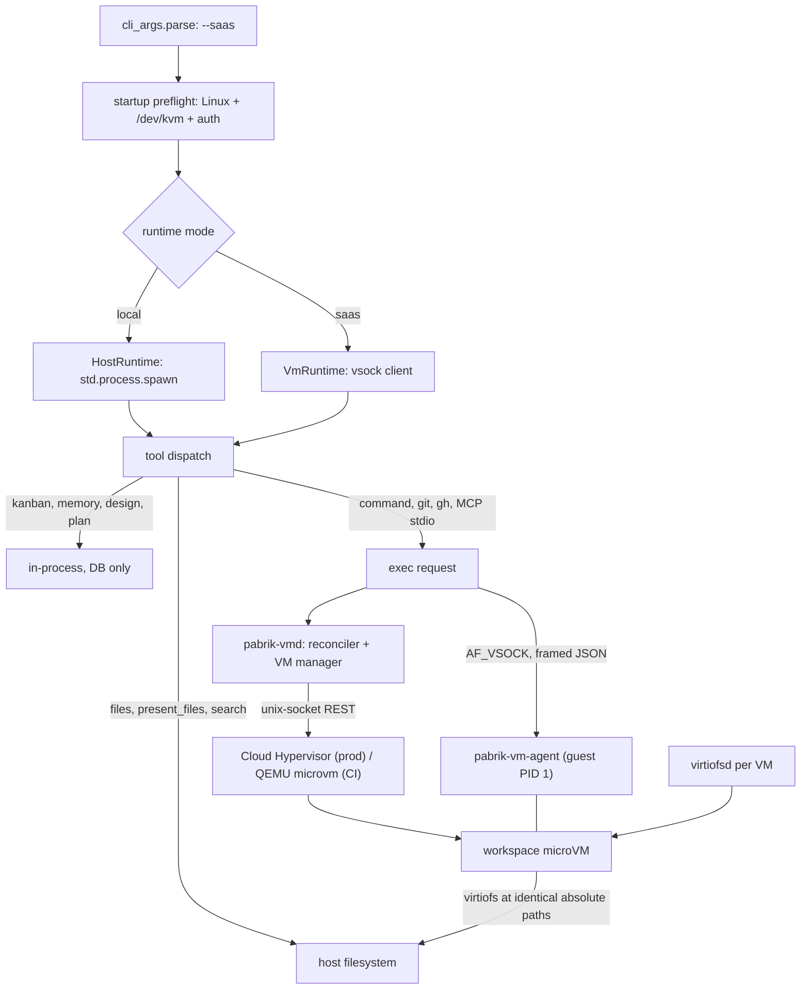

# Plan / design discussion — "every workspace is a VM": Linux-only SaaS mode (`pabrik --saas`)

- **Task**: `task_1792245573147_0` — "Workspace is a vm from microvm"
- **Worktree**: `~/.config/pabrik/.worktrees/workspace-is-a-vm-from-microvm-1792245526062`
- **Branch**: `worktree/workspace-is-a-vm-from-microvm-1792245526062` (base `main`)
- **Status**: PLANNING — nothing implemented. This document is the discussion artifact.
- **Decision already taken by the human** (2026-10-17): *the microVM runtime is a **Linux-only, opt-in
  mode**, selected at startup with `pabrik --saas`. Without the flag, Pabrik behaves exactly as it
  does today — the agent's tools run on the host. Every non-SaaS feature (kanban, design, memory,
  documents, skills, local chat) keeps working in **both** modes.*

What this doc adds to that decision: what "SaaS mode" has to mean in the code, the constraints the
current architecture imposes, a VMM comparison measured against **this** box, a phased path that
never breaks local mode, and the questions still open.

---

## 1. The shape being proposed

One binary, two runtimes:

```
pabrik                       → local mode   (today: tools execute on the host, arbitrary user paths)
pabrik --saas                → SaaS mode    (Linux only: one microVM per workspace, pabrik-owned paths)
```

- **SaaS mode is Linux-only, and refuses to start anywhere else** (or without `/dev/kvm`) with an
  explicit error — not a silent fallback. A tenant believing they are isolated when they are not is
  worse than a failed boot.
- **`--saas` implies the rest of the SaaS contract**: auth required, one tenant per workspace,
  workspace roots created and owned by Pabrik, per-workspace resource quotas, idle shutdown.
- **Local mode is not a degraded path.** It is the current product and it must keep shipping —
  which is why the first implementation phase is a seam, not a VM.

The mode is chosen at startup (process-wide), not per workspace, in v1. The seam leaves room for a
per-workspace override later (`--vm` for local single-user), without designing it now.

### 1.1 Why a mode switch is the right call

| | local mode | `--saas` |
|---|---|---|
| tool execution | host (`shell.zig` → `bash -c`) | inside the workspace microVM |
| workspace filesystem | arbitrary user paths (`/home/ginwa/pabrik`) | Pabrik-owned dir per workspace |
| cross-project reads | any sibling dir the user names | other workspaces of the same tenant, read-only (opt-in) |
| auth | `--auth` opt-in | **mandatory** (`--saas` implies it) |
| isolation | none (same uid, same kernel, same PID ns) | kernel-level per workspace |
| lifecycle | none — processes die with the server | start / stop / idle-shutdown / quota, per workspace |
| networking | the host's | vsock proxy, per-workspace preview URL |
| platforms | Linux, macOS, Windows | **Linux + KVM only** |
| kanban / design / memory / docs / skills | yes | **yes — identical code, tenant-scoped** |

That last row is the point of the mode split: the *product* is the same; only the *execution
substrate* and the *path policy* differ. Which means the work is concentrated in one place — the
tool boundary — instead of being smeared across every feature.

---

## 2. Today: where code actually executes

Pabrik is one Zig process (`pabrik --port 8081`) owning the SQLite DB, the agent loop, the
HTTP/SSE API, kanban/design/memory models and every tool. Tools are in-process calls dispatched
from `src/agentic_loop/handle_tool.zig`. The execution surface is the host, **with no confinement**:

| Fact | Evidence |
|---|---|
| `command`/`bash` spawns a real process: `bash -c <string>` | `src/modules/agent/tools/command.zig:19`, `shell.zig:600` (`run_shell_command`) |
| The only guards are strings: `cwd` present + absolute, `timeout` 1–600 s | `shell.zig:621-643` |
| The child inherits the server's full environment (API keys included) | `shell.zig` spawns with no `env_map` (zero occurrences in the file) |
| `read_file` reads **any absolute path**; `cwd` is only the base for relative paths | `read_file.zig:352-395` |
| A path-prefix sandbox exists for exactly one tool (`present_files`, "may this be shown to the browser") | `file_sandbox.zig:1-8`, `:147` |
| Detached jobs are host PIDs recorded per session | `src/models/session_background_process.zig:5-26` |
| Identity is DB rows + a `cwd` string; projects are absolute paths | migrations 22, 46, 71, 28 |
| Secrets are substituted into *tool arguments* and scrubbed from *output* | `src/agentic_loop/secrets_substitution.zig:1-30`, `handle_tool.zig:2357-2380` |

Consequences that the SaaS mode fixes:

- **The agent reaches everything the user can reach**: `~/.ssh`, `~/.config/pabrik/pabrik.db`
  (where the secrets live), every other project, the cloudflared config, the `pabrik` process.
- **`AGENTS.md` already contains a rule only isolation can enforce**: "DONT KILL THE PORT 8081
  SERVER". Nothing stops `kill $(pgrep -f 'pabrik --port 8081')` — same uid, same PID namespace.
- **The path sandbox is a string comparison.** `file_sandbox.zig` is 627 lines of hardening for
  `..`, symlinks, UNC prefixes and Windows case rules — and it protects one tool out of ~40.
- **A secret placeholder on a command line is visible in `/proc/<pid>/cmdline`** to anything
  running as that user. Substitution is a convenience, never a boundary.

In a multi-tenant product those are not "hardening TODOs" — they are incidents waiting for a date.

---

## 3. What SaaS mode must guarantee (acceptance criteria)

Written as testable statements, because the phase plan in §14 is judged against them:

1. **A workspace's shell cannot see a path that is not in its mount plan** — `cat
   /home/ginwa/.ssh/id_rsa`, `ls ~/.config/pabrik` and `rm -rf ~/pabrik` all fail *inside the VM*
   (`ENOENT`), for a workspace whose plan contains only its own root.
2. **A workspace cannot signal a host process.** `pkill -f pabrik` from inside a VM must fail.
3. **A workspace cannot reach the control plane.** No route from the guest to the host's DB, the
   API keys, the other tenants' roots.
4. **A workspace's files survive the VM.** Stop the VM, start it again: the tree is there, byte
   for byte, because it was never inside the VM's private disk.
5. **Two tenants with the same repo path do not collide** — the SaaS root is per workspace, never
   a shared host path.
6. **Local mode is byte-identical to today** — same tool outputs, same tests green, no KVM needed.
7. **`--saas` on macOS/Windows, or without KVM, fails fast with a message that says what to do.**

---

## 4. Five constraints the current code and this box impose

Each one removes design options; §6 scores the VMMs against them.

### 4.1 Absolute paths are load-bearing

`sessions.cwd`, `git_worktree_cwd`, kanban `cwd`, `workspace_items.path`, the "`cwd` is REQUIRED on
every path-taking tool" contract, and the cross-project context prompt all speak absolute host
paths. The model even writes them into commits and PR bodies.

**In SaaS mode this is mostly self-inflicted-pain-avoidance**: since Pabrik creates the workspace
root itself, it can choose a path and mount it at the identical path inside the guest
(`/var/lib/pabrik/workspaces/<id>/root` → same path). One rule, satisfied by construction.

### 4.2 The host must keep reading every workspace file

The host serves files to the browser (`GET /api/files/download`, `present_files`), builds diffs,
lists folders (`system_folder.zig`), and indexes for semantic search. A VM-private disk image
breaks all of it.

**Consequence: the workspace filesystem must be a shared, host-visible directory (virtiofs-class),
not a block image.** This kills the "obvious" Firecracker design.

### 4.3 Firecracker has no shared filesystem — verified, not remembered

The local `firecracker_spec-v1.17.0.yaml` exposes exactly: `actions, balloon(+hinting),
boot-source, cpu-config, drives, pmem, logger, machine-config, metrics, mmds, entropy, serial,
hotplug/memory, network-interfaces, snapshot/{create,load}, version, vm, vm/config, vsock`.

**No virtiofs, no 9p, no vhost-user device.** `pmem` is read-only memory-mapped, not a workspace.
So Firecracker forces a choice between a block device (violates 4.2), NFS over a NIC (needs root),
or a FUSE-over-vsock shim (100 % new code, slow on `npm install`-shaped workloads).

### 4.4 The stock guest kernel cannot mount a shared dir either

`strings` over `vmlinux-6.18.51` (the Firecracker CI kernel on this box):

| feature | hits | | feature | hits |
|---|---|---|---|---|
| `ext4` | 40 | | `vsock` | 7 |
| `virtio_blk` | 11 | | **`virtiofs`** | **0** |
| `virtio_pci` | 11 | | **`9pnet_virtio`** | **0** |
| `fuse` / `overlay` / `squashfs` | 14 / 37 / 5 | | `nfs` | 58 |

**Consequence:** Pabrik must ship its **own guest kernel + rootfs** (`CONFIG_VIRTIO_FS=y`,
`CONFIG_VIRTIO_VSOCKETS=y`, `CONFIG_EXT4_FS=y`, `CONFIG_OVERLAY_FS=y`, `CONFIG_MODULES=n`), built
reproducibly in CI, versioned and checksummed. Supply-chain work item, not a footnote.

### 4.5 Networking and devices need privilege — and this box has none

Verified: `sudo -n true` → *"a password is required"*. `/dev/kvm` and `/dev/vhost-vsock` are
`crw-rw-rw-`, so **KVM and vsock work unprivileged**; a tap device and `iptables` do not. (The
`firecracker-demo/boot.fish` on this box needs `sudo` for exactly three things: tap, `ip_forward`,
`MASQUERADE`.)

**Consequence: the default backend is privilege-free — no NIC in the guest, all networking over
vsock** (host↔guest in both directions). On a SaaS server one *could* run as root; we still
shouldn't, because a root VMM manager turns a tool bug into a host compromise.

---

## 5. What a VM buys, and what it does not

**Buys (kernel-enforced):**

- `rm -rf ~` cannot reach `~`; `~/.ssh` and `pabrik.db` do not exist in the guest.
- A compromised dependency (`postinstall`, `curl | sh`) cannot read tenant data or API keys.
- No accidental `pkill -f pabrik` — different PID namespace.
- Cross-tenant reads become a **mount flag**, not a prompt instruction.
- Filesystem containment that is not a string comparison.
- Per-workspace kernel + (later) per-workspace image, and portable workspaces.

**Does not buy:**

- **Secret hygiene inside the guest.** The agent is `root` in the guest; anything the VM is given,
  the agent can read. The VM protects the *host*, not the guest from its own agent → §11.
- **Protection from model judgement inside the mounted tree** (a `git push --force` is still that).
- **A patched host kernel.** KVM remains a shared surface — hence `jailer`/seccomp on the VMM.
- **docker-in-VM / GPU / nested virt.** No KVM in the guest by default.
- **macOS/Windows.** Out of scope by decision: VM feature is Linux-only.

---

## 6. Stack comparison (measured against §4)

Legend: ✅ yes · ⚠️ caveat · ❌ no.

| | Firecracker 1.17 | **Cloud Hypervisor** | QEMU `-M microvm` | libkrun | (ref) bubblewrap |
|---|---|---|---|---|---|
| shared dir (virtiofs) | ❌ (verified §4.3) | ✅ via `virtiofsd` (**installed here, 1.14.0**) | ✅ virtiofs or 9p | ✅ built in | n/a (bind mounts) |
| vsock | ✅ | ✅ | ✅ | ✅ | n/a |
| NIC without root | ❌ (tap only) | ❌ (tap / unix socket) | ⚠️ user-mode net = ✅ | ✅ TSI | n/a |
| snapshot/restore | ✅ (diff + UFFD) | ✅ (⚠️ not with every device) | ✅ | ❌ | n/a |
| VMM overhead / boot | ~5 MB, <125 ms | small, ~150–300 ms | larger | small | **0** |
| embeddable in-process | ❌ | ❌ | ❌ | ✅ (C API) | ✅ |
| macOS host | ❌ | ❌ | ✅ (HVF) | ✅ (HVF) | ❌ |
| maturity | ★★★★★ (AWS) | ★★★★☆ (Azure, Chromium) | ★★★★★ | ★★★☆☆ | ★★★★★ |
| packaging here | `extra/firecracker` ✅ | ❌ not in Arch repos (binary release/AUR) | ✅ qemu 11.1.1 | ❌ build from source | ✅ installed |

### 6.1 Recommendation

- **Primary: Cloud Hypervisor + `virtiofsd`.** The only mature microVM VMM that satisfies 4.2 while
  keeping a Firecracker-shaped REST API, so one client drives both. Cost: package one more static
  Rust binary.
- **CI/dev backend: QEMU `-M microvm`.** Already installed, rootless with user-mode networking,
  virtio-9p/virtiofs available. This is what the integration tests boot (§13).
- **Firecracker: block-only, later, if at all** — good for an immutable "task VM", wrong for a
  live workspace.
- **bubblewrap: the honest baseline**, behind the same interface: ~90 % of §3 in a week, no kernel
  work, no KVM, works on every platform. Not the target, but it makes the seam real and is the
  answer for dev boxes without `/dev/kvm`.
- **libkrun**: not for the SaaS server (no snapshot, in-process blast radius); the future answer for
  a macOS desktop VM, if that ever becomes a requirement.

---

## 7. Architecture

### 7.1 Mode selection and the tool seam



The seam is one Zig interface, implemented three times:

```zig
pub const WorkspaceRuntime = struct {
    vtable: *const VTable,
    pub const VTable = struct {
        ensureReady: *const fn (ctx: *anyopaque) Err!void,
        exec: *const fn (ctx: *anyopaque, req: ExecRequest) Err!ExecResult,
        spawnDetached: *const fn (ctx: *anyopaque, req: DetachedRequest) Err!Handle,
        // strict mode only (v2): file ops inside the guest
        readFile: ?*const fn (...) Err![]u8 = null,
    };
};
```

`HostRuntime` wraps today's `shell.zig` untouched. `VmRuntime` speaks vsock. `FakeRuntime` is what
unit tests use (§13) — it executes locally against a temp dir, so the whole tool suite stays
KVM-free and deterministic.

### 7.2 Three new components

1. **`pabrik-vmd` — VM lifecycle manager (in-process library in v1).** Owns the image cache, the
   per-VM state dir, the VMM process, the `virtiofsd` processes, vsock cids, and a reconciler loop
   shaped like the existing routine scheduler. Boots nothing directly: tools call `ensureReady`,
   the reconciler does the booting (idempotent, retryable, observable).
2. **`pabrik-vm-agent` — guest PID 1.** A small static Zig binary
   (`-target x86_64-linux-musl`): mounts the shares per the `hello` plan, writes `/etc/resolv.conf`
   and a userspace proxy config, listens on vsock, forks/execs commands with pty support, streams
   stdout/stderr, enforces timeouts, reaps zombies, proxies ports, powers off on request.
3. **`VmClient`** — the vsock protocol: length-prefixed JSON frames
   (`hello`, `exec.start`, `exec.stdout`, `exec.stderr`, `exec.exit`, `exec.signal`, `fs.read`,
   `fs.write`, `port.forward`, `health`, `shutdown`), version negotiated in `hello`, 4 MiB frame cap,
   explicit stream ids so N sessions can multiplex on one connection.

### 7.3 Where each tool executes in SaaS mode

| Tool family | SaaS mode | Why |
|---|---|---|
| `command` / `bash` / `pwsh` | **guest** | the entire risk surface |
| `git` tools (`set_git_worktree`, `pr_cli`, `diff`, `status_pull_request`) | **guest** | same repo, same index, same credentials; identical paths make it visible to the host |
| MCP stdio servers | **guest** | they spawn binaries and need project deps |
| `read_file`, `write_file`, `text_replace`, `glob`, `list_directory`, `search`, `remove_file` | host in v1, **guest in strict mode (v2)** | host is 10–50× faster on virtiofs metadata; strict mode closes the last host-side write path |
| `present_files`, `system_folder`, static preview, semantic index | host (always) | the browser is served by the host, and the share is host-visible by construction (4.2) |
| kanban, memory, skills, documents, plan, design | in-process | pure DB, tenant-scoped by existing `user_id`/`workspace_members` |
| secrets, LLM calls, embeddings, web_search | host | keys never enter a tenant's VM (§11) |

Two invariants, worth writing as rules because they eliminate a whole class of bugs:

- **V1 — one writer per file.** v1: host tools write source, guest writes only to its scratch disk
  (build caches, §8.2). Strict mode: the guest is the only writer.
- **V2 — no control plane in the guest.** No DB, no `~/.config/pabrik`, no cloudflared token, no
  SSH keys from the host. Those paths are not mounted, so they do not exist there.

---

## 8. Filesystem in SaaS mode

### 8.1 One root, identical path, two extra tags

```
host  /var/lib/pabrik/workspaces/<id>/root   → guest  /var/lib/pabrik/workspaces/<id>/root   (rw)
host  /var/lib/pabrik/workspaces/<sib>/root  → guest  (same path)                           (ro, opt-in)
host  /var/lib/pabrik/scratch/<id>           → guest  /pabrik/scratch                       (rw, guest-local)
```

- The root is created and owned by Pabrik — **no tenant-supplied host paths in SaaS mode**, so
  acceptance criterion 1 and 5 hold by construction.
- Cross-workspace reads are read-only mounts of *the same tenant's* other workspaces.
- `/home/ginwa` is never mounted as a whole — an allowlist of directories, not an exclusion list.
- `virtiofsd` is already installed here, so the runtime dependency is one binary we do not ship.

**Caveats to design around, not discover later:**

- **inotify.** Guest-originated writes wake the guest's own watchers, so Vite/webpack HMR inside
  the guest works. Host-originated writes may not wake them → in strict mode the guest is the only
  writer, which removes the problem; in v1 the host tool must touch the file via the guest agent
  (or accept a missed rebuild).
- **`git` on both sides** → `.git/index.lock` collisions. V1 forbids it: git only runs in the guest.
- **virtiofs is bad at metadata-heavy work.** `npm install` / `cargo build` / `zig build` over
  virtiofs is 5–20× slower than native.

### 8.2 The scratch disk is not optional

Each VM gets a ~2 GB sparse guest-local ext4 (`virtio-blk`) at `/pabrik/scratch`, and the agent
environment points the usual suspects there: `CARGO_TARGET_DIR`, `npm_config_cache`,
`ZIG_GLOBAL_CACHE_DIR`/`.zig-cache`, `GOPATH`, `PIP_CACHE_DIR`, `node_modules` (symlinked or
bound), `.next`, `target/`. This is the difference between "usable" and "every build takes six
minutes".

Visible consequence to accept: artifacts in the scratch disk are not on the host, so the file
browser, `present_files` and the semantic index do not see `node_modules`. That is correct for a
SaaS tenant (those are caches, not deliverables), and it is documented.

### 8.3 Image strategy

Immutable base (`squashfs`/`erofs`) + per-VM ext4 upper via `overlayfs`, or a per-VM CoW raw image
if overlay proves fiddly. One shared base ⇒ disk cost is the delta, not 1 GB × N. The image is
content-addressed with `image_version` recorded per VM (§12), so a toolchain bump is a new base,
never a mutation.

---

## 9. Lifecycle, warm start, and process accounting

### 9.1 States

```
absent → provisioning → starting → ready → busy → idle → stopping → stopped → absent
                                                ↘ failed (last_error, retried with backoff)
```

- `ready` = the guest agent answered `hello` — a real health check, not "the process exists".
- **One VM per workspace**, shared by all its sessions/cards; `busy` is a counter.
- Idle: `idle > 15 min` → stop (configurable). The reconciler is the only writer of state.
- Quotas (SaaS): vCPU/RAM/disk per workspace from the tenant plan; a workspace that exceeds its
  quota fails with a clear message rather than starving the host.

### 9.2 Cold-start budget (targets, to be measured in P1)

| stage | target |
|---|---|
| VMM spawn + configure (unix-socket REST) | < 50 ms |
| kernel → agent `hello` (custom kernel, `init=/sbin/pabrik-vm-agent`, no systemd) | < 800 ms |
| virtiofsd + mounts (started before the VMM) | < 150 ms |
| first `command` end-to-end | **< 1.2 s** |

Warm pool later: N pre-booted template VMs restored from a post-`hello` snapshot ⇒ ~50–150 ms.

### 9.3 Snapshots: template yes, live workspace no (v1)

- **Template snapshot** is the standard serverless trick: boot once to `hello` with placeholder
  shares, snapshot memory+devices, restore per workspace, then attach that workspace's
  virtiofsd/scratch. Caveat: a restored snapshot cannot change guest-visible device *tags* or
  `/proc/cmdline`, so the guest must learn its mount plan from the vsock `hello` message, not from
  fstab/boot args — which is exactly why the agent owns mounting (§7.2).
- **Live suspend/resume of a user workspace** is deferred. It needs consistent disk snapshots,
  vsock reconnect handling and a clock-jump policy, and it buys little: durable state is the
  directory + the DB, not the VM's memory. **Cattle, not pets.**

### 9.4 Process accounting

`session_background_process(session_id, pid, command, log_path, status)` gains `vm_id` and
`guest_pid`. Things that break and need an explicit answer:

- `process` (list/stop session jobs) must resolve `vm_id`+`guest_pid` through the agent.
- Stopping a VM kills every job in it. That is correct, but it must be *visible*: the tool result
  and the chat UI must say "VM stopped — job ended", not silently lose a dev server.
- In-process `pabrik-vmd` means a server restart orphans VMs. v1: accept it, boot fresh on next
  use, leave a state file behind so a real daemon (`service/daemon.zig` has the precedent) is a
  drop-in later.

---

## 10. Networking (rootless by construction)

```
guest process → 127.0.0.1:PORT (in-guest forwarder) → AF_VSOCK → host proxy (unprivileged) → real socket
```

- **Egress**: the guest's `HTTP_PROXY`/`HTTPS_PROXY`/`ALL_PROXY` and a SOCKS5 listener point at the
  in-guest forwarder; the host dials out **with the tenant's own egress policy**. No tap, no
  iptables, no sudo — mandatory given §4.5.
- **Ingress**: a dev server on `:3000` in the guest is reachable at
  `http://<host>:8081/api/ws/<workspace_id>/ports/3000/`. No port allocation, no exhaustion, one
  origin (no CORS/cookie puzzles), works through the existing cloudflared tunnel, and the UI can
  offer "open preview" for any port the agent started.
- **Egress policy becomes a feature**: per-tenant allowlist (npm/pypi/crates/github by default),
  audit log of destinations, "deny all" for untrusted imports.
- **Known limits, state them in the docs**: raw sockets (`ping`, mDNS) do not work; UDP is not
  proxied by an HTTP/SOCKS proxy (so the guest runs a tiny resolver that forwards over vsock);
  `git+ssh` is unsupported in v1 (HTTPS remotes only, configured with `insteadOf`).
- **Privileged mode** (a NIC, for LAN services) is an opt-in root helper with `CAP_NET_ADMIN` only.
  Out of scope for v1.

---

## 11. Secrets: the model must change in SaaS mode

Today: the placeholder is substituted into tool-argument strings and scrubbed from tool output
(`secrets_substitution.zig`, `handle_tool.zig:2357`). That works because everything shares one
trust domain. The VM breaks it in two directions:

1. **Substitution on a guest command line leaks it** — the value sits in `/proc/<pid>/cmdline`,
   readable by the agent, which is root in the guest. Scrub-from-output does not help.
2. **Mounting the config dir would hand over the store.** Today one `read_file` on
   `~/.config/pabrik/pabrik.db` exfiltrates every secret; V2 (§7.3) forbids the mount, which is the
   single biggest security win in this document.

Rules for SaaS mode:

- **R1 — no substitution into guest commands by default.** A guest command referencing a secret is
  refused with an actionable message ("this runs in the workspace VM; run the credentialed step on
  the host"). Tools that legitimately need a credential (LLM, web_search, forge API) run on the host.
- **R2 — explicit per-command grants.** `secrets: ["GH"]` on the exec request: the host injects
  them into the *guest agent's per-exec environment* (never the command line), scrubs the stream,
  and logs the grant (which secret, which command, when).
- **R3 — no long-lived guest credentials.** No SSH keys in the golden image, no `~/.netrc`, no
  cloud tokens. Short-lived, per-exec, revoked.
- **R4 — document that guest root is not a boundary.** The boundary is *what the VM was given*.

There is a **new hazard created by this design**: the placeholder token itself is substituted by a
pass over tool arguments, so any documentation, prompt or test that quotes the token verbatim will
trip the substitution and can fail the tool call. Keep that in mind when writing the prompt and the
tests (see the note in §13).

---

## 12. Data model

```sql
-- migration next-free (112 is the current head)
CREATE TABLE workspace_vms (
  workspace_id   TEXT PRIMARY KEY REFERENCES workspaces(id),
  vm_id          TEXT NOT NULL,
  state          TEXT NOT NULL,      -- absent|starting|ready|idle|stopped|failed
  backend        TEXT NOT NULL,      -- cloud-hypervisor|qemu|firecracker|bubblewrap
  socket_path    TEXT NOT NULL,      -- VMM API unix socket
  vsock_cid      INTEGER,
  pid            INTEGER,            -- VMM host pid
  image_version  TEXT NOT NULL,
  mem_mb         INTEGER NOT NULL,
  vcpus          INTEGER NOT NULL,
  root_path      TEXT NOT NULL,      -- /var/lib/pabrik/workspaces/<id>/root
  created_at     INTEGER NOT NULL,
  last_used_at   INTEGER NOT NULL,
  last_error     TEXT
);

ALTER TABLE session_background_process ADD COLUMN vm_id TEXT;       -- NULL = host (local mode)
ALTER TABLE session_background_process ADD COLUMN guest_pid INTEGER;

-- server-level fact, so a DB opened in the wrong mode can say so instead of half-working
CREATE TABLE server_settings (key TEXT PRIMARY KEY, value TEXT NOT NULL);  -- e.g. runtime=saas
```

No `workspaces.runtime` column in v1: the mode is process-wide. A workspace row is identical in
both modes — which is what makes "the same DB, two runtimes" true, and keeps the local product
untouched.

---

## 13. Test strategy (behavior-first, deterministic, KVM-free by default)

Three layers; only the last boots anything.

**L1 — pure logic (no KVM, no sockets, no clock).**

- Frame codec: every message type, unknown type, oversized frame, truncated frame, version
  mismatch — table-driven.
- **Mount-plan builder**: given workspace + tenant + siblings, assert the exact
  `(tag, host_path, guest_path, mode)` set. This is where "no tenant host paths", "siblings are
  read-only", "the root is mounted at the identical path", "`/home/ginwa` is never mounted"
  become *behavior tests* instead of comments.
- Reconciler transitions with an injected clock (`idle 900 s → stopped`), injected ids; no `sleep`.
- Port-forward table: allocate / resolve / release.

**L2 — tool behavior through `FakeRuntime` (in-process, temp dir).**

Every existing `command` test keeps passing unchanged (proving criteria 6), plus: a `cwd` outside
the mount plan is refused *before* any spawn; `strict` routes `write_file` to the runtime; a secret
placeholder on a guest command produces the actionable refusal. Assertions on outcomes
(`exit_code`, `stdout`, refusal text), never on "spawn was called with…". *(Note for the test
author: the placeholder token cannot be written verbatim in a test fixture either — it will be
substituted during the tool call. Build it from parts.)*

**L3 — real VM smoke (integration, opt-in).**

Gate on `PABRIK_VM_TEST=1` + `/dev/kvm`; boot QEMU `-M microvm` rootless with the golden image;
assert: `hello`, `echo` round-trip, guest-written file appears on the host at the same path,
host-written file appears in the guest, a dev-server port is reachable through the proxy, stopping
the VM ends the job. These are integration tests — never in the per-commit shard.

Anti-goals: `sleep 2; assert`; "wait for the SSH banner" in unit tests; asserting that a file or
function exists instead of what it does.

---

## 14. Phases (each one ships without breaking local mode)

| Phase | Deliverable | Exit criterion |
|---|---|---|
| **P0 — seam + flag** | `WorkspaceRuntime` (+`HostRuntime`, `FakeRuntime`), `--saas` in `cli_args.zig`, preflight (Linux, `/dev/kvm`, auth), `server_settings.runtime` | `--saas` refuses correctly on a non-Linux/no-KVM box; local mode is byte-identical; all tests green |
| **P1 — golden image** | reproducible kernel + rootfs + `pabrik-vm-agent` build in CI; agent mounts a share, answers `hello`, runs a command | a rootless `qemu -M microvm` boot from a Zig harness executes `echo` and a guest-written file appears on the host |
| **P2 — exec** | `VmRuntime` (vsock protocol), `command` incl. both detached modes, `vm_id`/`guest_pid` accounting, `pabrik-vmd` reconciler | every shell command of a SaaS workspace runs in its VM; `ps aux` on the host shows no agent `bash -c` |
| **P3 — fs + net** | virtiofs rw/ro plan, scratch disk, port-forward + preview proxy, egress proxy | `npm install` + test run inside a workspace VM; preview URL works; a sibling workspace is read-only |
| **P4 — strict + secrets + tenancy** | strict mode, R1–R4, egress allowlist, audit log, quotas, admin bootstrap (`pabrik user create` — there is no first-run admin path today) | acceptance criteria §3.1–3.5 hold, tested |
| **P5 — backend split** | `VmBackend` over Cloud Hypervisor + QEMU; CH as prod default | both backends pass L3; CH boots with virtiofs on this box |
| later | template snapshot warm pool, S3 (workspace = movable image), libkrun/bwrap backends, local `--vm` | — |

**P1 before P2, deliberately**: the guest image is the biggest unknown, and every later phase
inherits its mistakes.

---

## 15. Open questions

1. **`--saas` implies `--auth`: does it also imply "no local users / login required from the first
   request", and where does the first admin come from?** (There is no `create-admin` path in the
   repo today — `users` exists since migration 77, `workspace_members` since 100.)
2. **Tenant model**: is a tenant a `user`, an `organization`, or "whoever owns the workspace"? The
   existing rows give us `workspaces.user_id` + `workspace_members`; quotas and billing need a
   answer before P4.
3. **Does SaaS mode need to *import* an existing repo** (git clone from a URL, or upload/zip), and
   is `git push` from a workspace allowed to reach the tenant's real forge? That decides the
   credential story (R2/R3).
4. **Cross-workspace read-only mounts**: on by default, or an explicit per-workspace grant? (A
   tenant with two workspaces on the same repo is the common case; defaulting to off is safer.)
5. **Quota numbers**: on a 14 GB box (5 GB free with Pabrik running) the honest ceiling is ~6–8
   live VMs at 512 MB. Is the SaaS target a single box, or "one box = N tenants, scale by adding
   boxes"? Changes the reconciler into a scheduler.
6. **Cloud Hypervisor packaging**: acceptable to ship a second static binary (not in Arch repos), or
   must the backend be one that is packaged (`firecracker` is, but has no virtiofs)?
7. **Server restart policy**: in-process `pabrik-vmd` (simple, loses dev servers) or a real daemon
   (matches `service/daemon.zig`, more code)?
8. **Remote VM hosts**: should `VmClient` be able to talk to a *remote* `pabrik-vmd` from day one
   (`--vm-host`)? Cheap now, painful to retrofit.
9. **Local mode later**: is `pabrik --vm` (single-user, same VM machinery, arbitrary user paths)
   wanted after SaaS ships? It is ~80 % free once P1–P3 exist, but it re-opens §11 for a user who
   legitimately wants their `~/.ssh`.

---

## 16. What I would decide now

1. **P0 first: the seam + the flag.** Pure refactor, no user-visible change, makes "local vs SaaS"
   a switch instead of a fork, and unblocks the `bwrap` fallback.
2. **Cloud Hypervisor + virtiofsd as the SaaS backend**, QEMU `-M microvm` for CI/dev; Firecracker
   only if a future immutable-task mode needs it. Do not fight the missing shared filesystem.
3. **Privilege-free by construction**: vsock-only networking, no NIC, no sudo, no iptables — forced
   by §4.5 and better for security anyway.
4. **"Identical absolute paths" as a hard rule**, and **no tenant-supplied host paths in SaaS
   mode** — together they turn acceptance criteria 1/5 into construction properties.
5. **Say "no" in the docs**: no docker/GPU/nested-virt inside the VM, no VM feature on
   macOS/Windows, `git+ssh` unsupported in v1. Surprises at P3 are expensive.

---

## Appendix A — verified on this box (2026-10-17)

```
OS      Arch Linux, kernel 7.2.7-arch1-1, x86_64, AMD SVM
KVM     /dev/kvm          crw-rw-rw-  (usable unprivileged)
vsock   /dev/vhost-vsock  crw-rw-rw-  (usable unprivileged; VSOCKETS=m, VIRTIO_VSOCKETS=m)
CPU/MEM 16 vCPU, 14 GB RAM, ~5 GB available with pabrik running
sudo    password required → no tap/iptables in the default path
VMMs    qemu 11.1.1 (virtio-9p + vhost-user-fs present)
        firecracker v1.17.0 binary in ~/firecracker-demo (booted here 2026-10-13 → 2026-10-14;
        firecracker.log ends with "Shutting down VM after intercepting signal 1")
        extra/firecracker 1.17.0 available in the Arch repos
        cloud-hypervisor: NOT installed, NOT in the Arch repos
fs      virtiofsd 1.14.0 installed (extra/virtiofsd); squashfs-tools + e2fsprogs present
images  ~/firecracker-demo/vmlinux-6.18.51 (ELF, 27 MB), ubuntu-24.04.ext4 (1 GB)
kernel  guest kernel has ext4/virtio_blk/virtio_pci/fuse/overlay/squashfs/nfs/vsock;
        NO virtiofs, NO 9pnet_virtio → build our own (§4.4)
```

## Appendix B — Firecracker 1.17 API surface (from the local spec file)

`/actions /balloon /balloon/statistics /balloon/hinting/{start,status,stop} /boot-source
/cpu-config /drives/{id} /pmem/{id} /logger /machine-config /metrics /mmds /mmds/config /entropy
/serial /hotplug/memory /network-interfaces/{id} /snapshot/create /snapshot/load /version /vm
/vm/config /vsock`

No shared-filesystem device of any kind. The single fact that decides the VMM choice.

## Appendix C — what "workspace" is in the DB today

```
workspaces(id, user_id, ...)                         -- a row; no runtime, no path
workspace_members(...)                               -- migration 100: who may open it
workspace_items(id, workspace_id, item_type, path)   -- kanban/design/agent items, host paths
sessions(id, workspace_id, cwd, git_worktree_cwd)    -- a chat; cwd is an absolute host path
session_background_process(session_id, pid, command, log_path, status)   -- host PIDs
kanban tasks carry their own cwd                     -- migration 71
```

Nothing there is a *machine*. `workspace_vms` (§12) plus the mount plan are what turn the row into
one — which is why the data change is small and §9 is where the work actually is.
