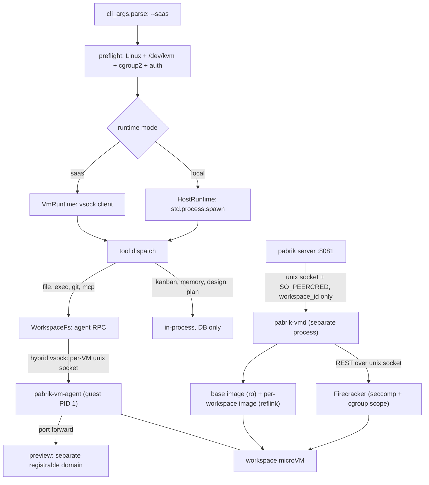

# Plan / design discussion — "every workspace is a VM": Linux-only SaaS mode (`pabrik --saas`)

- **Task**: `task_1792245573147_0` — "Workspace is a vm from microvm"
- **Worktree**: `~/.config/pabrik/.worktrees/workspace-is-a-vm-from-microvm-1792245526062`
- **Branch**: `worktree/workspace-is-a-vm-from-microvm-1792245526062` (base `main`)
- **Status**: rev 5 — **P0, P1 and all of P2 have landed in this branch** (§18–§24); P3+ is still a plan.
- **Human decision** (2026-10-17): the microVM runtime is a **Linux-only, opt-in mode** (`pabrik --saas`).
  Without the flag Pabrik behaves exactly as today; every non-SaaS feature works in both modes.

### Rev 3 — the storage decision reversed to **sealed**

The second review is right that rev 2 undermined its own default. §4.2 had already demoted "the host
must read the tree", leaving shared/virtiofs with only *operator convenience* as a benefit — while its
costs stayed concrete, and two of them are unfixable on this box:

- **Disk I/O isolation does not exist unprivileged.** Verified here: the `io` controller is present at
  the root cgroup but the delegated subtree is `cpu memory pids` only, and `user-1000.slice` has no
  `io.*` files — so `IOWeight` in rev 2's §10.2 would have been silently inert. A tenant saturating
  disk through `virtiofsd` is not preventable with the privileges we have.
- **Disk quota in shared mode is racy by construction** (`du` on a live tree), and the volume also
  holds SQLite.
- Plus: `virtiofsd` is the process resolving guest-controlled paths (a whole attack surface that
  sealed mode deletes), and native ext4 is simply faster than virtiofs for build workloads.

So: **sealed (per-workspace block image) is the default; Firecracker is the default VMM; shared /
virtiofs becomes an opt-in mode for local/ops convenience.** A lot of rev 2's machinery falls away
with that (custom kernel, virtiofsd hardening, scratch-disk workaround), which is the point.

Everything else the review raised is folded in, including five genuine holes I had missed:
**stored XSS through `/api/files/download`**, **cookies leaking to the tenant's preview server**,
**`pabrik-vmd` accepting paths over RPC**, **vsock peer authentication**, and **DNS as an exfil /
rebinding channel**. Plus the persistence and resize decisions, the "strict" leftover, and the
local-mode git hardening that is worth shipping on its own (§2.2).

---

## 1. The shape being proposed

One binary, two runtimes:

```
pabrik            → local mode   (today: tools execute on the host, arbitrary user paths)
pabrik --saas     → SaaS mode    (Linux only: one microVM per workspace, Pabrik-owned sealed images)
```

- **SaaS mode is Linux-only and refuses to start anywhere else** (or without `/dev/kvm`) with a
  precise message.
- **`--saas` implies the SaaS contract**: auth required, one tenant per workspace, Pabrik-owned
  storage, quotas, idle shutdown.
- **Local mode is not a degraded path** — it is the current product. That is why P0 is a seam, not a VM.
- The mode is process-wide in v1.

### 1.1 Mode matrix

| | local mode | `--saas` |
|---|---|---|
| tool execution | host (`shell.zig` → `bash -c`) | inside the workspace microVM |
| workspace storage | arbitrary user paths | **sealed ext4 image** per workspace (default) |
| who may touch tenant files | the host process, directly | **only the guest agent** |
| cross-project reads | any sibling dir the user names | **none in v1** (design for CoW snapshot attach, §9.4) |
| auth | `--auth` opt-in | **mandatory** |
| isolation | none | kernel-level per workspace |
| lifecycle | none | start / stop / suspend / quota per workspace |
| networking | the host's | vsock over a per-VM unix socket; preview on a **separate registrable domain** |
| disk I/O isolation | n/a | **Firecracker per-drive token bucket** (no privilege needed) |
| platforms | Linux, macOS, Windows | **Linux + KVM only** |
| kanban / design / memory / docs / skills | yes | **yes — identical code, tenant-scoped** |

---

## 2. Today: where code actually executes

One Zig process (`pabrik --port 8081`) owns the SQLite DB, the agent loop, the HTTP/SSE API,
kanban/design/memory models and every tool. Tools are in-process calls from
`src/agentic_loop/handle_tool.zig`. The execution surface is the host, **with no confinement**:

| Fact | Evidence |
|---|---|
| `command`/`bash` spawns a real process: `bash -c <string>` | `command.zig:19`, `shell.zig:600` |
| The only guards are strings: `cwd` present + absolute, `timeout` 1–600 s | `shell.zig:621-643` |
| The child inherits the server's full environment (API keys included) | no `env_map` in `shell.zig` |
| `read_file` reads **any absolute path** | `read_file.zig:352-395` |
| A path-prefix sandbox exists for exactly one tool (`present_files`) | `file_sandbox.zig:1-8`, `:147` |
| Detached jobs are host PIDs per session | `session_background_process.zig:5-26` |
| Secrets are substituted into tool arguments, scrubbed from output | `secrets_substitution.zig:1-30`, `handle_tool.zig:2357` |

`AGENTS.md` already contains a rule only isolation can enforce ("DONT KILL THE PORT 8081 SERVER") —
nothing stops `kill $(pgrep -f 'pabrik --port 8081')`, same uid and PID namespace.

### 2.1 The host already runs `git` on the project tree — seven places (RCE included)

| Call site | What a malicious repo can do |
|---|---|
| `git_state.zig:57` (host `git status` for the git chip) | `core.fsmonitor` → **arbitrary command execution** |
| `set_git_worktree.zig:167` (`git worktree add`) | tenant repo's **`post-checkout` hook** runs on the host |
| `system_folder.zig:275`, `list_directory.zig:75` (`git check-ignore`) | config parsing on a path the agent can aim anywhere |
| `git_pr_status.zig:267,341`, `git_pr_conflicts.zig:78`, `status_pull_request.zig:783` | tenant-controlled input to host processes |
| any host `git diff` / `git show` | `.gitattributes` `textconv` / `filter.*` drivers → **arbitrary command execution** |

**Rule for SaaS mode (absolute, testable): the API process never executes `git`/`gh` with a
tenant-controlled tree as its working directory or `-C` target.** Those seven call sites move to the
guest (Appendix C).

### 2.2 The same bug exists in local mode — ship that fix separately

The review is right that this is not a SaaS-only problem: opening an untrusted repo in Pabrik can run
`core.fsmonitor` on the host today. A cheap, independent hardening pass:

```
-c core.fsmonitor=false -c core.hooksPath=/dev/null -c diff.external=
-c core.pager=cat -c core.sshCommand= -c protocol.ext.allow=never
env: GIT_CONFIG_NOSYSTEM=1 GIT_TERMINAL_PROMPT=0 GIT_OPTIONAL_LOCKS=0
plus --no-textconv / --no-ext-diff on diff-shaped invocations
```

Honest limits: this **reduces** the surface, it does not eliminate it — `filter.*.clean/smudge`
drivers are named by the repo's own `.gitattributes`/config, and there is no single flag that
enumerates them. The real fix is "never run git on an untrusted tree", which local mode cannot do
(the user's own tree *is* the product). So: ship the flags, and document the residual risk.

This touches criterion 6 ("local mode is byte-identical") — it is a **deliberate, documented
exception**: identical *except* that git no longer honours repo-controlled execution hooks.

---

## 3. Acceptance criteria

1. **A workspace's shell cannot see a path outside its VM** — `cat /home/ginwa/.ssh/id_rsa`,
   `ls ~/.config/pabrik`, `rm -rf ~/pabrik` fail with `ENOENT`.
2. **A workspace cannot signal a host process** — `pkill -f pabrik` fails.
3. **A workspace cannot reach the control plane** — including through the egress proxy and the
   DNS resolver: loopback (v4, v6, **and IPv4-mapped**), `0.0.0.0`, RFC1918, CGNAT `100.64/10`
   (Tailscale), link-local, `169.254.169.254`, and the host's own listeners — denied and logged.
4. **A workspace's files survive the VM** — stop it, start it, tree byte-identical.
5. **Two tenants with the same repo path never collide**; a workspace's total disk is capped and
   filling it cannot affect the host volume holding SQLite.
6. **Local mode is byte-identical to today** — except §2.2's git hardening, which is deliberate.
7. **`--saas` off-Linux or without KVM fails fast** with a message that says what to do.
8. **The host process never opens a file inside a tenant filesystem.** Structurally: the only
   production `WorkspaceFs` implementation is the agent. If a host read is ever added, it uses
   `openat2(RESOLVE_BENEATH|RESOLVE_NO_MAGICLINKS)` on a directory fd and reads from that fd, never
   re-resolving a path (the current `files_download.zig:139-160` pattern is the counter-example).
9. **The host never runs `git`/`gh` against a tenant tree** (§2.1) — tested with a fixture repo
   carrying a `core.fsmonitor` canary.
10. **A preview cannot act as the app**: separate registrable domain (hosted) or a distinct port
    (single box) *with `Cookie`/`Authorization` stripped by the proxy*, host-only session cookies,
    and an `Origin` allowlist on every mutating route.
11. **Tenant-controlled files are never rendered on the app origin** — `text/html` and `image/svg+xml`
    are served as `Content-Disposition: attachment` + `X-Content-Type-Options: nosniff`; inline types
    are an explicit allowlist.
12. **A guest cannot exhaust the host**: RAM/vCPU/PIDs via cgroup v2, **disk I/O via the VMM's own
    rate limiter**, disk size via the image, output volume via the protocol budget.
13. **Host-side parsers treat guest output as hostile**: size caps, no exec, fuzzed (§14).
14. **The vsock channel is peer-authenticated** — per-VM unix socket (hybrid vsock), plus a CID check
    where a CID is used.

---

## 4. Constraints

### 4.1 Absolute paths are load-bearing — and in SaaS mode we choose them

`sessions.cwd`, `git_worktree_cwd`, kanban `cwd`, `workspace_items.path` all speak absolute paths. In
SaaS mode Pabrik owns the storage, so it mounts the workspace at a stable path inside the guest
(`/workspace`), and the DB stores the *logical* path plus the workspace id — not a host path. In
local mode nothing changes.

### 4.2 "The host must read the tree" — resolved, and now moot

Rev 1 turned a serving requirement into an architectural one, which forced virtiofs, a custom kernel
and a VMM choice. Serving is now an agent RPC. With sealed mode there is no host-side tree at all, so
the constraint disappears entirely; it survives only in the optional `shared` mode (§9.4).

### 4.3 Firecracker has no shared filesystem — verified, and now irrelevant

`firecracker_spec-v1.17.0.yaml` exposes `actions, balloon(+hinting), boot-source, cpu-config, drives,
pmem, logger, machine-config, metrics, mmds, entropy, serial, hotplug/memory, network-interfaces,
snapshot/{create,load}, version, vm, vm/config, vsock` — **no virtiofs, no 9p, no vhost-user**.
In sealed mode that is not a limitation; the workspace is a block device, which is exactly what
Firecracker is best at.

Two consequences worth stating: **Firecracker block devices are raw only** (no qcow2), and there is no
live disk resize.

### 4.4 The stock Firecracker kernel is now an advantage, not a problem

`strings` over `vmlinux-6.18.51`: `ext4` 40, `virtio_blk` 11, `virtio_pci` 11, `fuse` 14,
`overlay` 37, `squashfs` 5, `nfs` 58, `vsock` 7 — and `virtiofs` 0, `9pnet_virtio` 0.

Sealed mode needs ext4 + virtio-blk + vsock, all present. So the rev 2 "build and ship our own
kernel" item shrinks to **"pin the CI kernel by hash, and ship our own rootfs"** — with a custom
kernel as a later size/speed optimization, not a prerequisite.

### 4.5 No privilege on this box — and what that costs

`sudo -n true` → password required. `/dev/kvm` and `/dev/vhost-vsock` are `crw-rw-rw-`.
cgroup v2: root controllers include `io`, but the delegated subtree is **`cpu memory pids`** and
`user-1000.slice` exposes no `io.*` — so **no unprivileged disk I/O throttling via cgroups**. That is
why §10.2 uses the VMM's rate limiter instead: `firecracker_spec` defines `rate_limiter` token buckets
(`bandwidth`, `ops`) on drives and network interfaces. Verified in the local spec; needs no privilege.

---

## 5. Threat model

**Adversary**: code the agent runs in the guest — a tenant repository, a dependency's `postinstall`, a
prompt injection that talks the model into a destructive command, or the tenant themselves.

**Assets**: host filesystem, `pabrik.db` + secrets, other tenants, the control plane on `:8081`, host
availability, and the VMM manager's authority.

| # | Vector | Mitigation | Criterion |
|---|---|---|---|
| T1 | symlink/`..`/TOCTOU escape from a mounted tree into a host read | **no host-side tenant filesystem access at all** (sealed) | 8 |
| T2 | tenant `.git/config`/hooks/`textconv` executed by host `git` | git only in the guest; §2.2 flags for local mode | 9 |
| T3 | guest reaches `localhost:8081` via egress proxy or DNS | deny list + resolve-then-connect + same policy on the resolver | 3 |
| T4 | tenant dev server calls the API with the user's cookies | separate registrable domain, **proxy strips `Cookie`/`Authorization`**, host-only cookies, `Origin` allowlist | 10 |
| T5 | **stored XSS**: an uploaded `.html`/`.svg` served by the host on the app origin | `attachment` + `nosniff` + inline allowlist; never render tenant HTML on the app origin | 11 |
| T6 | resource exhaustion (RAM, vCPU, PIDs, disk, disk I/O, stdout) | cgroup v2 for cpu/memory/pids; **VMM rate limiter for I/O**; image size for disk; protocol budget + flow control for output | 12 |
| T7 | malformed frames / malformed diffs, listings, index batches (guest→host parsers) | length-capped codec, fuzzed decode paths, size caps on every parser | 13 |
| T8 | another guest connects to the host's vsock listener | **hybrid vsock** (per-VM unix socket, `uds_path`, verified in the FC spec) + CID check | 14 |
| T9 | `pabrik-vmd` RPC abused to configure an arbitrary VM | vmd **derives every path from `workspace_id` by rule**, never accepts a path or a mount plan; `SO_PEERCRED` uid check | — |
| T10 | in-guest root replaces/kills the agent, or lies over RPC | commands run as a **non-root uid with `no_new_privs`**, rootfs read-only | — |
| T11 | golden image supply chain | pinned kernel hash, content-addressed rootfs, `image_version` per VM, read-only image dir | — |
| T12 | prompt injection inside the tenant's own workspace | **not mitigated by the VM** — state it in the product docs | — |

---

## 6. What a VM buys, and what it does not

**Buys:** no path from the guest to `~`, `pabrik.db`, `~/.ssh`, other tenants, or the control plane;
`pkill -f pabrik` fails; disk is a hard cap; disk I/O is rate-limited without privilege; and there is
no `virtiofsd` in the path to resolve hostile paths.

**Does not buy:** secret hygiene *inside* the guest (the agent is root there, §12); protection from
model judgement inside the workspace; a patched host kernel (KVM is still a shared surface);
docker/GPU/nested virt; macOS/Windows; and it does not make a malicious repo's *content* safe to parse.

---

## 7. Stack comparison — re-scored after the storage reversal

| | **Firecracker 1.17** | Cloud Hypervisor | QEMU `-M microvm` | libkrun | (ref) bubblewrap |
|---|---|---|---|---|---|
| sealed block root | ✅ raw only | ✅ raw/qcow2 | ✅ | ✅ | n/a |
| per-drive I/O rate limit, no privilege | ✅ (token buckets, verified in spec) | ✅ | ⚠️ blkio cgroup = needs delegation | ⚠️ | ❌ |
| vsock | ✅ **hybrid UDS per VM (verified)** | ✅ (vhost-user) | ✅ | ✅ | n/a |
| snapshot/restore | ✅ (same-disk resume) | ✅ | ✅ | ❌ | n/a |
| shared dir (virtiofs) | ❌ | ✅ | ✅ | ✅ | n/a |
| boot / overhead | <125 ms / ~5 MB | ~150–300 ms | larger | small | 0 |
| packaging here | **`extra/firecracker` ✅** | ❌ not in repos | ✅ qemu 11.1.1 | ❌ source | ✅ |
| maturity | ★★★★★ | ★★★★☆ | ★★★★★ | ★★★☆☆ | ★★★★★ |

### 7.1 Recommendation

- **Default: Firecracker, sealed.** In the Arch repos, raw block + hybrid vsock + per-drive rate
  limiters + snapshots, no virtiofsd, no second binary to package, no custom kernel for v1.
- **QEMU `-M microvm` for CI/dev** — installed, rootless, no KVM exposure needed for the test suite.
- **Cloud Hypervisor only if `shared` mode is ever wanted** (it is the only path to virtiofs here).
- **bubblewrap stays a seam validator**, never a SaaS backend: shared-kernel isolation is not
  SaaS-grade, and `--saas` keeps refusing to start without KVM.

This reverses rev 2's choice, and the reason is simple: rev 2 chose the VMM to fit a storage mode that
turned out to be the wrong default.

---

## 8. Architecture

### 8.1 Components



1. **`pabrik-vmd` — a separate process from P2.** A bug in the web-facing server must not be able to
   configure VMs, and a server restart must not kill tenants' dev servers (this repo restarts
   constantly). **The RPC never carries a path or a mount plan**: the server sends a `workspace_id`
   and an action; vmd derives image path, drive config, socket path and cgroup scope from the id by
   rule, and authenticates the caller with `SO_PEERCRED` (uid + pid of the peer).
   Note on `jailer`: it needs root (it chroots and drops uid), so a **rootless** deployment
   relies on Firecracker's built-in seccomp filters plus the cgroup scope, and a root deployment
   (typical for a SaaS host) adds the jailer on top. Do not claim jailer-level isolation for the
   unprivileged case.
2. **`pabrik-vm-agent` — guest PID 1 (root).** Static Zig (`-target x86_64-linux-musl`): mounts the
   data drive, sets the resolver/proxy config, listens on vsock, forks/execs **as uid 1000** with
   `PR_SET_NO_NEW_PRIVS` and a `noexec`-free but `nosuid`/`nodev` mount set, streams output under a
   byte budget, tracks pids, runs `git`, serves file reads, forwards ports, reaps zombies, powers off.
3. **`WorkspaceFs` / `VmClient`** — length-prefixed JSON frames (`hello`, `exec.*`, `fs.*`,
   `port.forward`, `health`, `shutdown`), version negotiated in `hello`, 4 MiB frame cap enforced
   before allocation, per-stream flow control. Transport: **hybrid vsock** — Firecracker's `uds_path`
   (host dials the VM's own socket; a guest cannot reach another VM's channel, and socket permissions
   are filesystem permissions). Where a numeric CID is used (QEMU), verify the peer CID.

### 8.2 The seam

```zig
pub const WorkspaceRuntime = struct {
    vtable: *const VTable,
    pub const VTable = struct {
        ensureReady: *const fn (ctx: *anyopaque) Err!void,
        exec: *const fn (ctx: *anyopaque, req: ExecRequest) Err!ExecResult,
        spawnDetached: *const fn (ctx: *anyopaque, req: DetachedRequest) Err!Handle,
        readFile: *const fn (ctx: *anyopaque, req: ReadRequest) Err!ReadResult,
        writeFile: *const fn (ctx: *anyopaque, req: WriteRequest) Err!void,
        // glob, search, list, remove, git: same shape
    };
};
```

`HostRuntime` wraps today's `shell.zig` unchanged. `VmRuntime` speaks vsock. `FakeRuntime` executes
locally against a temp dir and is what unit tests use (§14).

### 8.3 Tool matrix (SaaS mode)

| Tool family | Where | Why |
|---|---|---|
| `command` / `bash` / `pwsh` | **guest** (uid 1000) | the risk surface |
| all file tools (`read_file`, `write_file`, `text_replace`, `glob`, `list_directory`, `search`, `remove_file`, `present_files` source, `diff`) | **guest** | one writer; no host path; guest-native scans |
| git/gh/forge (`set_git_worktree`, `pr_cli`, `status_pull_request`, `git_state`, ignore checks) | **guest** | §2.1 |
| MCP stdio servers | **guest** | spawn binaries, need project deps |
| semantic indexing | content from guest, embeddings on host | keys stay host-side |
| kanban, memory, skills, documents, plan, design | in-process | pure DB, tenant-scoped |
| secrets resolution, LLM, web_search | host | §12 |

**V1 — the guest is the only writer.** **V2 — no control plane in the guest.** Two invariants, and
with sealed storage both are true rather than aspirational.

---

## 9. Storage

### 9.1 sealed (default)

```
/var/lib/pabrik/images/<image_version>/base.ext4      read-only, content-addressed, shared
/var/lib/pabrik/workspaces/<id>/disk.ext4             per workspace, reflinked from base
/var/lib/pabrik/workspaces/<id>/home/                 rw, mounted at $HOME inside the guest
```

- **Image creation is O(1) on this box**: `/` and `/home` are **btrfs**, and
  `cp --reflink=always` succeeds (verified), so a new workspace image is a copy-on-write clone of the
  base with shared extents, not a 1 GB copy. On a non-reflink filesystem it degrades to a real copy —
  which is why the data dir should be btrfs/XFS and the image dir should carry `chattr +C`
  (`nodatacow`) to avoid CoW fragmentation of block images.
- **Building and inspecting images needs no root**: `mkfs.ext4 -d`, `debugfs`, `resize2fs`, `e2fsck`
  all work on a file (verified present here). No loop mounts, no sudo.
- **Disk quota is structural**: a workspace's disk is its image size. Filling it cannot touch the
  volume holding SQLite beyond the declared cap. Growing = **offline** (`truncate` + `resize2fs`, then
  start), because Firecracker has no live disk resize.
- **Export/backup**: copy the image file (the host never interprets it — it is a block file), or have
  **the guest** stream a `tar` if a file-level export is wanted. Never `tar`/`rsync` a live
  guest-controlled *tree* on the host (symlinks, hardlinks, device files, races) — that was a rev 2 bug.
- **Offline read of a stopped workspace is gone.** The UI must say "workspace stopped — start to
  browse", and file-level export runs through the guest.

### 9.2 What persists, and what doesn't (the review's missing decision)

Recommended: **immutable OS, persistent workspace.**

| layer | lifetime | rationale |
|---|---|---|
| base image (`base.ext4`, read-only drive) | shared, versioned | reproducible toolchain; a bad image is one version bump |

| workspace image (`/workspace`, rw) | persistent per workspace | the tenant's code, `node_modules`, build outputs |
| `$HOME` (rw, inside the workspace image) | persistent per workspace | `npm i -g --prefix ~/.npm-global`, `pip --user`, `cargo install` survive |
| OS packages (`apt install`) | **do not persist** — rootfs is read-only, commands are uid 1000, no sudo | no drift, no snowflake VMs |

The alternative — a writable OS layer per workspace — is available (`reset` = re-reflink from base),
but it creates per-tenant snowflake images, doubles disk per workspace, and makes support impossible.
Say it in the docs; offer "install tools into `$HOME`" as the supported path, and ship a fat base
image (node, python, rust, zig, go, ripgrep, git, gh, build toolchain).

### 9.3 Build caches

Native ext4 means `npm install` / `cargo build` / `zig build` run at local speed — **the rev 2 scratch
disk disappears**. The trade: caches live inside the workspace image, so they count against the
workspace quota, and they are not visible to the host (fine — they are caches).

### 9.4 shared (opt-in) and cross-workspace context

- **`shared` mode** (virtiofs/virtiofsd) is kept for local/ops convenience and for development of the
  product itself. It is **not** the SaaS default, because it cannot meet criteria 5/12 on an
  unprivileged host (§4.5) and it keeps `virtiofsd` in the path (T7 of rev 2).
- **Cross-workspace reads are dropped in v1.** The designed path is a **read-only CoW reflink snapshot
  of the sibling's image**, attached as a second read-only drive — safe because the clone is
  point-in-time and the source is not mounted twice. Taking it requires the sibling to be quiesced
  (guest-side `fsfreeze` → reflink → thaw); that is a later phase, not v1. The alternative (RPC to the
  sibling's agent) forces the sibling VM to be running, which contradicts idle shutdown.

---

## 10. Lifecycle, resources, output

### 10.1 States

`absent → provisioning → starting → ready → busy → idle → suspended|stopping → stopped → absent`,
with `failed(last_error)` and backoff. `ready` = the agent answered `hello`. One VM per workspace;
`busy` is a counter; `pabrik-vmd`'s reconciler is the only writer of state.

### 10.2 Resource limits

| resource | mechanism | note |
|---|---|---|
| RAM | cgroup v2 `MemoryMax` on the VMM scope + guest `mem_size_mib` | `systemd-run --user --scope -p MemoryMax=…` works here (verified) |
| vCPU | `CPUQuota` + `vcpu_count` | |
| PIDs | `TasksMax` | |
| **disk I/O** | **Firecracker `rate_limiter`** (bytes/s + ops/s token buckets) per drive | cgroups cannot: `io` is not delegated (§4.5) |
| disk size | image size (structural) | grow offline |
| output volume | protocol byte budget + flow control (§10.4) | |

Each `virtiofsd` (shared mode only) also gets its own scope.

### 10.3 Boot, suspend, snapshots

| stage | target |
|---|---|
| VMM spawn + configure | < 50 ms |
| kernel → agent `hello` (stock kernel, our rootfs, no systemd) | < 800 ms |
| first `command` | **< 1.2 s** |

- **Suspend/resume of the same workspace is viable**: Firecracker snapshots capture memory+devices and
  the workspace image is unchanged while suspended, so resume is consistent. The host-side vsock
  socket is recreated on resume and the agent re-listens.
- **No shared template warm pool**: a template VM cannot be restored for a *different* workspace,
  because the disk differs (and a shared-disk pool is exactly the inconsistency risk). Cold boot under
  1.2 s is the answer for v1.

### 10.4 Output must be bounded on the host

Per-exec byte budget (reusing `max_output`/`max_lines` semantics), flow-control window (the host
pauses reads instead of buffering), a truncation marker, and a hard cut when the budget is exceeded.
A guest that floods stdout loses its output, never the host's memory. The decoder is fuzzed (criterion 14).

### 10.5 Process accounting

`session_background_process` gains `vm_id` + `guest_pid`; the `process` tool resolves through the
agent. Stopping a VM kills its jobs — correctly, and visibly ("VM stopped — job ended").

### 10.6 Resize and restart semantics

- RAM/vCPU: **restart required**, only when the workspace is idle; running jobs are drained, and the
  UI says so. No silent kill.
- Disk: **grow only**, offline (stop → `truncate` + `resize2fs` → start). Shrinking is not supported.

---

## 11. Networking

```
guest process → in-guest forwarder → hybrid vsock (per-VM UDS) → host proxy → real socket
```

### 11.1 Egress deny list (and the resolver)

Refuse, before connect: loopback `127/8` + `::1` **+ `::ffff:127.0.0.1` (IPv4-mapped)**,
`0.0.0.0`/`::`, RFC1918 (`10/8`, `172.16/12`, `192.168/16`), **CGNAT `100.64/10` (Tailscale)**,
link-local (`169.254/16`, `fe80::/10`), the metadata IP `169.254.169.254`, multicast/broadcast, and
**every address the host's own listeners bind** (`:8081`). Resolve-then-connect (the IP that was
checked is the IP that is dialled), then a per-tenant allowlist and an audit log.

**The in-guest DNS resolver is a channel too** — it forwards over vsock, so it gets the same policy:
no query for a denied address, no arbitrary port, and a response-size cap. Otherwise it is a
rebinding and exfiltration path around the proxy.

### 11.2 Preview origin, and the cookie leak the review caught

Rev 2 offered "a distinct port per preview" as origin isolation. Two things were wrong:

1. **Cookies are not port-scoped.** `127.0.0.1:3000` still receives the app's cookies for
   `127.0.0.1`; the tenant's dev server would see the user's session cookie on every proxied request.
2. **Ports do not change the site.** `SameSite=Lax` still sends the cookie, because same-site is
   eTLD+1, not origin.

So:

- **The proxy strips `Cookie`, `Authorization`, `Proxy-Authorization` and hop-by-hop headers** before
  forwarding to the guest. This is mandatory in every deployment, not just hosted.
- **Hosted: a separate registrable domain** (`ws-<id>.preview.example.net`, wildcard DNS + cert), not a
  subdomain of the app domain.
- **Session cookies**: host-only (`Domain` unset), `Secure`, `HttpOnly`, `__Host-` prefix where possible.
- **Mutating API routes reject a foreign `Origin`**, plus a CSRF token — because same-site ≠ same-origin.
- **CSP on preview responses** (`frame-ancestors`, `connect-src`), so a tenant page can't frame the UI.

### 11.3 Serving tenant files (the stored-XSS hole)

`/api/files/download` serves tenant-controlled bytes from the app origin. An uploaded `.html` or `.svg`
would run as the app. Fix:

- `Content-Disposition: attachment` **by default**, and `X-Content-Type-Options: nosniff` on everything.
- Inline rendering only for an explicit allowlist (raster images, pdf, video/audio) — `text/html` and
  `image/svg+xml` are **never** inline, and SVG is treated as an active document.
- `present_files` keeps its sandboxed iframe (it already has one), but the download path is the hole
  that iframe does not cover.
- Optional hardening: serve file bytes from the preview origin instead of the app origin.

### 11.4 Known limits (documented)

Raw sockets (`ping`, mDNS) do not work; UDP is not proxied; `git+ssh` unsupported in v1 (HTTPS remotes
with `insteadOf`); a privileged tap-based mode is opt-in via a separate `CAP_NET_ADMIN` helper and is
out of scope for v1.

---

## 12. Secrets

Substitution currently puts a value into tool-argument strings; a VM breaks that in two directions:
the value lands in `/proc/<pid>/cmdline` (readable by the agent, root in the guest), and mounting the
config dir would hand over the store (V2 forbids it — one `read_file` on `pabrik.db` would otherwise
exfiltrate everything).

- **R1 — no substitution into guest commands by default.** Credentialed steps run on the host
  (LLM, web_search, forge API). A guest command referencing a secret is refused with an explanation.
- **R2 — explicit per-command grants** (`secrets: ["GH"]`): injected into the guest agent's per-exec
  environment (never the command line), scrubbed from the stream, logged.
- **R3 — no long-lived guest credentials.** No SSH keys in the image, no `~/.netrc`, no cloud tokens.
- **R4 — guest root is not a boundary.** The boundary is *what the VM was given*.
- **R5 — the placeholder token is substituted by a pass over tool arguments**, so a doc, prompt or
  fixture that quotes it verbatim can trip substitution and fail the call. Build it from parts (§14).

---

## 13. Data model

```sql
-- migration next-free (112 is the current head)
CREATE TABLE workspace_vms (
  workspace_id   TEXT PRIMARY KEY REFERENCES workspaces(id),
  vm_id          TEXT NOT NULL,
  state          TEXT NOT NULL,      -- absent|starting|ready|idle|suspended|stopped|failed
  backend        TEXT NOT NULL,      -- firecracker|qemu|cloud-hypervisor
  storage        TEXT NOT NULL,      -- sealed|shared
  api_socket     TEXT NOT NULL,      -- VMM REST unix socket
  vsock_socket   TEXT NOT NULL,      -- hybrid vsock uds_path (per VM)
  pid            INTEGER,
  scope_unit     TEXT NOT NULL,      -- systemd --user scope (cgroup limits)
  image_version  TEXT NOT NULL,
  disk_path      TEXT NOT NULL,      -- workspaces/<id>/disk.ext4
  disk_mb        INTEGER NOT NULL,   -- the quota
  mem_mb         INTEGER NOT NULL,
  vcpus          INTEGER NOT NULL,
  cmd_uid        INTEGER NOT NULL DEFAULT 1000,
  created_at     INTEGER NOT NULL,
  last_used_at   INTEGER NOT NULL,
  last_error     TEXT
);

ALTER TABLE session_background_process ADD COLUMN vm_id TEXT;
ALTER TABLE session_background_process ADD COLUMN guest_pid INTEGER;

CREATE TABLE server_settings (key TEXT PRIMARY KEY, value TEXT NOT NULL);  -- runtime=saas
```

No `workspaces.runtime` column: the mode is process-wide, so the row is identical in both modes.

---

## 14. Test strategy (behavior-first, deterministic, KVM-free by default)

**L1 — pure logic.** Frame codec (every type, unknown type, oversized/truncated, version mismatch) plus
a **fuzz pass**; mount/drive-plan builder from `workspace_id` only (assert no path ever crosses the
RPC — criterion 9); reconciler transitions with an injected clock; output-budget accounting; egress
classifier as a table-driven test including `::ffff:127.0.0.1`, `0.0.0.0`, `100.64.0.1`,
`169.254.169.254`, and a literal `:8081` probe; **header-stripping test** for the preview proxy
(`Cookie`/`Authorization` never reach the guest); **download response test**
(`text/html` → `attachment` + `nosniff`).

**L2 — tool behavior through `FakeRuntime`.** Every existing `command` test keeps passing (criterion
6), plus: a `cwd` outside the workspace is refused before any spawn; file tools route to the runtime
(assert on resulting content, never "called with"); a secret placeholder in a guest command yields the
actionable refusal; a fixture repo with a `core.fsmonitor` canary proves no host git runs; a fuzz-ish
batch of malformed guest diffs/listings is rejected by size caps, not by crashing.

**L3 — real VM smoke (opt-in, `PABRIK_VM_TEST=1` + `/dev/kvm`).** QEMU `-M microvm` rootless: `hello`,
`echo`, guest-written file visible in the image, dev-server port through the preview origin,
preview-origin isolation probe, egress probe to `127.0.0.1:8081` fails, stopped VM ends its jobs,
suspend/resume keeps the tree.

Anti-goals: `sleep 2; assert`, "wait for the SSH banner", existence/arity assertions instead of behavior.

---

## 15. Phases

| Phase | Deliverable | Exit criterion |
|---|---|---|
| **P0 — seam + flag** | `--saas` flag + preflight, then the `WorkspaceRuntime`/`WorkspaceFs` seam with `HostRuntime`/`FakeRuntime` (**flag + preflight done, seam still open**) | `--saas` refuses correctly off-Linux/no-KVM; local mode byte-identical (modulo §2.2); tests green |
| **P0.5 — tenancy gate** | answers to §16 Q1–Q3; quota model; an admin bootstrap built on the existing `pabrik create-admin` subcommand | no later phase depends on an unresolved tenant question |
| **P1 — image + benchmark** | rootfs build (reflink/unprivileged `mkfs.ext4 -d`), pinned kernel hash, `pabrik-vm-agent`, **sealed-vs-shared benchmark as the control arm** | rootless `qemu -M microvm` runs `echo`; benchmark table exists (boot, `git status`, `npm install`, 500 MB read, image clone time) — and the design survives it |
| **P2 — vmd + exec** | `pabrik-vmd` as a **separate process** (workspace_id-only RPC, `SO_PEERCRED`); `VmRuntime` + hybrid vsock; non-root command uid; cgroup scopes; `vm_id`/`guest_pid` | commands run in the VM; host `ps` shows no agent shell; restarting `pabrik` leaves VMs alive; a forged RPC without the right uid is rejected |
| **P3 — files, git, serving** | all file tools + git through the agent; download hardening (attachment/nosniff); folder/diff/index content from the guest with size caps | criteria 8, 9, 11 pass; no host `git` on a tenant tree |
| **P4 — network** | port forward, preview on a separate domain, header stripping, `Origin` allowlist, egress + DNS deny lists | criteria 3, 10 pass |
| **P5 — secrets + quotas + audit** | R1–R5, per-tenant egress allowlist, disk quota growth path, resize semantics | criteria 5, 12 pass |
| **P6 — security gate** | threat-model walkthrough (§5) + pre-launch review against criteria 8–14 | no open high-severity finding |
| **later** | suspend/resume, cross-workspace CoW snapshots, `shared` mode, remote `--vm-host`, local `--vm` | — |
| **independent** | **§2.2 local-mode git hardening** — its own small PR, shippable before any of the above | canary test proves `core.fsmonitor`/`post-checkout` no longer execute on the host |

---

## 16. Open questions

1. **Tenancy**: user, organization, or "whoever owns the workspace"? Quotas, mount plans and audit logs
   all depend on it — before P2.
2. **First admin**: `pabrik create-admin --email E --password P` already exists (`src/boot/cli_dispatch.zig:133`) and provisions a default workspace, so this may need no new code — only a decision about who may run it in SaaS mode.
   migration 77, `workspace_members` since 100).
3. **Quota and scale**: this box (14 GB, ~5 GB free) honestly supports ~6–8 live VMs at 512 MB —
   one box or a scheduler over boxes?
4. **Persistence**: confirm "immutable OS + persistent workspace image" (§9.2), with `apt install`
   explicitly not supported. Or pay for per-workspace OS layers.
5. **Cross-workspace context**: confirm it is dropped in v1, and that the CoW-snapshot attach
   (§9.4) is the planned later path.
6. **`shared` mode at all?** If it is dropped, Cloud Hypervisor and virtiofsd leave the design
   entirely and the VMM story is one binary from the distro repos.
7. **Import/push**: clone in the guest by URL, upload, or both? Is `git push` to the tenant's forge
   allowed? (This is the credential story, R2/R3.)
8. **Remote VM hosts**: should vmd's RPC be network-reachable from day one (`--vm-host`)?

---

## 17. What I would decide now

1. **Sealed storage + Firecracker as the default.** It is the only combination that satisfies disk
   isolation (rate limiter), disk quota (image), and attack-surface reduction without privilege — and
   it is one binary from the Arch repos.
2. **`shared`/virtiofs demoted to opt-in.** If nobody needs it, Cloud Hypervisor and `virtiofsd` leave
   the design entirely.
3. **P0 seam first, §2.2 git hardening as a separate PR now.**
4. **`pabrik-vmd` separate from P2, workspace_id-only RPC, `SO_PEERCRED`, hybrid vsock.**
5. **Immutable OS + persistent workspace image**, `apt install` unsupported by design, fat base image.
6. **Preview: separate registrable domain when hosted, header stripping always, `Origin` allowlist on
   mutation, tenant files never inline on the app origin.**
7. **Say "no" in the docs**: no docker/GPU/nested-virt, no macOS/Windows VM, no `git+ssh`, no live disk
   resize, no cross-workspace mounts in v1, bubblewrap is not the SaaS answer.

---

## Appendix A — verified on this box (2026-10-17)

```
OS       Arch Linux, kernel 7.2.7-arch1-1, x86_64, AMD SVM
storage  / and /home on btrfs; `cp --reflink=always` succeeds → O(1) image clones
KVM      /dev/kvm          crw-rw-rw-  (unprivileged OK)
vsock    /dev/vhost-vsock  crw-rw-rw-  (VSOCKETS=m, VIRTIO_VSOCKETS=m)
cgroup   cgroup2fs; root controllers include io, but delegated subtree is "cpu memory pids" and
         user-1000.slice has no io.* files → NO unprivileged I/O throttling via cgroups
         `systemd-run --user --scope -p MemoryMax=64M -- /bin/true` → exit 0
sudo     password required (no passwordless)
VMMs     qemu 11.1.1 (virtio-9p + vhost-user-fs present)
         firecracker v1.17.0 binary in ~/firecracker-demo (booted here 2026-10-13 → 2026-10-14)
         extra/firecracker 1.17.0 in the Arch repos; cloud-hypervisor NOT installed/repo
firecracker spec: rate_limiter (bandwidth + ops token buckets) on drives and net;
         vsock is hybrid: uds_path (host dials `CONNECT <port>`), uds_path_<PORT> for guest-initiated
image tools (unprivileged, no loops): mkfs.ext4, debugfs, resize2fs, e2fsck
virtiofsd 1.14.0 at /usr/lib/virtiofsd (not on PATH): --sandbox namespace|chroot|none,
         --uid-map/--gid-map, --translate-uid/--translate-gid (squash-guest), --xattr, --posix-acl
guest kernel vmlinux-6.18.51: ext4/virtio_blk/virtio_pci/fuse/overlay/squashfs/nfs/vsock;
         NO virtiofs, NO 9pnet_virtio
```

## Appendix B — Firecracker 1.17 API surface (local spec)

`/actions /balloon /balloon/statistics /balloon/hinting/{start,status,stop} /boot-source /cpu-config
/drives/{id} /pmem/{id} /logger /machine-config /metrics /mmds /mmds/config /entropy /serial
/hotplug/memory /network-interfaces/{id} /snapshot/create /snapshot/load /version /vm /vm/config /vsock`

## Appendix C — host `git` call sites that must move into the guest (SaaS mode)

```
git_state.zig:57             git <status/diff …>            ← core.fsmonitor = RCE
set_git_worktree.zig:167     git worktree add …             ← post-checkout hook = RCE
system_folder.zig:275        git -C <dir> check-ignore -- …
list_directory.zig:75        git -C <dir> check-ignore <name>
git_pr_status.zig:267,341    git rev-parse --git-dir | remote get-url origin
git_pr_conflicts.zig:78      git -C <path> …
status_pull_request.zig:783  git remote get-url origin
(+ any host `git diff`/`git show`: .gitattributes textconv / filter drivers)
```

---

## 18. Implementation status (this branch)

Landed in `worktree/workspace-is-a-vm-from-microvm-1792245526062`:

| item | where | proof |
|---|---|---|
| `--saas` flag, usage line, parse test | `src/cli_args.zig` | 67/67 file tests pass |
| mode decision + refusal messages with an injected probe | `src/runtime_mode.zig` (new) | 6/6 tests pass |
| preflight wired before TLS/config/DB; refusal exits 2 | `src/boot/server_boot.zig`, `src/main.zig` | `pabrik --saas` prints the refusal and exits `2`; `pabrik --port 8099` booted and logged `runtime mode: local` |
| git hardening prefix (`-c` policy: fsmonitor, hooksPath, diff.external, pager, sshCommand, protocol.ext) | `src/helpers/git_hardening.zig` (new) | 3/3 tests pass |
| wired into `git status` (fsmonitor), `git worktree add` (post-checkout) and both `check-ignore` sites | `git_state.zig`, `set_git_worktree.zig`, `system_folder.zig`, `list_directory.zig` | `zig build test:shard:0` compiles the whole tower; the two argv tests were rewritten and pass |

Still open from P0, deliberately: the `WorkspaceRuntime`/`WorkspaceFs` seam (`HostRuntime` +
`FakeRuntime` + routing the tool layer through it) and `server_settings.runtime` — that table has no
consumer until `pabrik-vmd` exists, and a table nobody writes is not worth a migration.

Three of §2.1's seven call sites are **not** yet hardened: `git_pr_status.zig:267,341`,
`git_pr_conflicts.zig:78`, `status_pull_request.zig:783`. They run `rev-parse`/`remote get-url`,
which spawn no hooks and no filters, so they are the lowest-risk remainder — but the rule is "git
never runs on an untrusted tree", so they are listed as open rather than settled.

The environment-variable half of the hardening (`GIT_CONFIG_NOSYSTEM`,
`GIT_TERMINAL_PROMPT`, `GIT_OPTIONAL_LOCKS`) is **not** wired: `helpers/run_captured.run` has no
`env_map` parameter, so it needs a signature change across its call sites. The `-c` layer is the
load-bearing one (command-line config outranks every config file), so the env layer is a follow-up,
not a gap in the current policy.

---

## 19. P1 status (step 1 landed)

`scripts/vm-guest-smoke.sh` boots a guest image on Firecracker **without root and without a NIC**
(vsock + block + serial only) and completes a framed `hello` round-trip. `scripts/vm-vsock-hello.py`
is the host-side client.

| item | how | result |
|---|---|---|
| guest agent | `src/vm_agent/main.zig`, static `x86_64-linux-musl` | **4912 bytes**, PID 1, raw syscalls only |
| image | `truncate` + `mkfs.ext4 -d` + `e2fsck -fn` | 32 MiB ext4, clean, **no root, no loop mount** |
| boot | `firecracker --api-sock … --enable-pci`, no tap, no iptables | kernel reached `/init` at **0.725 s** (guest clock); agent listening within ~50 ms |
| transport | hybrid vsock: host connects to `uds_path`, sends `CONNECT 5000\n` | `{"type":"hello","agent":"pabrik-vm-agent","version":"0.1"}` |
| shutdown | `{"type":"shutdown"}` → `{"type":"bye"}` + guest log ack | asserted in the smoke run |

Four findings that change P2:

1. **Hybrid vsock has a text handshake.** The host must read one `OK <port>\n` line after `CONNECT`
   before any frame arrives; a client that reads a frame first sees the handshake bytes as a length
   prefix (this cost a debugging cycle). The muxer's `ERR` form must be handled too.
2. **The guest cannot make Firecracker exit.** `reboot(LINUX_REBOOT_CMD_POWER_OFF)` logs
   *"Power off not available: System halted instead"* on the CI kernel — no ACPI power path. So the
   `shutdown` frame is only an acknowledgement; **stopping the VM is `pabrik-vmd`'s job** (P2), and
   the smoke test asserts the ack plus stops the VM from the host instead of waiting for an exit.
3. **`devtmpfs` is missing from the stock CI kernel.** `proc` and `sysfs` mount; `devtmpfs` does not,
   so the guest has no `/dev` — which P2 needs for PTYs. Either build our own guest kernel with
   `CONFIG_DEVTMPFS` + `CONFIG_DEVPTS` (rev 1 planned this; rev 3 deferred it, which this partially
   reverses) or have the agent `mknod` its own nodes as root-in-guest. Decide in P2.
4. **Firecracker warns `Cannot acknowledge unknown features page: 2/3`** on every boot with this
   kernel — cosmetic noise, not a failure, but it should not be mistaken for one in a CI log.

Reproduce: `FC_BIN=<firecracker> scripts/vm-guest-smoke.sh`.

---

## 20. P1 status (step 2 landed) — exec over the protocol

`scripts/vm-guest-smoke.sh` now drives the whole protocol and asserts ten behaviours from the host
side (`scripts/vm-guest-probe.py` is the client):

| assertion | result |
|---|---|
| muxer handshake, `hello` frame | ok |
| `exec` stdout round-trip (`/bin/probe echo …`) | ok |
| exit code 0 / non-zero exit code 7 + stderr | ok |
| **commands run as `uid=1000`** (non-root, `no_new_privs`) | ok |
| a guest-written file survives in the sealed image | ok, read offline as `persisted` |
| `timeout_ms: 500` on a 30 s sleep → `exec.timeout` + killed | ok |
| `max_output_bytes: 64` on a 4 KiB flood → `truncated`, 64 bytes kept | ok |
| `shutdown` ack | ok |

Implementation: `src/vm_agent/main.zig` (fork + two pipes + `poll` loop, `setgid`/`setuid`
1000, `PR_SET_NO_NEW_PRIVS`, per-exec output budget, `SIGKILL` on deadline,
`{"exec.stdout","exec.stderr","exec.exit","exec.timeout"}` frames, base64 payloads), plus
`src/vm_agent/probe.zig` — a 9 KB static multicall fixture (`echo`, `id`, `env`, `write`, `read`,
`sleep`, `fail`) so the protocol has something to exec before the image has a userland.

Five findings:

1. **exec as uid 1000 with `no_new_privs` works in this minimal guest** — `id` reports
   `uid=1000 gid=1000`, so the "agent is PID 1 root, workloads are not" split from §8.1 is real,
   not aspirational.
2. **The missing `devtmpfs` is solved without a custom kernel.** The agent creates its own device
   nodes as root-in-guest (`mknod /dev/null`, `zero`, `full`, `random`, `urandom`, `tty`, plus a
   `devpts` attempt) and logs `device nodes prepared`. This reverses §19's finding 3 for P1/P2:
   a self-built kernel is a size/speed optimization, not a prerequisite.
3. **A hard VM stop leaves the image unclean, and `debugfs` does not replay the journal.** The
   guest's `fsync` did commit (the transaction was in the journal), but the file appeared in the
   image only after `e2fsck -fy`. So: **any offline read of a stopped workspace needs a journal
   replay first**; a raw `cp` backup is still safe. It is also the argument for a clean stop
   (`sync` in the guest, then stop) before snapshot, export or cross-workspace CoW (§9.4).
4. **The golden image needs a pinned static userland, and this box has none.** Arch's
   `/usr/lib/initcpio/busybox` is dynamically linked (glibc + libcrypt), so it cannot run in this
   guest; that is why the probe fixture exists. P2's exit criterion ("a real session's commands run
   in the VM") needs `busybox-static` (built in CI, or fetched with a pinned checksum) in the image
   — a supply-chain decision that now has a deadline.
5. **The VM smoke test cannot run on hosted CI.** Firecracker needs `/dev/kvm`, which GitHub-hosted
   runners do not expose, so this stays a local/self-hosted-runner test. It is deliberately not
   wired into `zig build test`; the P2 CI plan needs a self-hosted Linux runner or nothing.

Reproduce: `FC_BIN=<firecracker> scripts/vm-guest-smoke.sh` (needs `/dev/kvm`, e2fsprogs,
python3; no root, no tap, no sudo).

---

## 21. The userland supply chain — decided, implemented, running

§20 finding 4 left the image with no userland (Arch's `/usr/lib/initcpio/busybox` is dynamic, so it
cannot run in the guest). This is the answer, and it is running today:

**The guest rootfs is assembled from a pinned `alpine-minirootfs` (musl end to end), and
`scripts/guest-image.manifest` is the whole supply chain.**

| piece | what it does |
|---|---|
| `scripts/guest-image.manifest` | one `<sha256>  <url>` line per artifact. Nothing else may enter the image. |
| `scripts/build-guest-image.sh` | fetch → **verify sha256 (fail closed)** → extract (no root, no loop mount) → add `/init` + `/bin/pabrik-probe` → `mkfs.ext4 -d` → `e2fsck -fn` → print image sha256 |
| `scripts/vm-guest-smoke.sh` | uses the builder, then boots and drives the protocol |

Verified in the guest, over vsock, as `uid=1000`:

```
/vm-smoke ok  the guest image ships a real shell          → 3.24.2
/vm-smoke ok  shell expansion and command substitution    → 42 / 1000
/vm-smoke ok  busybox provides the userland               → 304 applets
```

### The rules (these are the supply chain)

1. **Nothing enters the image except through the manifest**, and every entry carries a 64-char
   SHA-256. A missing hash or a mismatch stops the build — the same "fail closed" rule
   `CODING_STANDARDS.md` §3.4 sets for lints.
2. **Version-pinned URLs only.** `/alpine/v3.24/releases/...` is immutable;
   `/alpine/latest-stable/...` is banned in the manifest because the pinned content could move.
3. **The image hash is the version.** The builder prints it; `workspace_vms.image_version` records
   it, so a workspace is tied to the bytes it was created to boot, and an upgrade is a new image
   rather than a mutation.
4. **Our own binaries are built from this repo in the same run** (`/init`, and the probe fixture),
   so the image hash transitively pins the agent's source.
5. **Fetch through `PABRIK_VM_CACHE`** (`~/.cache/pabrik-vm`), so a rebuild works offline and CI can
   seed the cache; verification happens on every build, cached or not.

### Where the size goes next (P2/P3)

Today the base gives `sh` + coreutils (304 busybox applets) and no more. The dev toolchain —
`git`, `node`, `python`, `rust`, `zig` — is added as **Alpine packages from the same pinned
generation** (`apk add --root <rootfs> --repository <pinned-snapshot> ...`), each package an entry
in the manifest. `apk` needs apk-tools on the build host, so that step belongs in the CI image
build (a container), not in the local rootless path. **Decision to make in P2:** the exact package
set per plan tier (a smaller `base` image + a fatter `dev` image is the obvious split).

### Two caveats, both recorded rather than papered over

- **Ownership.** A rootless build cannot restore root ownership, so the whole base lands as
  `uid 1000` inside the guest — meaning a `uid-1000` workload *can* rewrite `/bin/busybox`. Inside a
  tenant's own VM the blast radius is their own workspace, but this must not ship: CI builds the
  image as root (in a container), and the builder warns loudly when it cannot.
- **The build needs the network once** (~19 s for 3.7 MB from here) and then works from cache.
  CI must cache by hash and must never skip verification to make a build faster.

---

## 22. P2 status (step a landed) — pabrik's own VM client

`src/vmd/vm_client.zig` is the product's side of the protocol — boot, exec, stop — and
`src/vmd/main.zig` is a CLI over it. `scripts/vmd-smoke.sh` asserts five behaviours:

```
[vmd-smoke] ok  exec over the Zig client -> hello / uid 1000 / Alpine 3.24.2
[vmd-smoke] ok  exit=7 reported and stderr forwarded
[vmd-smoke] ok  /workspace/keep.txt read back after a full VM restart
[vmd-smoke] ok  deadline tripped, reported as timed_out
[vmd-smoke] ok  $PABRIK_VM_DIR/workspaces/demo/{disk.ext4,api.sock,vsock.sock,serial.log,fc.log}
```

**The layout rule is now code, not a promise**: `layoutFor()` derives every path from a workspace
id (`<root>/workspaces/<id>/…`), which is what lets P2b's RPC take an id and literally nothing else.
The base image is cloned per workspace with `cp --reflink=auto` (O(1) on this box's btrfs), so the
sealed disk from §9.1 is real and a workspace's files survive a stopped VM — asserted, not assumed.

Three findings, all of which the daemon has to respect:

1. **Ready is not "started".** The muxer accepts a `CONNECT` before the guest's listener exists, so
   the first request can fail with a protocol error (my first attempt did). Readiness = **a retried
   `hello` answered** (`waitReady`), the §10.1 definition — nothing weaker works.
2. **Stale sockets break a boot.** Firecracker refuses to bind an `api.sock` that already exists, and
   a killed VM leaves one behind. The manager unlinks both sockets before boot; in P2b the reconciler
   must first prove no live VMM owns them.
3. **The VMM must not inherit the manager's stdout.** Firecracker's early lines ("Running
   Firecracker…", "Listening on API socket…") went to the CLI's stdout and corrupted the captured
   command output. The child now writes both streams to the workspace's `fc.log` and reads stdin from
   `/dev/null` — a daemon whose stdout is a protocol stream cannot let a child share it.

Reproduce: `FC_BIN=<firecracker> scripts/vmd-smoke.sh` (needs `/dev/kvm`; no root, no tap, no sudo).

---

## 23. Where to pick up (handoff brief)

> **Superseded by §24 for P2:** the two cards this brief names — P2b and P2c — have both
> landed. The rest of the brief (P3, the CI/image card, the human decisions) still stands.

**State.** P0, P1 and P2a have landed on
`worktree/workspace-is-a-vm-from-microvm-1792245526062` (PR #983, 9 commits, base `main`).
Everything below was verified on this box; nothing else is claimed.

**Read first.** §15 (phases + exit criteria), §19–§22 (what each phase proved and the findings),
then `load_memory` — the session notes hold the details that are expensive to rediscover
(hybrid-vsock handshake order, the missing `devtmpfs`, journal replay, the three §22 traps,
`zig test -lc`, the 3-line comment ceiling).

**Reproduce both proofs, one command each** (needs `/dev/kvm`; no root, no tap, no iptables):

```bash
FC_BIN=$HOME/firecracker-demo/firecracker scripts/vm-guest-smoke.sh   # 13/13: image, boot, exec protocol
FC_BIN=$HOME/firecracker-demo/firecracker scripts/vmd-smoke.sh        #  5/5: the Zig client, end to end
```

**Next three cards** on the board (ids are session ids): P2b — the daemon with `SO_PEERCRED` and a
`workspace_id`-only RPC (`task_1792253347120470076`); P2c — route `command` into the VM
(`task_1792253361415403777`, blocked by P2b); the CI/image card
(`task_1792253361427014458`) for the self-hosted runner, the root image build and the `apk` dev
layer. P3 (`task_1792253371122659109`, blocked by P2c) is the rest.

**Decisions only a human can make** (they gate P3, not P2b/P2c): the per-tier package set for the
guest image; the tenant model (user / org / workspace owner) and quota-vs-one-box; who may run
`pabrik create-admin` in SaaS mode; and whether `shared`/virtiofs is wanted at all (if not, Cloud
Hypervisor and `virtiofsd` leave the design).

**One process note.** PR #983 still bundles the §2.2 git hardening — a live RCE-class bug in *local*
mode — with the VM phases. Splitting it lets the fix land on its own
(`task_1792251191827552698`).

**Traps that cost time here, so they do not cost it again:** hybrid vsock needs the `OK` line
consumed before the first frame; `devtmpfs` is absent from the stock kernel (the agent `mknod`s);
a hard VM stop leaves ext4 unclean (replay with `e2fsck -fy` before any offline read); the CI kernel
cannot power the VM off, so stopping is the manager's job; Firecracker refuses to rebind a stale
`api.sock`; the VMM must not share the manager's stdout; `zginlint` counts files *with* findings, and
a `//!` header over three lines fails CI.

---

## 24. P2 status (steps b and c landed) — the daemon, and the command tool routed into it

§22 landed P2a (the Zig client). This is P2b and P2c:

| item | where | proof |
|---|---|---|
| the RPC: framed JSON, `workspace_id` + action only, 4 MiB cap before allocation | `src/vmd/rpc.zig` | 16 vmd unit tests (`zig build test:vmd`, in `zig build test`) |
| the policy the whole design rests on: an inert id, a workspace-relative `cwd`, the peer rule | `src/vmd/policy.zig` | same suite; `../../etc` and `/etc` are refused |
| the host-side client (one connect, one frame, one reply) | `src/vmd/vmd_client.zig` | driven by the CLI below |
| the daemon: unix socket, `SO_PEERCRED`, one VM per workspace, adoption from disk | `src/vmd/daemon.zig` | `scripts/vmd-daemon-smoke.sh` 8/8 |
| `serve` / `ping` / `exec` / `status` / `stop`; `run` unchanged | `src/vmd/main.zig` | `scripts/vmd-smoke.sh` 5/5 (P2a, still green) |
| `--saas` boots only when a manager answers a ping; local mode identical | `src/runtime_mode.zig`, `src/boot/server_boot.zig` | `scripts/vmd-saas-smoke.sh` 3/3 |
| the routing seam: an executor replaces the host spawn, the host path is untouched | `shell.Executor`, `execute_command_with`, `src/agentic_loop/vm_runtime.zig`, `workspace_scope.resolveWorkspaceRoot` | unit tests + the two smokes |
| build wiring: `zig build vmd`, `zig build test:vmd` (both in `zig build test`) | `build.zig` | 4670/4674 pass, 4 skipped = the pinned Linux ceiling |

```
[vmd-daemon-smoke] ok  ping -> pabrik-vmd 0.1
[vmd-daemon-smoke] ok  exec -> uid 1000 on Alpine 3.24.2
[vmd-daemon-smoke] ok  $VMS/workspaces/demo/{disk.ext4,api.sock,vsock.sock,serial.log,fc.log,fc.pid}, vmm pid=4097457
[vmd-daemon-smoke] ok  status -> ready pid=4097457
[vmd-daemon-smoke] ok  a restarted daemon adopted vmm pid=4097457 and ran a command in it
[vmd-daemon-smoke] ok  /etc and ../../etc were refused before any VM was touched
[vmd-daemon-smoke] ok  stop ended vmm pid=4097457; the next command booted pid=4097513 and read the file back
[vmd-daemon-smoke] ok  uid 1000 was refused by a daemon expecting uid 1001 (SO_PEERCRED, not a claim)

[vmd-saas-smoke] ok  pabrik --port 8080 -> runtime mode: local
[vmd-saas-smoke] ok  exit 2 and a refusal that names pabrik-vmd
[vmd-saas-smoke] ok  pabrik --saas --port 8080 -> runtime mode: saas (manager on …/vmd.sock)
```

### The decisions this phase turned into code

1. **The daemon holds no VM map.** `<workspace>/fc.pid` plus a live `api.sock` *is* the
   state, so a restarted `pabrik-vmd` adopts the VMs it finds instead of orphaning them —
   asserted, including "the same daemon restart keeps the same VMM pid". It also removes
   the mutex a per-process map would need, and only the boot path takes a lock (an
   `flock` on the workspace directory) so two callers cannot bind one disk.
2. **"Stopped" is a fact, not a claim.** SIGKILL is asynchronous and an adopted VMM is
   nobody's child, so `stop` polls until the pid is gone *and* reaps it with
   `wait4(WNOHANG)` when it is our own child (a zombie still answers `kill(pid, 0)`).
3. **The workspace id is the only input, so it must be inert.** `workspaceIdValid` allows
   `[A-Za-z0-9_-]` only: an id is not a place, and `../../etc` must not be able to steer
   `layoutFor`. The exec cwd is the same rule in the other direction — *relative*, with no
   `.`/`..` segment, joined under `/workspace` by the daemon.
4. **`SO_PEERCRED` is the kernel's statement, not the caller's.** The daemon accepts its
   own uid unless `--allowed-uid` says otherwise, and logs who it refused. Proven the only
   way it can be on a single-uid box: run a daemon that expects uid+1 and watch it refuse.
5. **The seam is a parameter.** `shell.execute_shell_with(…, executor)` and
   `command.execute_command_with(…, executor)`; `null` is the host path byte-for-byte, and
   `vm_runtime.executorFor` returns null unless the process booted `--saas` *and* the
   backend can exist on this platform. No global hook, no half-switched process.
6. **Fail closed, and say so.** In SaaS mode a command whose session does not resolve to a
   workspace, or whose `cwd` is outside it, is *refused* — never run on the host. Same for
   the boot: `--saas` without a manager that answers a ping exits 2 and names
   `pabrik-vmd serve` / `PABRIK_VMD_SOCKET`.
7. **A legal capture cannot produce an illegal frame.** The reply is base64, so
   `max_output_bytes` is capped at 1 MiB in the RPC — well under the 4 MiB frame.

### What this does NOT yet do (stated, not implied)

- ~~**Detached commands are refused under `--saas`** with a named error: `mode` in the guest
  is a P3 item, and pretending otherwise would silently change `command`'s contract. So is
  `§10.5`'s `vm_id`/`guest_pid` accounting — `session_background_process` has no guest
  columns yet.~~ §26 closed both: a detached command is a job IN the guest, and the row
  carries `vm_id` + `guest_pid`.
- **No cgroup scope per VM.** `§10.2`'s limits are not applied by the daemon; the VM has
  its `mem_size_mib`/`vcpu_count` and nothing else. That is the next card, not a claim here.
- **The routing is proven without an LLM.** The tool envelope, the executor selection, the
  cwd mapping, the capture shaping and the RPC are covered by unit tests, and the RPC is
  driven end-to-end by the daemon smoke — but no agent loop has yet *chosen* to run a
  `command` inside a VM, because that needs a model. P3's `PABRIK_VM_TEST=1` smoke is where
  that run belongs.
- **`pabrik-vmd` must be started by hand.** Nothing supervises the daemon (no unit file,
  no auto-spawn). ~~The reconciler of `§10.1` is only its first two states in code.~~ §25
  closed that: `absent → starting → ready`, with `failed(last_error)`, backoff and a sweep.

---

## 25. P2b's reconciler — the state machine, and the lock a VMM was holding

`src/vmd/reconciler.zig` is the one writer of a workspace's VM state. §24 shipped
`ready` and `absent`; this is the rest of §10.1, and it closes the gap §24 named.

| item | where | proof |
|---|---|---|
| `decide` — a pure function of the record plus three probes | `reconciler.zig` | 13 unit tests: no VMM, no clock, no socket |
| the persisted record (`vmd.state`: state, pid, attempts, retry_at, since, error) | `reconciler.zig` | round-trip, plus a forged-newline test |
| stale `api.sock`/`vsock.sock` reclaimed only once nothing owns them | `observe` | smoke: `kill -9` → `absent`, sockets gone, next command boots |
| `failed(last_error)` + exponential backoff (1 s → 60 s) | `decide` / `request` | smoke: a missing base image → `failed`, then a backoff |
| the sweep: every workspace, one pass per interval | `sweep`, `--sweep-interval-ms` | smoke: `swept 1 workspace(s): ready=1 …` |
| `status` carries the reason, not just the state | `rpc.zig`, `vmd_client.zig` | smoke: `failed pid=0 error="…"` |

### The decision table

```
socket owned by a VMM with no recorded pid   -> refuse (never unlink)
live pid, hello answered                     -> adopt
live pid, no hello yet, inside the deadline   -> await_hello  (starting)
live pid, no hello, past the deadline         -> failed("the guest never answered hello")
recorded failed, inside the backoff           -> failed(backing off)
dead pid (or none), nothing on the socket     -> reclaim its sockets, then boot
```

The first row is the safety property: **a connect that succeeds is the only evidence a
socket has an owner.** The socket *file* outlives the VMM that made it and the pid file
can be missing or stale, so a live socket nobody recorded must stop the daemon rather
than be unlinked — unlinking it would boot a second VMM onto one disk.

### The bug this surfaced: a VMM inherited the workspace lock

The daemon serialises boots with an `flock` on the workspace directory, and
`vm_client.boot` forks the VMM *after* that lock is taken — so the child inherited the
open file description and Firecracker held the workspace's lock for its whole life
(`/proc/<vmm>/fd/6 -> …/workspaces/<id>`). Every later `flock` on that workspace then
blocked forever, which the old code never noticed because it only took the lock on the
boot path and never probed the workspace again. The first symptom here was a request
that hung with nothing in the daemon log.

Fix: every fd the daemon holds across a fork is now `CLOEXEC` — the workspace lock, the
state file, the pid file, the listening socket and the accepted connections. `execve`
drops them, which is what makes the lock mean "somebody is booting right now".

### Reproduce

```
FC_BIN=$HOME/firecracker-demo/firecracker scripts/vmd-daemon-smoke.sh   # 12/12
```

```
[vmd-daemon-smoke] ok  ping -> pabrik-vmd 0.1
[vmd-daemon-smoke] ok  exec -> uid 1000 on Alpine 3.24.2
[vmd-daemon-smoke] ok  swept 1 workspace(s): ready=1 starting=0 absent=0 failed=0
[vmd-daemon-smoke] ok  …/workspaces/demo/{disk.ext4,api.sock,vsock.sock,serial.log,fc.log,fc.pid}, vmm pid=908967
[vmd-daemon-smoke] ok  status -> ready pid=908967
[vmd-daemon-smoke] ok  a restarted daemon adopted vmm pid=908967 and ran a command in it
[vmd-daemon-smoke] ok  /etc and ../../etc were refused before any VM was touched
[vmd-daemon-smoke] ok  stop ended vmm pid=908967; the next command booted pid=909036 and read the file back
[vmd-daemon-smoke] ok  kill -9 left pid=909036 dead and its sockets behind; the next command reclaimed them and booted pid=909074
[vmd-daemon-smoke] ok  the unaccounted VMM kept its socket and the workspace recovered with its pid back
[vmd-daemon-smoke] ok  a missing base image -> failed(DiskCloneFailed) on disk, and a backoff on the next request
[vmd-daemon-smoke] ok  uid 1000 was refused by a daemon expecting uid 1001 (SO_PEERCRED, not a claim)
```

`zig build test:vmd` — 31/31 (15 reconciler, 6 policy, 9 rpc, 1 test root). The branch was
also merged up to `origin/main` (b09240e2e): `build.zig` keeps this branch's `vmd` block
and main's `zglint` dependency, and `workspace_scope.zig` keeps both test sets.

### What this still does NOT do (stated, not implied)

- **No `busy`/`idle`/`suspended`.** §10.1's counter states want a shared counter the
  daemon deliberately does not carry — a lock held across a multi-second boot is what
  hangs a manager — so the record is `absent`/`starting`/`ready`/`failed`. Suspend/resume
  is a P3 card.
- **The sweep reclaims, it does not stop.** An idle VM is left running: idle-stop needs a
  policy and a `busy` counter, neither of which exists yet.
- **No cgroup scope and no supervisor.** §10.2's limits and a unit file are untouched —
  `pabrik-vmd` is still started by hand.

---

## 26. P2c's second half — a detached command is a job in the guest

§24 routed `command` into the VM and then refused the detached modes, because a
detached job's *pid* and *log* are the guest's, and the accounting row could not
say so. This is the rest of P2c: `§10.5`'s accounting, the guest side of a
detached job, and the visible ending a stopped VM owes its jobs.

| item | where | proof |
|---|---|---|
| the guest forks a job: own session, log on both streams, caller's uid | `src/vm_agent/main.zig` (`spawn`, `spawnChild`) | daemon smoke: `spawn -> pid=605 log=/tmp/pabrik/bg_smoke.log` |
| the pid is the job's process-GROUP id, so a tree stop is one syscall | same | smoke: `signal -> alive=false` |
| probe reaps before it asks: a zombie still answers `kill(pid, 0)` | `runProbe` | smoke (this is the bug the smoke caught: the job was dead and reported alive) |
| one positional read of a job's log, inside the guest | `runReadLog` | smoke: `log -> pabrik-detached-<pid>` |
| four new RPC actions (`spawn`, `probe`, `signal`, `log`), `log_name` only | `src/vmd/rpc.zig` | unit: round-trips + a hostile `log_name`/`pid`/`signal` refused |
| the daemon derives the log path; the caller names a token, never a path | `policy.logNameValid` / `guestJobLogPath` | unit: `../../etc/passwd` and `/etc/shadow` refused |
| `vm_id` + `guest_pid` on the row (migration 113) | `src/migrations/migration_113.zig` | unit: round-trip + host rows keep the default |
| the liveness decision, as a pure function of the manager's answer | `src/agentic_loop/guest_jobs.zig` | 8 unit tests, no VM, no manager |
| the guest watcher: poll through the manager, note the ending | `background_watcher.watchGuestJob` | 4 unit tests with an injected probe |
| `process` resolves through the guest (read, stop, liveness) | `src/modules/agent/tools/process.zig` | unit + the smoke's log/probe/signal assertions |
| the cron handles guest rows too, instead of asking the HOST about a guest pid | `cleanup_stale_background_process` | same probe/read helpers |

```
[vmd-daemon-smoke] ok  spawn -> pid=605 log=/tmp/pabrik/bg_smoke.log
[vmd-daemon-smoke] ok  ps on the host shows no such command
[vmd-daemon-smoke] ok  probe -> alive=true state=ready boot_pid=1174976
[vmd-daemon-smoke] ok  log -> pabrik-detached-1173864
[vmd-daemon-smoke] ok  signal -> alive=false state=ready boot_pid=1174976
[vmd-daemon-smoke] ok  a stopped VM reports its job as ended (state=absent) and cannot serve its log
```

### The decisions this phase turned into code

1. **The reply has the host path's shape.** A detached guest command returns
   `PID: <guest pid>\nLog: <guest path>`, exactly the two lines the host's
   `nohup` path returns. The tool parses one format, and `vm_id` is what tells
   the two apart — never the shape of the output.
2. **Only `spawn` boots a VM.** `probe`, `signal` and `log` ask a VM that is
   *already* running (`readyLayout`), because booting one to answer a question
   about a job it no longer holds is a side effect, not an answer. It is also
   what makes a stopped VM's answer honest: `absent`/`failed`, not a fresh VM
   that happens to have the old log on its disk.
3. **`unknown` is not an ending.** A manager that cannot be reached, or a VM
   still starting, is *not* evidence that a job died — `pabrik-vmd` adopts the
   VMs it finds, so a restarted manager must not turn into a false completion
   message. Only the manager saying `absent`/`failed` (or a changed VMM pid)
   ends a job. The cron keeps the row in the `unknown` case, and the watcher
   keeps polling.
4. **A restarted VM cannot vouch for an old pid.** The guest recycles pids
   (it is PID 1 plus a handful of jobs), so the probe reply carries the VMM pid
   of the boot that answered; a different one means the job's VM is gone,
   however its pid reads.
5. **The host never opens a tenant log.** The bytes come through the guest
   (`read_log`), and the cursor (`last_read_offset`, migration 108) still
   belongs to the host's row — so `process read` keeps its "only what is new"
   contract across substrates.
6. **A guest log is fetched where it can be read.** The completion notification
   reads a HOST file, so the guest watcher fetches the log first and hands the
   bytes over (`log_content`); the envelope's `note` — `VM stopped - job ended`
   — is what makes the ending visible in the chat.
7. **The zombie is reaped by the probe.** The guest agent is PID 1 and never
   waits on its jobs, so a killed job stays a zombie that answers signal 0.
   `runProbe` reaps with `wait4(WNOHANG)` first — the same lesson the host's
   `reap_pid_nohang` learned.

### What this still does NOT do (stated, not implied)

- **A guest job's log needs a running VM.** Stopping the VM makes the log
  unreadable (`vm_unavailable`) rather than rebooting to fetch it — the file is
  still on the workspace disk, and a `pabrik-vmd` that boots the VM again will
  serve it.
- **No cgroup scope, no supervisor** (§10.2, and the sweep still reclaims
  without stopping). Unchanged from §25.
- **`do_encoding` and the forbidden-command guard are host-side.** In the guest
  the command is the tenant's own shell line; `command`'s argument validation
  (`cwd`, `timeout`, `mode`) is the part that is enforced on both substrates.
- **No suspend/resume, and no `busy`/`idle` counter.** A job does not hold the
  VM awake; nothing stops an idle VM yet, and nothing keeps one alive either.

---

## 27. The CI gate for the VM — the image builds as root, the boot stays on a KVM box

§20 finding 5 and §21's two caveats were the two CI gaps, and both are now code
that CI runs. The card was `task_1792253361427014458`.

### `zig build` builds the whole VM trio

| step | artifact | notes |
|---|---|---|
| `zig build vm` | `pabrik-vm-agent`, `pabrik-probe`, and `pabrik-vmd` on Linux | the three at once |
| `zig build vmd` | `zig-out/bin/pabrik-vmd` | unchanged, still in `zig build test` |
| `zig build` | all of the above | `build:all` is a step of its own, so hooking only `install` produced none of them |

The agent and the probe are `x86_64-linux-musl` with a FIXED target, so a macOS
or Windows host builds the guest's binaries too — which is the point, since the
guest image is assembled on whatever machine has the repo. `pabrik-vmd` stays
Linux-only (unix sockets, a forked VMM).

`scripts/vm-guest-smoke.sh`, `vmd-smoke.sh` and `vmd-daemon-smoke.sh` lost their
`zig build-exe` lines: they run `zig build vm -Doptimize=ReleaseSmall` /
`zig build vmd -Doptimize=ReleaseSafe` and read `zig-out/bin`. The agent is
78,640 bytes and the probe 9,008 at `ReleaseSmall`; a default `zig build` leaves
Debug copies there (12.9 MB), which is why the scripts and CI name the optimize
mode instead of inheriting it.

### The image: three roles in one manifest, two tiers, built as root

`scripts/guest-image.manifest` is still one `<sha256>  <url>` line per artifact,
now with a role column: `rootfs` (extracted, both tiers) and `dev` (an `.apk`
installed with `apk add --root`, dev tier only). One parse, one fetcher, one
place where a hash is checked.

The `dev` set is real and it is a **closure**: the resolved closure of
`git nodejs npm python3 rust cargo zig` — **65 packages, 397 MiB of downloads,
1188.2 MiB installed**, each an entry with its own 64-char sha256. apk resolves
dependencies across the whole set, so carrying only the six names would leave 59
unresolved; that is why the manifest is long. Re-pin with
`scripts/resolve-guest-packages.sh` in the builder container, which fetches the
closure, maps every file back to the repository that publishes it (apk 3's
APKINDEX has no `F:` field, so the file name is `<name>-<version>.apk`) and prints
the lines to review. The image hash is the image version: a re-pin is a new
image, never a mutation.

```
apk add --root ROOT --repositories-file /dev/null --no-network \
        --force-non-repository <the pinned files>
```

Four properties, each load-bearing: **no repository exists**, so the pinned files
are the only source apk may pick from; `--no-network` means no fetch could happen
even if one did; `--force-non-repository` is apk's own way of being told "yes,
install files that no repository backs"; and the Alpine **package signature still
verifies** against the keyring in the builder image, so the manifest's hash and
Alpine's signature are both checked.

Two tiers, because the toolchain is 1.2 GiB and a workspace that only needs `sh`
should not pay for `zig`: `--tier base` (128M default) and `--tier dev` (2048M).

`--in-container` is how §21's ownership caveat dies. Restoring root ownership
needs root, so the flag re-runs the script inside a builder image pinned by
digest (`alpine:3.24.2@sha256:294b683c…`, plus `bash=5.3.9-r1` and
`e2fsprogs=1.47.4-r0`) with the repo read-only and the cache and output
directory writable, and asserts before `mkfs.ext4` that `/bin/busybox` and
`/init` are owned by `0:0`. Without the flag the build still works, but says
which uid the base belongs to and that a workload of that uid can rewrite it.
The other half is subtraction: the extract no longer ends in `2>/dev/null ||
true`, which is what hid the chown failures a rootless tar reports — rootless it
passes `--no-same-owner`, as root it does not, and a real failure now stops the
build instead of shipping half a rootfs.

### `scripts/check-guest-image.sh` — reading the shipped bytes back

Nothing before this looked at the finished image from outside. This does, with
`debugfs` alone: no root, no loop mount, no VM.

```
[check-image] ok  /init regular 0755 0:0
[check-image] ok  /bin/busybox regular 0755 0:0
[check-image] ok  /bin/sh symlink 0777 0:0
[check-image] ok  /usr/bin/git regular 0755 0:0
[check-image] ok  /usr/bin/node regular 0755 0:0
[check-image] ok  /usr/bin/python3 symlink 0777 0:0
[check-image] ok  /usr/bin/cargo regular 0755 0:0
[check-image] ok  /usr/bin/zig regular 0755 0:0
```

That third-from-last line is the whole card: `/usr/bin/git` inside the SEALED
image is owned by `0:0`, which a rootless build cannot produce. It also asserts
`/init` is mode 0755 and takes `--require PATH` for extra payload
(`/bin/pabrik-probe`).

### `.github/workflows/ci-vm-image.yml` — hosted, no KVM needed

`selftest` runs the three scripts' pure logic — 14 + 6 + 3 assertions over the
manifest parse, the tier split, every refusal rule, the APKINDEX parse and the
inode-field parse — with no network, no root and no container, so it cannot be
flaky. `guest-image` builds BOTH tiers as root in the builder container on
`ubuntu-24.04`, caches `~/.cache/pabrik-vm` by
`hashFiles('scripts/guest-image.manifest')` (the manifest IS the artifact list,
so an unchanged manifest can never need a different byte), then runs
`check-guest-image.sh` over the result. Path-filtered, so it runs only when the
manifest, a builder script, the agent or `build.zig` move.

It is deliberately **not** in `ci.yml`'s `ci-ok`: `ci-ok` is the one required
check, and a new heavy job there blocks every merge the day it flakes. It reports
its own status and can be promoted into branch protection once it has history.

### `.github/workflows/ci-vm-smoke.yml` — the /dev/kvm job, and the manual gate

The five smokes cannot run on a hosted runner (§20 finding 5: Firecracker needs
`/dev/kvm`). This workflow runs them on `[self-hosted, linux, x64, kvm]` behind a
`preflight` job that fails with a named reason — no `/dev/kvm`, no `firecracker`,
no kernel, a missing tool — before any VM starts, and it prints the kernel's
sha256 so a red run is attributable.

**No such runner is registered today**, so the PR trigger is behind the
`PABRIK_KVM_RUNNER` repository variable: set it to `true` once a Linux runner
with `/dev/kvm` is online and the gate becomes live. `workflow_dispatch` runs it
by hand meanwhile. A job that waits for a runner nobody has registered queues
forever, which is why this is a variable and not a label.

**The manual gate** — one command per suite, on a box with `/dev/kvm` (all five
verified locally: 13/13, 5/5, 8/8, 3/3 on 2026-10-18, and 7/7 on 2026-10-19):

```bash
FC_BIN=$HOME/firecracker-demo/firecracker scripts/vm-guest-smoke.sh     # 13/13 image, boot, exec protocol
FC_BIN=$HOME/firecracker-demo/firecracker scripts/vmd-smoke.sh          #  5/5 the Zig client
FC_BIN=$HOME/firecracker-demo/firecracker scripts/vmd-daemon-smoke.sh   #  8/8 the daemon + reconciler
zig build && FC_BIN=$HOME/firecracker-demo/firecracker scripts/vmd-saas-smoke.sh  #  3/3 the boot decision
zig build && FC_BIN=$HOME/firecracker-demo/firecracker scripts/saas-cwd-smoke.sh  #  7/7 a chat runs at /workspace
```

The runner provides `firecracker` and the kernel; the repo vendors neither.
`PABRIK_FC_BIN` and `PABRIK_GUEST_KERNEL` (repository variables) override the
paths the smokes default to, and an empty value falls back to the script's own
default rather than to an empty path.

### What is still open (stated, not implied)

- **The guest kernel is not pinned by hash.** The smokes default to
  `$HOME/firecracker-demo/vmlinux-6.18.51` and log its sha256, but nothing
  asserts it. §19's "pin the CI kernel by hash" is exactly the item it was, and
  it is the one thing that makes a red smoke attributable to the code rather than
  to a newer kernel.
- **The dev tier's package set is still a human decision.** §21 left it open and
  this card pinned the six tools it named. `build-base` is NOT in the set, but
  `rust`'s closure already brings `gcc`, `binutils` and `musl-dev`, so `cargo
  build` can link — whether a tenant gets `gcc` on purpose or by accident is the
  decision that is still open.
- **The dev tier is heavy** (397 MiB download, 1188.2 MiB installed, a 2 GiB
  image) and its cold cache dominates the image job. That is why the cache is
  keyed on the manifest and why a re-pin is a reviewed edit.
- **The image hash is a version, not a checksum.** `mkfs.ext4` stamps a fresh
  UUID, so the same inputs produce a different image sha256 every run.
- **No CI cell runs plain `zig build` on macOS or Windows**, so hooking the trio
  into `build:all` is proven on Linux only. The backend cells run `zig build
  test` / `pabrik-desktop` / `check:desktop-cross`, and the install cells
  download a prebuilt binary, so none of them touches `build:all`. Zig's musl
  target is host-independent by construction and the agent's source is std-only,
  but that is an argument, not a run — the first macOS or Windows `zig build`
  will be the measurement.
- **`crash_handler_smoke.sh` still calls `zig build-exe`.** Unrelated to the VM
  trio, so it was left alone.
---

## 28. P3 step 0 — the sealed VM, measured before the filesystem work depends on it

The card was `task_1792251191834068607`, and its stated blocker was **stale**: it read
"blocked on the dev-toolchain image layer … and that needs the per-tier package-set
decision", which §27 had already shipped (66 `dev` entries, git/nodejs/npm/python3/rust/
cargo/zig pinned, `/usr/bin/git` owned `0:0` in the sealed image). Step 0 was therefore
measurable, and this section is the measurement rather than the estimate P1's exit
criteria were dropped for.

```
FC_BIN=$HOME/firecracker-demo/firecracker scripts/vm-guest-bench.sh
```

### The harness

Three new files, and one flag on the image builder:

| file | what it is |
|---|---|
| `scripts/vm_guest_client.py` | the protocol client — the muxer handshake, the frames, the exec reply loop |
| `scripts/vm-guest-bench.py` | the deterministic fixtures, the timed drive and the report |
| `scripts/vm-guest-bench.sh` | the harness: dev-tier image, one vCPU boot, both arms |
| `build-guest-image.sh --payload DIR` | the fixtures ride **inside** the image |

The payload flag is what makes the read numbers real: `/opt/bench/big.tar` is bytes in the
sealed ext4, not a file the harness copied in after boot. `vm-guest-probe.py` now imports
the same client (its own copy of the framing is gone), and `BENCH_ONLY=<substring>` narrows
a run to the rows whose name contains it, which is how a failing workload gets iterated on
without paying for the suite.

**Two arms, one plan.** Every workload is a shell line and a timed argv; `guest` runs it
over the exec protocol against the sealed disk, `host` runs the identical line on the host
filesystem — the control arm for the `shared` mode the design demoted to opt-in — and the
report
prints the ratio. Both are pinned to one CPU (the guest has one vCPU; the host arm gets
`taskset -c 0`).

Before each cold row the host's page cache is dropped for the file that backs it
(`posix_fadvise(POSIX_FADV_DONTNEED)`, unprivileged), so "cold" means the device on both
sides. The guest's **own** page cache is deliberately not dropped — it is the thing being
measured, and it is why the row order in the table below matters.

### What is measured, and at what

Fixtures are generated from one seed with no network (`fixtures` subcommand; sizes are
exact, and the tarball's 500 MiB is asserted by arithmetic *and* by a real tar reader):

| fixture | shape |
|---|---|
| `big.tar` | **524,288,000 B = exactly 500 MiB**, 100 files |
| `repo` | a real git repo, **25,000 tracked objects** in 250 directories, `HEAD cb675b80` |
| `npm` | 12 offline package tarballs, 800 files × 2048 B each |
| `zigproj` | 24 modules behind `build.zig` |
| `cargoproj` | 40 modules, no registry dependency |

The VM is the dev tier (2048 MiB of packages, 4096 MiB image), **1 vCPU, 1024 MiB**, no NIC.

### The numbers

One run, 2026-10-18, on the box of Appendix A (`/dev/kvm`, firecracker 1.17.0, kernel
6.18.51):

| workload | guest | host | guest/host |
|---|---|---|---|
| boot · `InstanceStart` → agent banner | **0.90 s** | — | — |
| image clone · `cp --reflink=auto` | — | **< 0.01 s** | — |
| `git status` · 25,000 files, clean | 0.25 s | 0.34 s | **0.74×** |
| `git status` · 20 files touched | 0.23 s | 0.33 s | **0.71×** |
| `npm install` · 12 local packages | 5.88 s | 5.01 s | 1.17× |
| `zig build` · cold cache | 21.77 s | 12.81 s | 1.70× |
| `zig build` · warm cache | 0.06 s | 0.06 s | 1.03× |
| `cargo build` · cold cache | 0.64 s | 0.39 s | 1.66× |
| `cargo build` · warm cache | 0.02 s | 0.01 s | 1.13× |
| `dd` read · 500 MiB, cold | 0.49 s | 0.15 s | 3.31× |
| `dd` read · 500 MiB, warm | 0.44 s | 0.03 s | 16.50× |
| `tar -xf` · 500 MiB | 0.95 s | 0.61 s | 1.56× |
| `dd` write · 256 MiB `conv=fsync` | 0.33 s | 0.08 s | 4.19× |

| rate (MiB/s) | guest | host |
|---|---|---|
| read 500 MiB, cold | 1,029 | 3,409 |
| read 500 MiB, warm | 1,125 | 18,558 |
| `tar -xf` 500 MiB | 528 | 823 |
| write 256 MiB + fsync | 770 | 3,227 |

### What it settles

- **§9.3's "native ext4 means `npm install` / `cargo build` / `zig build` run at local
  speed" is now measured, and it holds where it matters.** Metadata-heavy small-file work
  is at parity or *faster* in the guest (`git status` 0.71–0.74×: the guest starts with a
  clean ext4 and its own cache, while the host arm starts with the cache dropped and btrfs
  metadata to walk). Compilation costs 1.66–1.70× on a cold cache and ~1.0× on a warm one.
  Nothing here argues against the sealed default, and nothing here needs a shared
  filesystem.
- **The dev-tier package set is decided: `gcc`, `binutils` and `musl-dev` stay, on
  purpose.** §27 left this open because `rust`'s closure had delivered them, and asked
  whether a tenant gets a C compiler "on purpose or by accident". All three are already
  *individual pinned manifest entries*, and `cargo build` was measured linking a binary
  inside the guest — so the tier is defined by what it was measured to do, not by a
  transitive accident. **No manifest change**; this paragraph is the record.
- **A new input to §10.2 (`mem_size_mib`).** At **1024 MiB**, a 500 MiB working set does
  not stay resident once the builds have run: the two read rows are 3.31× and 16.50× in the
  suite and 1.53× and 1.01× in isolation (below). The default has to be chosen against the
  workspace's working set, not against the image size.

### The isolated re-run, and why it differs

`BENCH_ONLY="dd read"` runs the same two rows with nothing before them:

| workload | guest | host | guest/host | guest MiB/s | host MiB/s |
|---|---|---|---|---|---|
| read 500 MiB, cold | 0.31 s | 0.20 s | **1.53×** | 1,619 | 2,470 |
| read 500 MiB, warm | 0.04 s | 0.04 s | **1.01×** | 11,801 | 11,928 |

A hand-booted guest reading the same file four times, with `dd`'s own timing: 0.297 s
(1.6 GB/s, cold), then 0.029 s and 0.031 s (16.7 / 15.7 GB/s), with `/proc/meminfo` showing
`MemTotal: 1008400 kB` and `Cached: 513448 kB` — the file *is* resident, and it is the same
speed as the host's cache. The host's cold read is 3.5 GB/s, so the sealed path costs
**~2× on a cold sequential read and nothing at all once the guest's own cache holds it**.

So the suite's 3.31×/16.50× are not the read path: they are what happens when 1024 MiB of
guest RAM is asked to hold a 500 MiB file *and* two build caches. Both tables are true, and
the pair is more useful than either — the isolated one measures the disk, the suite one
measures the guest.

### What measuring found that the smokes could not

1. **`/workspace` shipped unwritable.** In a `--in-container` (root) build it was
   `0755 root:root`, so the uid-1000 guest workload — for whom `/workspace` is `$HOME` —
   could not write in its own home. Every P2 smoke builds its image **rootless**, which is
   exactly why none of them saw it; the one card that made the root build the shipping path
   (§27) only asserted `/init`, `/bin/busybox` and the tier binaries. Fixed in
   `build-guest-image.sh` (hand `/workspace` to 1000:1000) and asserted in
   `check-guest-image.sh`, which now fails the old image with
   `FAIL /workspace is owned by 0:0, expected 1000:1000`.
2. **`vm-guest-probe.py`'s debug mode read `--` as the port.** `vm-guest-probe.py <uds> --
   <argv>` sent `CONNECT --` and the muxer closed the connection; the smoke never used that
   mode. Fixed to only take `argv[2]` as a port when it precedes the separator.
3. **Readiness is an answered `hello`, and the socket deadline has to outlast the agent's.**
   §22's finding 1 (`the muxer accepts a CONNECT before the guest's listener exists`) bit the
   harness twice, so `connect_ready()` now retries a `hello`. And a 20 s read deadline turned
   a silently-compiling `zig build` into a Python traceback — the client now takes a deadline
   that outlasts `TIMEOUT_MS` and reports silence as a named error.
4. **The agent calls `execve`, which searches no `PATH`.** `argv[0]` must be absolute or the
   child dies 127 with the agent's "exec failed". Not a product bug — `policy.zig:112`
   `shellArgv()` already wraps every tenant command as `["/bin/sh", "-c", cmd]` — but it is a
   trap for anything else that speaks the protocol, so the bench adopted the same shape.

### What this does NOT establish

- The host arm is **this box's btrfs**, one CPU, not `virtiofs`/9p. It is a proxy for the
  `shared` mode the design demoted to opt-in, and what it measures is "sealed ext4 +
  virtio-blk versus the host filesystem", not a mode that was never built.
- Tool versions are close but not identical: host npm 12.1.0 / node 26.10.0 / cargo 1.98.1 /
  git 2.55.0 against guest 11.12.1 / 24.18.1 / 1.96.1 / 2.54.0. `zig` is 0.16.0 on both.
  Single-digit percentages in those rows are not attributable to the VM.
- **One run, no repeats.** Run-to-run spread is unmeasured; treat the ratios as
  order-of-magnitude, not as calibrated.
- `--in-container` needs podman or docker, so this runs on a KVM box. Hosted CI exercises
  the five selftest suites (58 assertions: 21 + 6 + 3 + 11 + 17) and the image build;
  **`--payload` is exercised only here**, on a box with `/dev/kvm`.
- The image hash is still a version rather than a checksum (§27): `mkfs.ext4` stamps a fresh
  UUID, so two identical runs produce two different image sha256s.

---

## 29. P3 status — the guest file RPC, and the network's policy layer

The card was `task_1792253371122659109`, and §28 had already answered the
question it was blocked on: the layout is **sealed ext4, native**, and the
numbers say why (`git status` 0.71–0.74×, boot 0.90 s, `cp --reflink=auto`
< 0.01 s). Nothing in this section needed a shared filesystem, and nothing
found one.

| item | where | proof |
|---|---|---|
| the guest file ops: `fs.stat`, `fs.read`, `fs.remove`, each resolved under a `/workspace` fd | `src/vm_agent/main.zig` | `zig build vm`; the agent carries its own relative-path rule because it imports nothing but std |
| the containment: `openat2` + `RESOLVE_BENEATH`, so a symlink out of the workspace is `EXDEV` | same | the kernel's answer, not a string check — a `..`-free path alone is not enough |
| the path crosses RELATIVE, and is refused at both ends | `src/vmd/fs_policy.zig`, `rpc.zig` (`decodeFsAction`), `daemon.zig` | vmd suite: `/etc/passwd`, `../etc/passwd`, `a/../../b`, `src/` all `BadRequest` before the agent is asked |
| the reply ceiling is the frame's, and `missing` is its own answer | `rpc.zig` (`encodeFsRead`/`encodeFsStat`) | vmd suite: `max_fs_read_bytes + 1` refused, `missing` round-trips |
| the host side: absolute host path → guest `/workspace`, bytes back in bounded pieces | `src/agentic_loop/workspace_fs.zig` | 6 tests, no VM; fails closed with no resolvable workspace |
| **`read_file` routed through it** | `src/modules/agent/tools/read_file.zig` (`readThrough`, `shapeContent`) | `shapeContent` is shared by the host read and the guest read, so both answer with one shape; 2 tests pin it without a VM |
| the egress deny list, as one pure table | `src/vmd/egress.zig` | 8 table-driven tests: `127.0.0.1`, `::1`, `::ffff:127.0.0.1`, `0.0.0.0`, `::`, RFC1918, CGNAT `100.64.0.1`, `169.254.169.254`, multicast/broadcast, and a `:8081` host-listener probe |
| the resolver's half of the same policy | same (`answerDenied`, `queryNameValid`, `resolver_response_cap`) | a rebinding name is not a way around the proxy |
| the preview origin's rules | `src/http_handlers/preview_origin.zig` | 9 tests: separate registrable domain, `Cookie`/`Authorization`/`Proxy-Authorization` stripped, hop-by-hop neither way, a foreign `Origin` refused on a mutation |
| no tenant document inline on the app origin | `src/http_handlers/files_download.zig` | `nosniff` unconditional; inline only for raster/pdf/media, so `.html` and `.svg` are attachments however they are asked for |

```
zig build test          → 4730/4734 pass, 4 skipped (the pinned Linux ceiling)
zig build test:vmd      → 53/53
./zig-out/bin/zginlint src build.zig → 0 findings
```

### What this does NOT do (stated, not implied)

- **Six of the seven file tools are still host reads.** `write_file`,
  `text_replace`, `remove_file`, `list_directory`, `glob` and `search` are
  unchanged, so criterion 8 is **not** met yet — `read_file` is the one tool
  that routes, and the seam (`workspace_fs.forSession`) is what the other six
  need. They are not small: `search` is 4,190 lines and `glob` 2,085, and both
  scan the tree, so they need a guest walk (`fs.walk`), not just `fs.read`.
  `write_file` needs an `fs.write`; the agent has no write op yet.
- **The host still runs `git` on a tenant tree.** §2.1's seven call sites and
  Appendix C are untouched, so criterion 9 is not met. The route is the
  `exec` RPC the `command` tool already uses (`policy.shellArgv` +
  `cwd_rel`), so it is plumbing rather than new protocol — but it is not done.
- **There is no egress proxy, because there is no network device.** The VM
  boots with no NIC (§28's bench uses none), so `egress.zig` is policy with no
  caller yet: nothing dials, so nothing is refused. §11.4's privileged
  tap-based mode is the missing prerequisite, and that is P4.
- **There is no in-guest resolver.** §11.1's "the resolver is a channel too"
  is a rule (`answerDenied`) with no `resolv.conf` writer and no forwarding
  proxy behind it.
- **There is no preview proxy.** `preview_origin.zig` is the policy a proxy
  would apply — the domain, the stripped headers, the `Origin` check, the CSP.
  Nothing forwards a request to a guest port yet, so nothing is stripped yet.
- **The `Origin` allowlist is not wired into the routes.** There is no
  CSRF/`Origin` check anywhere in the server today, so the allowlist is a
  function the mutation seam will call when that seam exists.
- **`fs.write` does not exist**, so the guest is not yet "the only writer"
  (§8.3 V1). `read_file` reads through the guest; the writing half is open.
- **No `PABRIK_VM_TEST=1` L3 run.** Everything above is L1 (pure) plus the
  existing smokes; the file RPC has not been driven against a live VM by CI,
  and `scripts/vmd-daemon-smoke.sh` does not exercise `fs.*` yet.

---

## 30. Definition of done for this branch, and how to keep it alive

**The rule (human, 2026-10-17): this feature reaches `main` in one go, when it is done.** Nothing
merges partially, so the branch is long-lived: ~22 commits and counting, and P0–P3a are on it while
`origin/main` has none of it.

### The checkable finish line

"Done" means all five, not "it feels finished":

1. **§3 criteria 1–12 pass**, each with a test or a smoke assertion. Today: 8 (host opens no tenant
   file) and 9 (host never runs tenant git) are the open two.
2. **§29's "What this does NOT do" list is empty** — `fs.write` + `fs.walk`, the six file tools
   routed, git in the guest, and the network policies given a caller.
3. **P4 done**: the privileged tap helper, the egress proxy, the in-guest resolver, the preview proxy
   and the `Origin` wiring — `egress.zig` and `preview_origin.zig` are policy with no caller until
   then.
4. **P5's security review** walks the §5 threat model against criteria 8–14 with no open
   high-severity finding.
5. **Green on the final commit**: `zig build test`, `zig build test:vmd`, `./zig-out/bin/zginlint src
   build.zig`, and both smokes on a KVM box (`scripts/vm-guest-smoke.sh`,
   `scripts/vmd-smoke.sh`).

P6 (the Cloud Hypervisor backend) is a *later* item and is **not** part of the gate.

### Keeping a long-lived branch mergeable

- **Merge `origin/main` into the branch whenever it moves** — done once already (`67d5adfd6`). CI
  after each merge is the only drift detector that exists here; a green run on a stale base means
  nothing.
- **Re-run both smokes before pushing anything that touches `src/vm_agent`, `src/vmd` or the image
  scripts.** No CI cell can run them (Firecracker needs `/dev/kvm`), so a regression there is
  invisible until someone boots a VM by hand.
- **Never put a card in `merged` while the code is branch-only.** This board's `merged` column reads
  "already merged in main branch", and the dependency gate treats a card there as *unfinished* when
  the column carries no completion flag — so `P2c` and `P3` **cannot be moved** while their blocker
  sits there (attempted; it refused). Either flip that column's "completes work" flag in the column
  editor, or read `merged` on this board as "done on the branch".

### One accepted cost, stated once

The §2.2 git hardening — a live RCE-class bug in **local** mode (`core.fsmonitor`, hooks, `textconv`
drivers running on the host from an untrusted repo) — is inside this branch, so it ships with the
feature and not before. `task_1792251191827552698` exists to split it if that changes.


---

## 31. P3b — `fs.write` + `fs.walk`, and the six file tools behind the seam

The card was `task_1792319132618120369`, and §29 named it as the first item on its
"What this does NOT do" list. This section is what landed, what it cost, and what
is still open. The rule from §30 held: nothing merges partially, so this is all on
`worktree/workspace-is-a-vm-from-microvm-1792245526062` (PR #983).

### The two new guest ops

| op | request | reply | containment |
|---|---|---|---|
| `fs.write` | `{path, offset, data_b64, create_dirs?, truncate?}` | `fs.write.ok {size, offset}` | `openat2` + `RESOLVE_BENEATH` under a `/workspace` fd, `O_WRONLY\|O_CREAT\|O_TRUNC` on the first piece |
| `fs.walk` | `{path, max_depth?, max_entries?}` | a STREAM of `fs.walk` frames, the last one `done:true` | every directory entered the same way; every reported path is a workspace-relative join of names the kernel returned |

Three shapes the protocol had to choose, and why:

- **A write is paged.** A frame is 64 KiB and base64 costs 4 bytes per 3, so one
  `fs.write` piece carries `fs_write_chunk` = 32 KiB. `vm_client.writeFile` splits a
  body across pieces (`offset` 0 creates, the rest extend); the app-side RPC carries
  the whole body, capped at `fs_policy.max_write_bytes` = 1 MiB. A `write_file`
  above that cap is refused with a message rather than truncated.
- **A walk is streamed, not paged.** The agent has no allocator, so one reply's
  ceiling is a stack buffer (56 KiB, ≤48 entries). The client reads frames until
  `done`, and the daemon reassembles them into one reply (so one app-side walk is
  ≤ `fs_policy.max_walk_entries` = 20 000 entries). A walk the ceiling cut short
  says `truncated` — that is not a tree that ended.
- **Entries carry a kind, not a size.** Everything the six tools ask of a listing
  is "is this something to descend into"; a size is what `fs.stat` is for. A
  `walk` also needs no `stat` per entry, so it is `openat2` + `getdents64` and
  nothing else.

`ensureParents` is the one place a write creates anything, and it does it segment
by segment: `openat2` beneath the fd it already has, or `mkdirat` on a single
segment under that fd. A symlinked segment is `EXDEV`, never a directory made
somewhere else.

### The six tools, and what each now asks the seam for

| tool | seam call | what did NOT change |
|---|---|---|
| `write_file` | `writeAll(path, content, create_with_dir)` | the JSON envelope, and `error.PathNotFound` for a missing parent (one extra `stat`, only after the guest refused) |
| `text_replace` | `readAll` → `applyTextReplace` (new, pure) → `writeAll` | the CRLF contract, the diff view, every error message |
| `remove_file` | `stat` → `remove` / `removeAll` (bottom-up) | the XML envelope; a `recursive=false` directory is refused with the same sentence |
| `list_directory` | `listDir` + `gitCheckIgnore` | the sort (dirs first), the hidden rule, absolute paths in the payload |
| `glob` | a `DirSource` the walk's listings and `.gitignore` reads come through | the whole pattern engine — prefix consumption, negation, depth — and the local byte-identical host path |
| `search` | the same ripgrep argv, run by the guest through the exec RPC | the `rg --json` parser, the row cap, head/tail, snippets, the error table |

Two choices worth stating explicitly:

- **`list_directory` asks the ignore question ONCE per directory.** The host path
  spawns `git -C <dir> check-ignore <name>` per entry; the guest path hands the
  whole candidate list to one `git check-ignore -- …` in the guest. Same answer
  from the same program, one process instead of N — and the git is the guest's,
  because a tenant tree is not the host's to run git on.
- **`glob` keeps its own walk.** A flat "walk everything, match in memory" would
  have meant re-deriving the prefix-consumption and negation semantics of a
  1 000-line walker. Swapping only the listing source is exact by construction:
  with no source the host path is the code that shipped before this card, byte for
  byte, which is what the 40-odd existing glob tests pin.

### Verification

```
zig build test          → exit 0 (4853 scanned test names, 8 shards)
zig build test:vmd      → exit 0
./zig-out/bin/zginlint src build.zig → 0 finding(s) in 0 file(s)
FC_BIN=$HOME/firecracker-demo/firecracker scripts/vm-guest-smoke.sh   → exit 0
FC_BIN=$HOME/firecracker-demo/firecracker scripts/vmd-daemon-smoke.sh → exit 0
```

The guest smoke grew 18 assertions: `fs.write` creates a file and its directories,
pages a 40 KiB body over two frames, refuses `../escape.txt`, `/etc/passwd`, a
non-base64 body, an oversized piece and a missing parent without `create_dirs`;
`fs.walk` descends, names file vs dir, reports only relative paths, stops at depth
1 and at an entry ceiling, and refuses to walk a file or an escaping path. Its
offline read of the sealed image now also proves the **`fs.write` bytes** are on
the disk (`debugfs -R 'cat /workspace/seam/deep/note.txt'`). The daemon smoke drives
`vmd fs-write` / `vmd fs-walk` through the CLI, reads the bytes back from inside the
guest with `cat`, and pins three refusals as `bad_request`: `../escape.txt`, a
missing parent, and a file named as a directory.

### What this does NOT do

- **`search` has no scan engine in the image.** The route is in place — the same
  argv, the guest's `/usr/bin/rg`, the guest's `cwd_rel` — but §9.2's fat image
  lists ripgrep and the **dev tier does not ship it** (the `dev` set is the resolved
  closure of git/nodejs/npm/python3/rust/cargo/zig). So a `--saas` `search` fails
  with `RgNotFound`, which is the *fail-closed* answer (it never scans the host),
  and it is the honest one until the package set changes. That is a human decision
  per §23 and it needs the live apk index (`scripts/resolve-guest-packages.sh`), so
  it is not this card's to make. The same is true of the guest's git: it works
  because `/usr/bin/git` is already pinned.
- **The host still runs `git` on a tenant tree.** Appendix C's seven sites are
  untouched, so criterion 9 is still open — this card moved the *file* tools, not
  the git ones.
- **`present_files`' source, `diff`, semantic indexing and the working-directory
  context prompt** still read the host. §8.3's matrix lists them; they were not in
  this card's six.
- **`fs.walk` reports no size, and no `truncated` reasoning is shared** with
  `search`: an exec capture truncates on one number for both streams, so a guest
  search whose *stderr* hit the cap is reported as a capped stdout, not as the
  host path's `StderrTooLong`.
- **No `PABRIK_VM_TEST=1` L3 run.** Everything above is L1 (pure) plus the two
  smokes on this box; no CI cell runs them (§30).
- **`removeAll` refuses the workspace root** where the host's Linux path would
  happily `deleteTree` it. That is a deliberate asymmetry, stated here because it
  is a behaviour difference and not an accident.

### Traps that cost time on this card

- **`openat2` with an empty path is `ENOENT`.** The workspace root has to be named
  `"."` inside the agent (`walkPathZ`), or a walk of the root is "no such
  directory". Cost one smoke run.
- **A guest write needs a `sync` before a hard VMM kill.** The guest smoke stops
  the VM with `kill`, so a file written seconds earlier sits in the page cache: the
  offline `debugfs` read of it came back empty until the probe ran `sync`. Cost one
  smoke run. (The daemon smoke's long-standing `…; sync` line is the same fact.)
- **32 KiB is the agent's own per-frame write ceiling.** A 40 KiB single-frame
  write is refused — the client pages it. A probe that does not page is testing the
  ceiling, not the write.
- **`catch |err| switch (err)` only sees the destination's error set.** A switch
  prong naming an error that lives in another module's set does not coerce; compare
  values (`err == vmd.Error.WriteFailed`) or move the distinction into the failure
  code the daemon returns. The daemon now answers `bad_request` when the *guest*
  refused the caller's request (a path it will not open, a directory it will not
  enter) and `vm_unavailable` for everything else — which is what lets the seam tell
  "the parent is not there" from "the VM is not there".
- **A doc comment cannot be attached to a `test` block.** Zig 0.16 rejects `///`
  above `test "…"` ("documentation comments cannot be attached to tests"); use `//`.
- **`std.mem.trimRight` does not exist in Zig 0.16** — it is `trimEnd`.
- **`zig build test:shard:0` type-checks only what that shard reaches.** A `[]u8`
  vs `[]const u8` mismatch and a two-value enum read as a three-value one both
  compiled in a shard and failed the full build. Run `zig build test` before
  believing a shard.
- **The `mod_tests` step prints `failed command: …/test --listen=-` on a GREEN
  run.** The gate is `zig build test`'s exit code (0), not that line — reading it
  as a failure cost a false alarm.

---

## 31. Integration status after the three parallel slices

Three sessions ran in parallel, each in its own worktree, and their slices are now on the feature
branch (`925aa00a6`, all three merged through their own PRs into *this* branch — `main` is untouched):

| slice | landed as | what it added |
|---|---|---|
| fs.write + fs.walk | `7baf478d4` | `fs.write` in the guest, `fs.walk`, and the six remaining file tools behind `workspace_fs` |
| git in the guest | `8654a7014` (#995) | §2.1's host call sites routed through the exec RPC |
| P4 network | `925aa00a6` (#996) | egress proxy, in-guest resolver, preview proxy, the `Origin` check, the tap helper |

Verified on the integrated tree (by hand, 2026-10-18):

```
zig build test:vmd        → green
./zig-out/bin/zginlint .. → 0 findings
scripts/vm-guest-smoke.sh → 34/34 ok, including "seam/deep/note.txt = written by the protocol"
scripts/vmd-smoke.sh      →  5/5 ok
```

**The evidence gap that has to close before this is called done:** the two slice PRs each ran **one**
status check (not the 24-job matrix), and PR #983's new head `925aa00a6` currently reports **zero**
checks — so the integration has no full-matrix CI run behind it. §30 condition 5 is therefore not met
yet. Next: force CI on this head, run `zig build test` in full, run the daemon smoke, then P5.

---

## 32. What CI found, and what it cost to make it green

Five real defects, all in the slices this branch added — none of them flakes, and each one fixed at
its cause rather than by loosening a test:

| symptom | cause | fix |
|---|---|---|
| PR `CONFLICTING` | main (#994) deleted `stampedWorkspaceId` + four stamp tests; our branch had appended tests at the same tail | `7cafc8c88`: take main's removal, keep our `resolveWorkspaceRoot`/`resolveWorkspaceForPath` tests |
| `backend (Linux)` + `(macOS)`: `leaked 1 allocations` | `previewHostFor` returns an owned slice and its test never freed it | `243f71ed5`: one `defer allocator.free` |
| `backend (macOS)`: `signal SYS` | the host tower imports the vmd client, whose `connectUnix` issued raw `std.os.linux` socket syscalls; on Darwin those numbers mean something else | `bcc018dc2`: comptime gate — off Linux, `Error.ConnectFailed` (fail closed, no skips) |
| `backend (Windows)`: `panic: TODO implement dirSetFilePermissions windows` | a test chmod-ed a fake git hook | `1564d5618`: POSIX-only chmod (comptime), and dropped a `return` that made the `--saas` half vacuous everywhere |
| **all six functional shards, both platforms**: `403` on `PUT /api/workspaces/tasks/:id`, then renames/deletes/toggles/creates failing | the engine's cross-site pre-gate was enabled for **every** deployment: `gs.cors = .{ .enabled = true, … }`. The UI is served from the **Vite dev origin** (the harness pins a port range), which the allowlist does not contain, so every state-changing request was refused | `boot_mode == .saas` — the check is a *tenant* defence (§11.2), not a local-mode one |

Two lessons worth keeping:

1. **A `std.os.linux` call in code the cross-platform tower imports is a macOS/Windows bug waiting
   for a test to touch it.** The gate now makes it a failed connect instead of SIGSYS; a
   compile-time transport stub would be better still (logged as a follow-up).
2. **A security gate shipped as "always on" is a functional regression until its allowlist matches
   every way the app is served.** The local UI answers a different origin than the API's own port,
   and CI said so on six shards at once.


---

## 33. `--saas` starts its own manager — the one-command bring-up

§24 named the gap: *"`pabrik-vmd` must be started by hand. Nothing supervises the daemon
(no unit file, no auto-spawn)."* That made `--saas` a two-step recipe, which contradicts the
product sentence it exists for: **pabrik is a platform where one process serves many agents, and
a workspace is an isolated VM.** So the boot now starts the manager itself when it finds none.

| item | where | proof |
|---|---|---|
| resolve → fork → wait, refused with a message that names the artifact | `src/vmd/bootstrap.zig` (new) | 8 unit tests, `scripts/vmd-saas-smoke.sh` |
| the boot calls it before giving up | `src/boot/server_boot.zig::startManager` | smoke: `--saas: started pabrik-vmd (pid …)` then `runtime mode: saas` |
| candidate order is pure (env map in, paths out) | `vmdCandidates` / `baseImageCandidates` / `kernelCandidates` / `fcCandidates` | asserted on every platform, no filesystem |
| argv is a pure function of the artifacts | `argvFor` | one test pins all 11 words and their pairing |

### The resolution order (first hit wins, absolute paths only)

| artifact | 1 | 2 | 3 | 4 |
|---|---|---|---|---|
| `pabrik-vmd` | `PABRIK_VMD_BIN` | beside this executable | each `PATH` entry | — |
| guest image | `PABRIK_VM_BASE_IMAGE` | `<root>/base.ext4` | `~/.cache/pabrik-vm/images/base.ext4` | — |
| guest kernel | `PABRIK_GUEST_KERNEL` | `<root>/vmlinux` | `~/.cache/pabrik-vm/vmlinux` | highest `vmlinux*` in `~/.cache/pabrik-vm` or `~/firecracker-demo` |
| firecracker | `PABRIK_FC_BIN` | each `PATH` entry | `~/firecracker-demo/firecracker` | — |
| VM root | `PABRIK_VM_DIR` | `~/.local/share/pabrik/vms` | — | — |

### What the fork does

`fork` → `setsid` (a Ctrl-C on the server never takes the manager down, and an orphan is
adoptable by the next boot) → `chdir("/")` → stdout+stderr appended to `<root>/vmd.log` →
`execve` with `pabrik-vmd serve --socket … --base-image … --kernel … --fc … --root …`. The
boot then polls `ping` for 5 s. The socket probe is unchanged and still the authority: a second
`--saas` boot on a live manager attaches instead of forking a second one (asserted).

### The failure that is still a refusal, and its message

A boot that cannot find the artifacts exits 2 and names the one that is missing, so a clean box
is told `set PABRIK_VM_BASE_IMAGE (scripts/build-guest-image.sh --out IMG)` rather than being
handed a socket error. The five `runtime_mode` refusals are unchanged and still come last.

```
[vmd-saas-smoke] ok  pabrik --port 8080 -> runtime mode: local
[vmd-saas-smoke] ok  exit 2, naming both pabrik-vmd and the missing guest image
[vmd-saas-smoke] ok  pabrik --saas --port 8080 -> runtime mode: saas, manager started by the boot
[vmd-saas-smoke] ok  still 1 manager(s) on …/auto.sock
```

Measured on this box (2026-10-19), clean `HOME` with only the artifacts symlinked in, **no
`PABRIK_*` variable set**: one `pabrik --saas --port 8080` → `runtime mode: saas`, then three
workspaces touched → 3 Firecracker VMMs, 3 × 128 MiB `disk.ext4`, ~78 MB RSS each, and a file
written in `agent-a` invisible in `agent-b`.

### What this still does NOT do

- **The kernel and firecracker are discovered, not pinned.** §27's open item stands: nothing
  asserts their hash, so a red smoke can still be a newer kernel. `PABRIK_GUEST_KERNEL` /
  `PABRIK_FC_BIN` are the override, and a pinned host-artifact manifest is the next card.
- **No cgroup scope per VM**, so N workspaces are N × `mem_size_mib` with no ceiling (§24 §10.2).

---

## 34. The agent's cwd is the VM's path, not the host's

A `--saas` session used to keep a **host** path in `sessions.cwd` and translate it to the guest's
`/workspace` on the way down. The model, the prompt and every tool therefore still spoke the host's
vocabulary while the shell ran in a VM — and the translation was invisible, so `pwd` printing
`/workspace` looked like a bug rather than the design.

The rule now: **under `--saas` a workspace's cwd is `/workspace`.** One path, one meaning, in the
prompt, in the tools and in the guest.

| item | where | proof |
|---|---|---|
| one cwd vocabulary: `/workspace…` or a host path under the root | `vmd/policy.zig::relativeWorkspace` | unit: guest root, nested, `/workspaces`, `/workspace/../etc`, `/etc` |
| the shell executor accepts it | `agentic_loop/vm_runtime.zig` | — |
| the file seam accepts it, and answers in the same vocabulary | `agentic_loop/workspace_fs.zig` (`relative`, `relativeDir`, `hostPath`, `guest_paths`) | 2 unit tests: `/workspace/src/agent` vs the host spelling |
| a kanban task's session is created with `cwd=/workspace` + `workspace_id` | `http_handlers/kanban_tasks_create.zig` | — |
| a task-linked chat session likewise | `http_handlers/session_create.zig` | — |
| resolution stops depending on cwd | `agentic_loop/workspace_scope.zig::stampedWorkspaceId` | order: task link → row stamp → cwd heuristic |

**Why the row stamp matters.** With `cwd=/workspace`, the cwd heuristic can no longer match a
workspace (items carry host paths), so the session row's own `workspace_id` (migration 25) became
load-bearing. `stampedWorkspaceId` reads it and answers null on a schema that predates the column,
so a fixture DB behaves exactly as before.

`zig build test`: **4807/4811 passed, 4 skipped** (the pinned Linux ceiling). Local mode is
byte-identical: `guest_paths` is false for every `Fs` the host builds (`substrate(.host, …)`), so
every walk still answers `/home/you/proj/...`.

### What this does not do yet

- **The project picker still lists the host.** `GET /api/system/folder?action=list` is a host
  `readdir`; in `--saas` it must be workspace-scoped and list the guest through `fs.walk`, and the
  dialog must start at `/workspace`. Next card.
- **Nothing imports files into `/workspace`**, and the default image is the 128 MiB base tier
  (no git/node/zig), so a new VM's tree is still empty.

---

## 35. The app's own origin passes the origin gate

`--saas` refused **every** state-changing request on a deployment served from its own public
hostname (behind a reverse proxy or a Cloudflare tunnel):

```
403 — Cross-origin request blocked
Origin https://agent.ginwa.site is not in server.cors.allowed_origins.
```

The engine's pre-gate compares the request's `Origin` against a **static** allowlist, and that
allowlist only knew the loopback port the server bound (`127.0.0.1:8081`, `localhost:8081`). The
app's own public origin was "foreign" to it: the deployment's own pages could not talk to the
deployment's own API.

§32's lesson applies a second time: **a security gate's allowlist must match every way the app is
served.** The missing way is the app's own origin, and the only thing that knows it at request time
is the request itself — the `Host` header the browser set. An `Origin` that names the endpoint the
request was addressed to is same-origin, and a page on another site cannot forge it.

| item | where | proof |
|---|---|---|
| the engine's pre-gate allows a same-origin `Origin` | kabelweb #12: `security.sameEndpoint`, `CORSConfig.allow_same_origin` | kabelweb: 7 new behaviour tests, 789 passed / 5 skipped |
| the pin moves to it | `build.zig.zon` | `e834a67` (the head of `fix/same-origin-gate`) |
| the preview proxy's own origin check learns the same rule | `http_handlers/preview_origin.zig::mayMutate`, `http_handlers/preview_proxy.zig` | 2 new behaviour tests |
| the deployment needs no configuration | — | `--saas` on 8080: `POST` with `Origin: https://agent.ginwa.site` answers 401 (the handler ran); the same request on main answers 403 |

A foreign origin is still refused, and so is the same host on another port: the tenant defence
(§11.2) is unchanged.

**The limit.** A `Host` header carries no scheme, so the rule compares the host and the port only:
a page served over plain http on the same host counts as same-origin for the gate. A deployment
that serves one host over both schemes should terminate http (HSTS + a redirect) — that is the
only place the scheme is visible at all.
